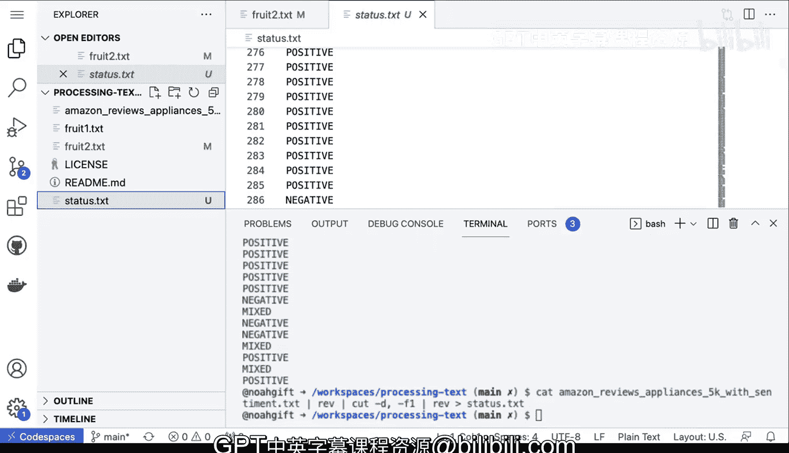

# 杜克大学｜Python、Bash和SQL数据工程基础2-4Python Bash and SQL Essentials for Data Engineering p65 65_04_04_Linux中grep、cut、sort与unique使用.zh_en -BV1XS421X7tw_p65-

Let's get started at using some offthe shelf tools that come with all Linux machines and to start with I have some reviews from Amazon purchases and notice here the basic structure where there is a marketplace ID。

 there's a customer ID， a review ID， a product ID product parent。

 a lot of different fields here in this document Now if I want to explore this document and take a look at some of the stuff。

 including for example， the sentiment of the review like was it negative or positive。

 one of the ways to start would be to use the head tool。

 So if I type in head in one and I type an Amazon review。

 it just shows me the columns and so this is a great way to explore a file to see a little bit about what it does。

 likewise if I wanted to look at the bottom。Of the file。

 I can go through here and I can see the very bottom of the file， so it gives me。

A rough idea of what's happening， even if I don't have access to a guibased development environment。

 So this is really important to know how to navigate around。

 now the first thing I would do if I was gonna start you know processing some text would be to maybe look at Gr now and let's see if we want to count the word bad。

 How many times there's a word bad appear inside of some text here well。

 I would just go through and I would put in rep C bad very， very fast。

 it found 154 instances if I then wanted to find out and look at the actual things that it found notice that it's highlighted right here every time it found the word bad in some kind of a review likewise I try other ideas out I could go through here and say。

 okay what about the word plastic that will probably crop up a lot well。

 I would go through here same thing there's 125 instances So really by using the Gr itself and counting this is a great way to just get a feel for the document now。

let's see actually how many rows are inside of here if I do a WCL。We see there's 5000 rows。

 So what if I want to get account for how many negative and how many positive reviews are， Well。

 fortunately， I can do this without using a fancy data processing tool。 I just， again， use Gr。

 So I do Gr C and I look at negative。Here as the thing that I'm looking for and what do we find out of the 5000 rows。

 1175 of those are negative reviews and then if we want to look at another metric we can look at mixed which is another type of review status we have negative mixed or positive what happens there's only 241 mixed reviews so very。

 very tiny amount， the rest obviously would be positive and we can really confirm that by just going through here again and going positive right Here we go。

Perfect， and again， this is what I think is so powerful about using the command line is that I can do these things without needing any software。

 It's going to come on my computer if I'm using Linux。 Now。

 what if we want to get a feel for other kinds of operations here。 Well。

 another thing you can do is you can actually do diffs between things。

 So let's take a look at this file here， this one is called fruit1 do Txt。

 it's got cherry pear strawberry， and it's got the word apple twice。 If I look at fruit 2。

 it's got in this scenario here。😊，Let's actually clean this up a little bit。 It's got cherry。

 it's got pear， and it's got strawberry and it's got apple。

 So we see here that it's got a little bit different of a signature。

 So if I wanted to compare these two documents， let's say I'm working with lots of different customer records and I want to see which customer records are different pretty simple using a built-in tool that comes with Linux called diff。

 if I type in diff fruit， In fact I can be really lazy and I can just do star and this will diff these two files notice what it says it says basically the only difference here is that one of them is missing Apple。

 So if I go through here and I say fruit one。And I do fruit2。

 well get basically the same thing as I got at the beginning because the fruit star will find all files and do a diff between them so we can see here that basically there's no new line at the end of the other file and this file the difference is that Apple is missing right。

 we have one apple that's extra so。What can we do here beyond just a diff well another thing you can do is we could actually go to another file and look at a unique process and so we know that this fruit file here has two apples。

 it could be 10，000 items this one is a little bit simple because there's only five and it's obvious but visually it would be difficult to know what duplicates are in a file that had basically 5。

000 items in it so what we can do is we can type in unique first。

And go through here and notice that it only gives me four， even though there's five entries。

 because it doesn't give me Apple twice。 Likewise， what I could do is I could actually do a dash C。

And I'll go through here and it'll give me a count of the unique items inside of the file。Basically。

 a diff will show me the differences and a unique will give me the ability to only get the unique items and or only count the items。

 So very， very powerful concept here。 Now， another thing that comes in very handy that's similar that you would do in SQL is the ability to sort。

 So if I， if I type in the word cat and I go to fruit here。Fruit1。

 notice what happens is we get cherry， we get pear， Strberry， apple， apple。

 but what happens if I want to sort this file。 Well is' actually pretty straightforward。

 I just type in sort and what will happen is it'll alphabetically sort it and in in fact。

 I can reverse sort it as well。 So this is really handy again if I'm looking at customer records or I'm looking at some kind of data is that I don't even have to bring it into another tool。

 I can do it right here from the Linux command line。

 So the final thing I'll show you is the ability to trunnccate files by using cut and the ability to to pull some of the things out of the file。

 So this is something that you do a lot with a spreadsheet。

 but we can do the same thing by using the cut operation。

 Now let's take a look at a neat little one liner that I got built up here and then I'll walk you through it。

 So first what I do is I do a cat which prints out what's inside of this file then I reverse the order。

Of everything inside of this。 then what I do。 So I'm reversing each line。Inside。

 and the reason because I'm doing this is I'm going to use the comma as a delimiter and I'm going to pull the first field out。

 So if you remember if we look at this file again， notice that at the very end of this file is where the sentiment is kept。

 So if I reverse it I can easily get just that column out as long as I tell it that this is the delimiter。

 this comma right here， and then at the end I just reverse it back So let's go ahead and take a look at this。

There we go。 And now you see I was able to basically do some transformations to pull out just that column。

 And if I wanted to， I could go and I could take the output of that and I could call this maybe like status TxT or something like this。

 And now if we take a look at this。 what's pretty cool is look at this， we have all the sentiments。

 So I easily if I wanted to I could maybe clean it up a little bit more。

 get rid of some missing spaces and or pull that right into a process that that can handle it in Python using。

 let's say pandas So there's a lot you can do and we went through several of the utilities for text processing。

 the best way to learn it is just to play around and again。

 think about why not first use the text processing tools when you're first encountering data in you're on Linux。

