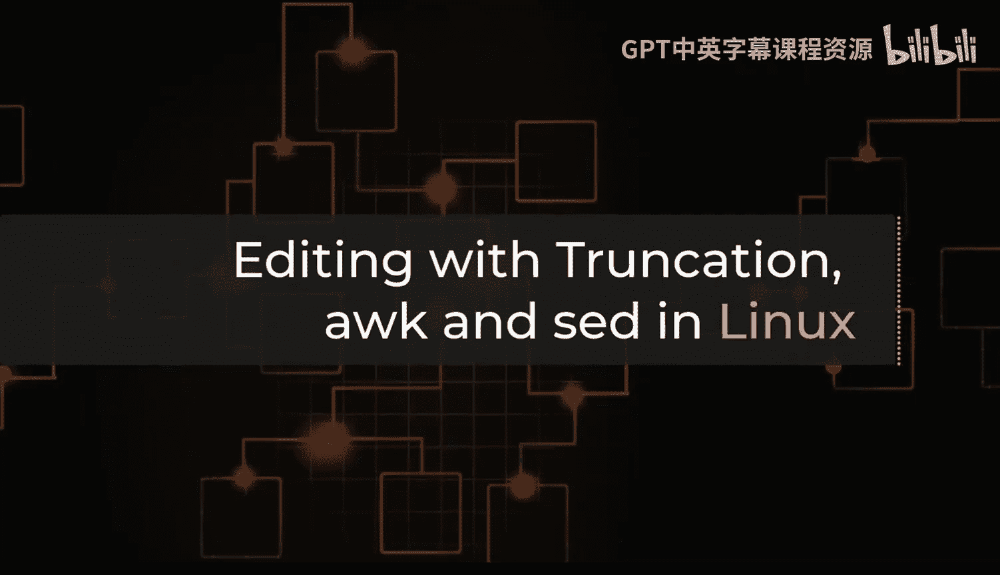
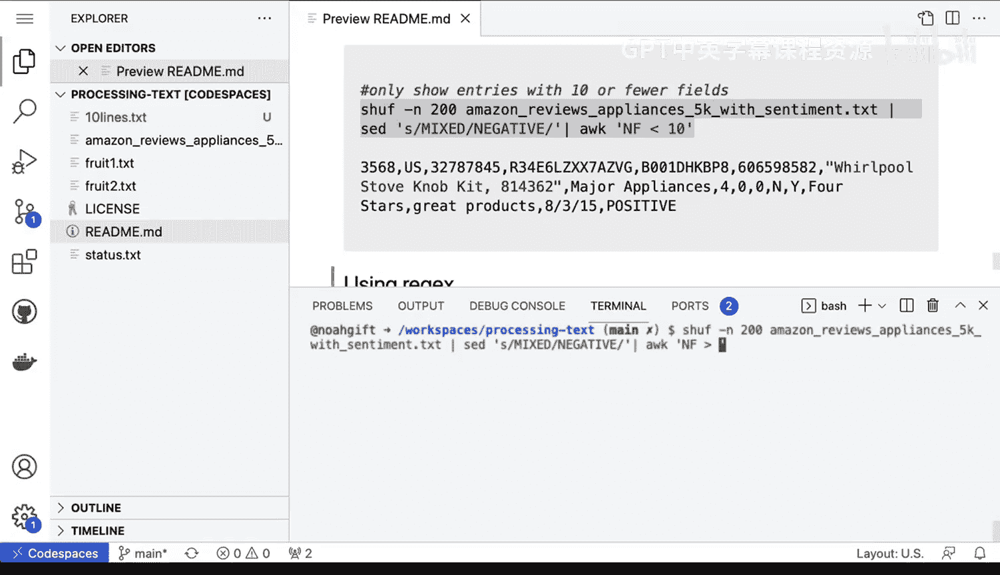

# 杜克大学｜Python、Bash和SQL数据工程基础2-4Python Bash and SQL Essentials for Data Engineering p66 66_04_05_Linux中truncation、awk与sed编辑技术.zh_en -BV1XS421X7tw_p66-

Let's take a look at using truncation， transliteration， Oc and saidD。

 really common stream processing tools to start with。

 I would recommend the shuffle command is one of the most underutilized and amazing commands that a data scientist needs to know about and I'm going to go through here and I'm going to run this command real quick the shuffle and let's go ahead and take a look at why I like this so much。

What it does is it randomly selects from all 5，000 entries。

 whatever number I want in this case I said9 or 10。

 and then if I go through here and I do a word count L， notice that it's able to pick just those 10。

 so this is so helpful if you have a huge file like a petabyte file and need to process it and you just want to blow up some Python based system or R based system that may be very sensitive to memory。

Now， likewise， if I wanted to write that out to a file somewhere。

 I could just go through here and I could just say you 10 lines Txt and I would go through and do that by using the greater than operator and then if I go through and I do a word count L on 10 lines you can see it's just 10 in that particular file so really powerful tool to use the shuffle command and if you run man shuffle。

You can see there's other options here， but basically it generates random permutations and you can take those and again write them out to a file so I use this all the time to sample data without if I use head。

 it'll do it in a linear way or if I use tail it'll do a linear way in this case I want to do it in a nondeterministic manner。

Now let's move on to another really interesting tool here which is the ability to transliterate so here we have a file that's lowercase or an echo string that's lowercase and if I use TR it will take the lowercase and and it'll change it into uppercase here we go pretty pretty cool right or if I want to go and do something a little even more simple I can say hello right and then this will make it uppercase now why would I want to use this。

 there could be a lot of reasons maybe your stream processing a bunch of stuff and you need to uppercase at first and so here's a great example。

If I combine this with that other example below what happens if I do a random sampling。

 it randomly picked something and made it all uppercase。

 which could be some type of data transformation I need to do before I I don't know。

 do machine learning with it or put it into a database or whatever。

 so it's nice to know that there's a tool that you can actually transliterate the text and change it to some new thing。

Now， similarly， there's a really powerful editor called said。

 and you'll see this if you just Google you know simple said operations。

 I'm going to show you a very， very simple one here。

 which is that basically it's a search and replace。

 so if you go through here and you type in echo mixed。

 which is something I'm going to use in the future。

I want to every time I see the word mixed in a line of text。

 I want to swap it out with the word negative and the reason I want to test this out。

Here you can see that's what happened。 The echo got transported out for a negative。

 The reason I want to do this is that maybe I want to do a preprocessing on all of the reviews。

 and I want to take the mixed out because I want to convert anything that's mixed to negative so that I can maybe have a binary classification model that I'm working on well。

 pretty simple to do in fact， we can even randomly sample so we can combine those two techniques together and now if we go through here。

 what happens。 Well， this will basically find any mixed sentiment analysis and swap it out with negative。

 Now how can I tell for sure that's happening。 Well we can run things with our Gr command if we want to play around with this so if I go through here and I play around with this command and I want to see if it's truly get rid of things。

 look the negative， every time I do a sample we can see roughly25，30%。

Are stuck at negative now what if I want to count of the 200 and how many of positive， what happens？

We can see this should be about 75% as well right So pretty interesting。

 we can see because we're randomly sampling that we can actually count the positive and the negative。

 Now， what happens if I type mixed well， mixed shouldn't exist right because we're swapping out the positive I'm sorry the mixed with a negative。

 So here we go we see zero。 So every time I randomly sample this you can see that this said was able to process that string。

 So again for doing some kind of data processing pipeline。

 this really simple said search and replace here， could really come in handy。

 Now let's close out here by just really briefly talking about a language called OC。

 which was a programming language built at bill Labs in the 1970s So this has been around for quite some time and you can go to the official documentation at the Gnu org website。

But basically it's a condition and an action。 And so here's an example here where I say I only want to show entries with 10 or fewer fields。

 Well， how would I do this， Well， look， I can combine everything I just did and I could say look this commander here says if the number of fields is below 10 go ahead and show me what those are Okay。

 let's go ahead and find like really small reviews here we go if I go through here and I paste this and check it out look it finds only reviews where there's a really small amount of information and here like here we go。

 one star horrible， do not buy you know five stars love it right so if this was again。

 something I wanted to randomly sample and just find really tiny reviews right。

 this would be a good tool to use for that Now what if I want to do the opposite。

 what if I want to go through here。And I want to find like very large reviews。

 How could I do this Well， again， this just finds files or lines that are really large。

 basically because it' it's it's subtracting them and shrinking them down so that only the small ones appear here we could do the opposite so we could go this way and we could say only show me the number of fields where it's 300。

 So now we do this and huge， huge text like this finds like really verbose you know reviews on products。

 So you know in a nutshell here by combining all these things together using said。

 truncate all these shuffle， you can do lots of combinations and this is really the power of shell processing。

