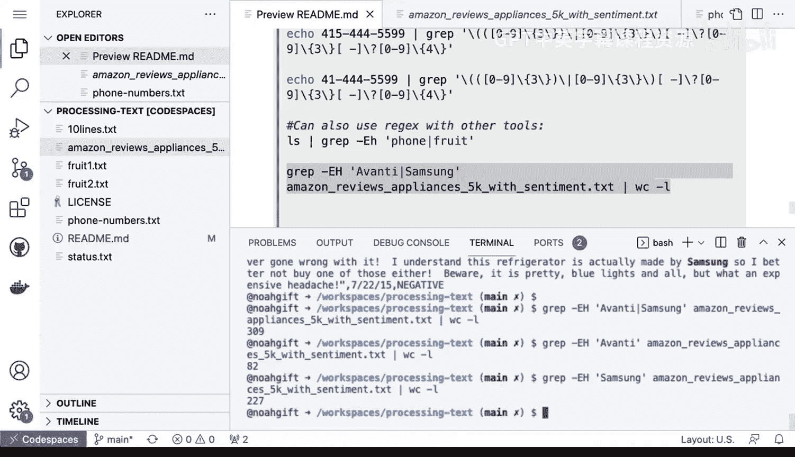

# 杜克大学｜Python、Bash和SQL数据工程基础2-4Python Bash and SQL Essentials for Data Engineering p67 67_04_06_Linux正则表达式使用.zh_en -BV1XS421X7tw_p67-

One of the superpowers of anyone doing text processing is a regular expression。

 and this is maybe one of the classic examples is you have a huge list of phone numbers and a document and some of them are mangled and you want to get just the good ones out that are valid phone numbers So for example。

 this first phone number here this looks good this looks bad this looks good。

 this one looks bad right so that's going to be very difficult to do even for maybe someone that's got a few years of work experience。

 it's tedious。 you're gonna to make a lot of mistakes。 Fortunatelyly。

 you can actually easily process this yourself by using the tools that we have at our disposal in Linux So what I'm going to do is I'm going move over here to a command I've got hanging out here and I'm going to go through it and I'm going to run a Gr command and I'm going to echo it out So let's go ahead and and analyze this script。

Comman notice that I echo out a valid phone number and what I do is I say give me something that's three digits and it's between zero。

And9 and then it's followed by again， three digits。

0 and9 followed by a three digits here and then in this case， I'm followed by four。

 So basically it's got to match this pattern of three hyphen3 hyphen4。 Okay。

 let's go ahead and echo it that looks like it works Now what happens if I give it a bogus number here。

And if I paste this in what happens， well it won't match right so that's the whole idea is sometimes it matches if it's valid if it doesn't match。

 it just ignores it because you want to process a whole stream of data so what can we do Well we can take this We can take this entire Gr and we can put this together with another line of Linux command so we can say cat phone numbers because all these phone numbers are in a file here and then we can do a pipe and we can throw that Gr operation inside Okay let's go ahead and take a look。

There we go。 we've been able to get just the two numbers that are valid。

 so you can see here how if you build out regular expressions into a shell script。

 you can easily process。Really messed up documents。 Now。

 there are some dark sides to this in that the regular expressions are very， very complex。

 and you do need to really spend the time getting it right。 But if you do get it right。

 you can clean up text in a very， very quick way。 Now。

 let's take a look at another example of something you could do。 And in particular。

 this is a good one is the Ls command right， So let's see if I just do Ls on my operating system。

And I want to scroll through here and look at these files let's say I have thousands of files it could be really annoying to figure out maybe I just want two types of files well here we go here's a good command for you if we go to LS and I pipe it into the GrP command here and I do dash E this basically says listen。

If something has either the wordphone in it or it has the wordfruit in it。

 give me just those results in the LS。There we go and we can see here this is a great example of that there's two files that have fruit and there's one that has phone numbers so you also can play around with other utilities and and pipe the stream output of that Now one other really cool thing you can do is using that same style is we could actually go back to our reviews document here which is just thousands and thousands of huge document here So what could we do to process it well we could use that same Gr pattern and we could look for only reviews that have the word avante or the word Samsung inside of the review and we can count again。

 remember this is 5000 lines of code and what do we pull out when we pull out just avante or just Samsung there's 309 reviews and in fact we can just take this out so you can visually see it there we go look you can see this is in fact correct So this again could be a very simple way to preprocess some data。

Before you do some other thing with it is just use Gr right just go through and pull out maybe I want either this or this now one thing I'm going to show you how to do here that's pretty neat。

I we can actually do a little bit of testing to make sure that our GrP is working properly notice this is 309 entries because it's getting both Avante and Samsung let's double check it's really doing what we think though because let's pull out and count how many are just avante there's 82 and now let's count out how many are just Samsung and let's add those up and just double check that our tools doing what we think there we go 227 plus 82 we can see that's nine so we can see this is 309 here that we're able to get based on combining those two Gr queries together so regular expressions are a great thing to learn phone numbers are a perfect place to do it trying quick and dirty things to scrape through the files is a great use case for regular expressions and a little bit of time that you spend on regular expressions willll certainly pay off in the future。

