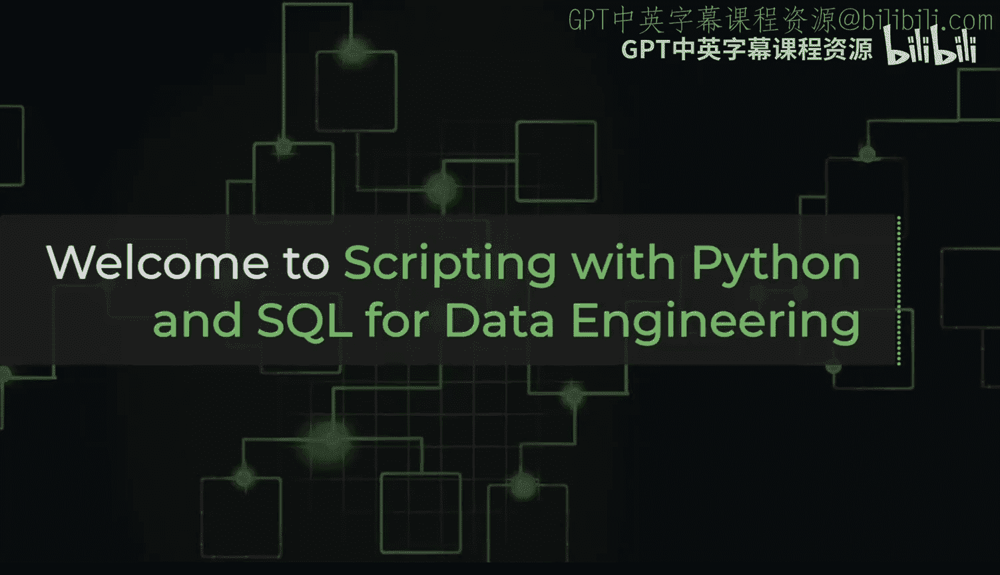

# 杜克大学｜Python、Bash和SQL数据工程基础2-4Python Bash and SQL Essentials for Data Engineering p68 01_01_01_欢迎来到Python与SQL数据工程脚本编程.zh_en -BV1XS421X7tw_p68-

In this course， I'll go through techniques to work effectively with Python and SQL。

We will go through useful data structures to Python scripting and connect to databases like MySQL。

You'll learn how to use a modern text editor to connect and run SQL queries against a real database。

 performing operations to load and extract data。Finally。

 you will use extracted data from websites using scraping techniques。

This knowledge will allow you to work effectively when data is not readily available。

 or when special queries are required to extract useful information from databases。

