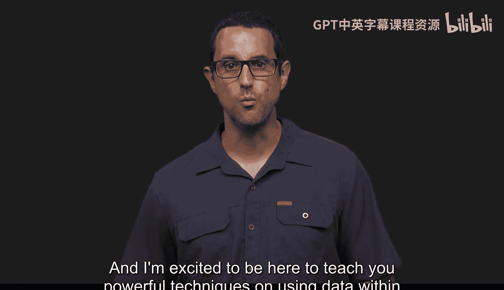

# 杜克大学｜Python、Bash和SQL数据工程基础2-4Python Bash and SQL Essentials for Data Engineering p69 02_01_02_认识你的课程讲师Alfredo Deza.zh_en -BV1XS421X7tw_p69-

My name is Salreesa， a former Olympic athlete and working as a cloud advocate with Python and machine learning。

My background is heavy on system administration， Python and DevOs。

 I've written many books about Python and machine learning。

 and I'm excited to be here to teach you powerful techniques on using data within Python with SQL and databases。

