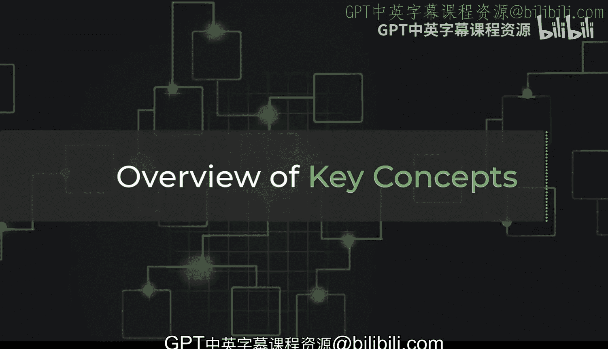
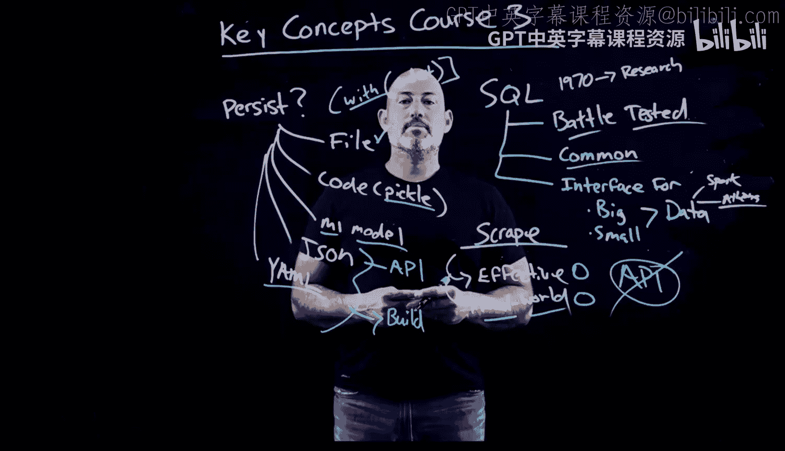

# 杜克大学｜Python、Bash和SQL数据工程基础2-4Python Bash and SQL Essentials for Data Engineering p70 03_01_06_关键概念概览.zh_en -BV1XS421X7tw_p70-

Welcome to the key concepts in course3 I'm going to talk about some of them in a way that I think will really help you understand why they're important in particular if we start with persisting data in Python this is a little bit confusing when would you want to choose one format versus another well let's start with a file so in Python you can actually save things out by just writing a file out to disk this is very common one of the things that you'll see a lot is people will use this with statement why would they use a with statement the idea is to apply a context to your code so that you don't have to forget know to write it out to disk you can just say open it'll automatically save it to disk so this is probably one of the key takeaways here is this with statement Now the other thing that is actually a very useful skill to have is to pickle your file out so let's say that you just started working on some kind of project maybe a scraping project and you have a big data。

structure in a dictionary， well， if you want to save that out to disk。

 you could just use the pickle file here and just import the pickle module and save it out to a pickle file。

Likewise， very common with machine learning。 If you're using a framework like Tensorflow。

 for example， is you can save out your results to disk and then later pull that in and someone doesn't even need to know about how you created that model。

 So it's nice to know when to use the cr technique for the job at hand。

 The two down here that are very interesting are Jason and Yaml。

 These are more software development types of tools。

 You'll see Jason a lot when people are building APIs。

 The reason why they like to use Jason is it stands for a jascript optic notation。 is that it's easy。

 You can just look at it， visually inspect what's happening in the payload。

 And that's why Jason is still so common for developers。

 And so if you build something in an adjacent data structure。

 you can pass that along to other people。 Now， in terms of Yaml here。

 One thing to point out is that it's very similar to Jason。

 except for it's a slightly more human readable form。

 And so you'll see this a lot with build systems like Devops type processes where。

Let's say GiHub actions or you know Google app Engine or any of these kind of services that are high level services。

 you'll see that the configuration is in YmL so you can write this in Python。

 you can take a dictionary， import the YaL file and persist it out to so it really depends on the problem you're solving at hand。

Now we're also going to get to SQL and what's important to know about SQL is that it's battle tested right that's the main thing to be aware of。

 in fact， 1970， believe it or not， was the first mention of SQL in research papers in computer science。

And in fact it's been around for quite some time so we know it's effective people are still using it。

 it's very common and so it is important to know a little bit of SQL。

 It's also an interface for both big data and small data so even big data systems use SQL a good example this would be spark you can query Sp with a SQL language you can also use these kind of next generation tools like Amazon Athena and you can actually go through and use SQL to query a big datalink as well so SQL doing a little bit of work will definitely go a long way Finally we talk about scraping and the reason for scraping websites is that sometimes they're not built with an API and so this is something where you maybe are looking at an older data set or a government website where they weren't originally planning for people to use it from a computer or a script and so that's when scraping really can come in and come in handy is because you can go through。

And take a website， pull it down， extract the things you want。

 and then potentially save it into a relational database。

 so this is a real world technique where get into it。

 make sure that you understand how to do it and then once you understand scraping。

 you can be a more effective data scientist。

