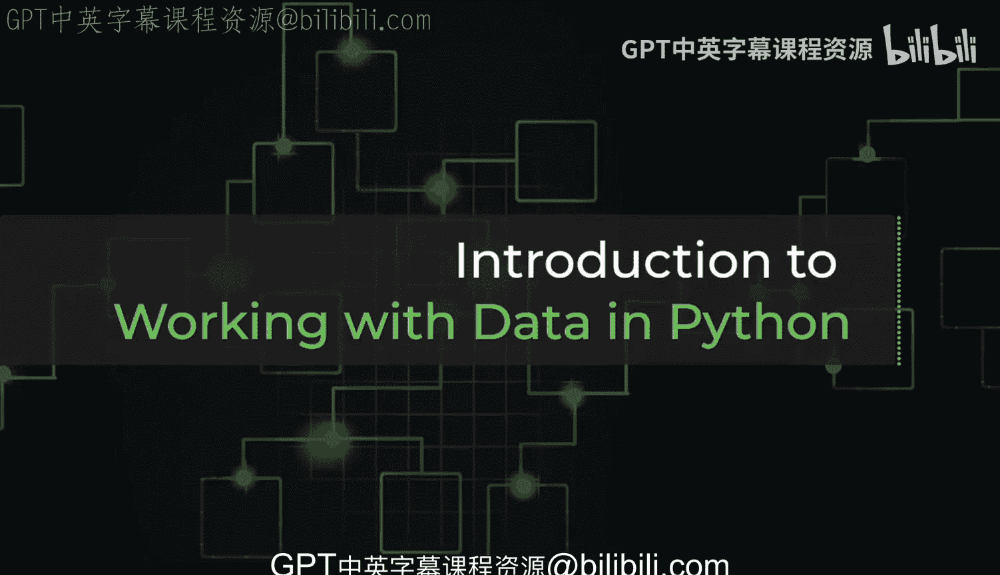
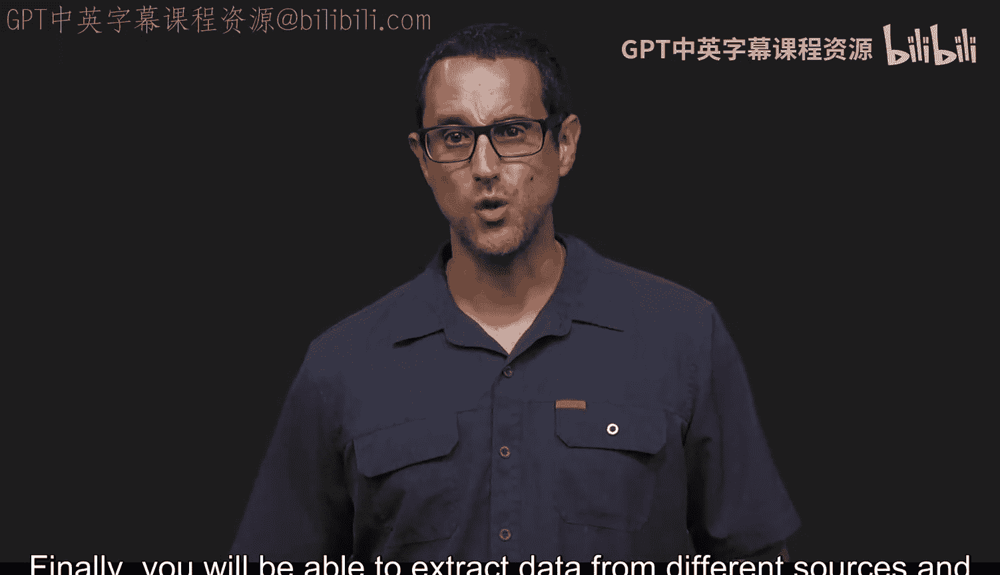

# 杜克大学｜Python、Bash和SQL数据工程基础2-4Python Bash and SQL Essentials for Data Engineering p71 04_01_02_Python数据处理入门.zh_en -BV1XS421X7tw_p71-

This week， you will learn how to effectively use Python's data structures to load， persist。

 and iterate over data。You will apply these data structures to solve different problems when working with popular data formats like J。

Finally， you will be able to extract data from different sources and map it to Python data structures。

