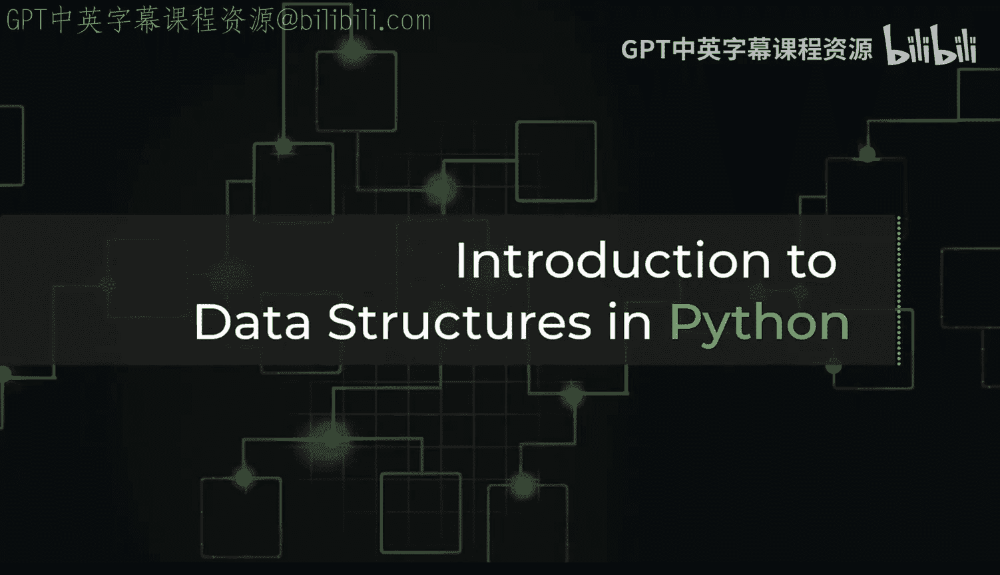

# 杜克大学｜Python、Bash和SQL数据工程基础2-4Python Bash and SQL Essentials for Data Engineering p72 05_01_03_Python数据结构入门.zh_en -BV1XS421X7tw_p72-

Different data requires different data structures to work with in a way that is more efficient。

So although it might sound enticing to use some of the more common data structures in Python every time you can。

 there's certainly a place for the less common data structures in Python in this lesson we will cover some of the more common ones like lists and dictionary。

 but as well as some of the less common ones like sets and tuples。

 they all have a good place in them and knowing them and knowing understanding how they work will allow you to make better decisions when you're working with data。

