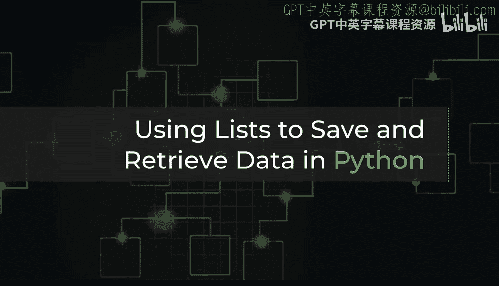
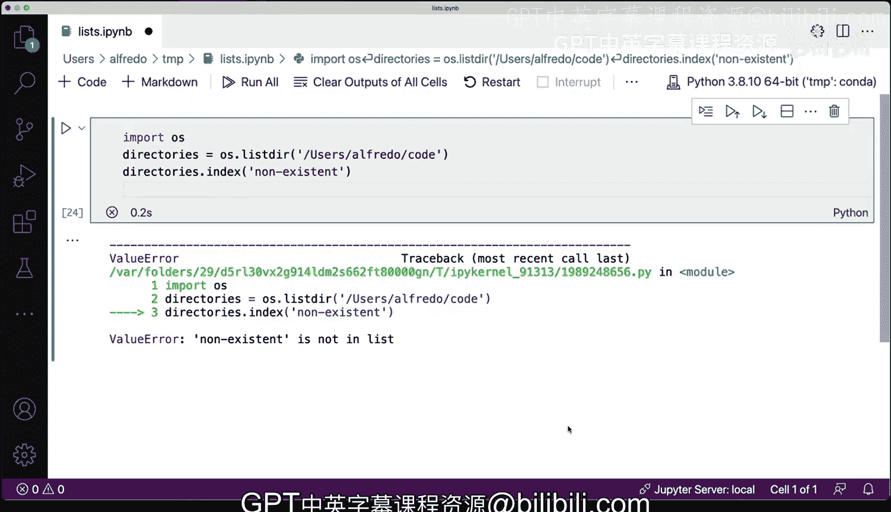

# 杜克大学｜Python、Bash和SQL数据工程基础2-4Python Bash and SQL Essentials for Data Engineering p73 06_01_04_使用列表在Python中保存与检索数据.zh_en -BV1XS421X7tw_p73-

Lists are like containers， we put things in them， we can retrieve things from them and there's no restriction as to what the items are within a list。

 We can define a list by the in it first let's start with an empty list so we can say something like things and square brackets that means if I say things afterwards I've created a variable that is showing us an empty empty list。

 there's nothing in there we can certainly also declare a list with some items in there so we can say things one and there's no restriction as to what types of data we can we can have within list we can see something like a true or a10 and if we run that we of course are going to have the same items in there。

Now that's fine， but that's really very quite straightforward， it doesn't tell us how to add things。

 extend things and modify these list， let's try to use the module to list the directories that I have in my code。

Pa so I'm going to import OS and I'm going to declare a bearable called directories and this is going to be OS that list there and this is going to be a path which is the path to my code to my code directories so if I say directories here and I run this again we're going to have the contents of that path we have several directories there。

That's all very good， but what happens if I want to add something in there。

 so if I say I want to directories that append an item， say， for example， example。

This would cause the last item。 it would insert like it would add this item to the very end。

 So it would go after scraping demo there。 So let's run this and see what happens。 So if I run that。

 you can see example is now showing at the very end。

 you might also want to insert these at a specific position。 So if you say insert0。

 it will insert at the very beginning。 So if I do this example will show up。

 Now we're getting into something quite interesting because we're talking about positions。

 and this is something that can be very surprising in Python。 Python， let's start their indexing at0。

 That is the first item we' have the zero index。 if I say。

If I want to retrieve the first item in a list， I'll say I'll use the square brackets and the zero index。

 so if I do that what will happen is the DS store will show up because it's the first item in my lists within the directories if I wanted the second item I can do it with one。

And so that's O'reilly videos right there The indexes have different various properties。

 I could also say minus1， which will give me the last item in the list in this case that's scraping demo。

Additionally， from retrieving。Items in a list by their index， we can also。We can。

 we can request the number of a specific index。 So say， for example。

 we're not sure what's the index number that is the position of scraping demo the scraping demo so we can say index and we can do。

We can paste that and that will give us a number let's see what number we're going to get here。

 we're getting number 16。 so that means that if I wanted to programmatically get something from a list and understand what the position is。

 I could now do something like directories。And then the number 16。

So if I do these and then I run again I'm going to get scraping demo So what did I do there Well first I found what's the index。

 what's the position of the scraping demo and then I found it I requested deposit from the directories list so that's a very useful straightforward way of finding programmatically the index and you have to be very careful because if you're requesting something that doesn't exist so for example nonexistent directory and and I remove these this will cause an error because it won't find that item we're gonna to get a value error non-existent is not enlist so that's it that's a good introductory introduction to Python lists and how to add extend aend things to to an existing list and how to retrieve values from it。

