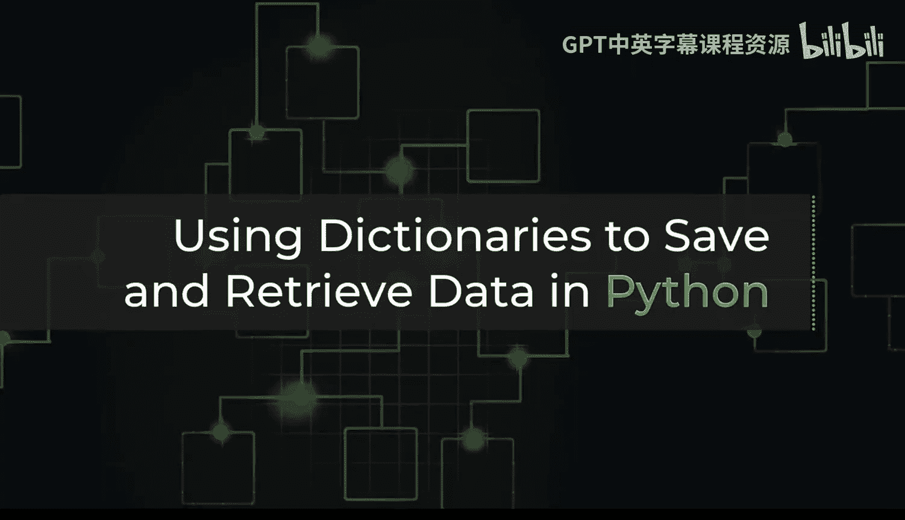
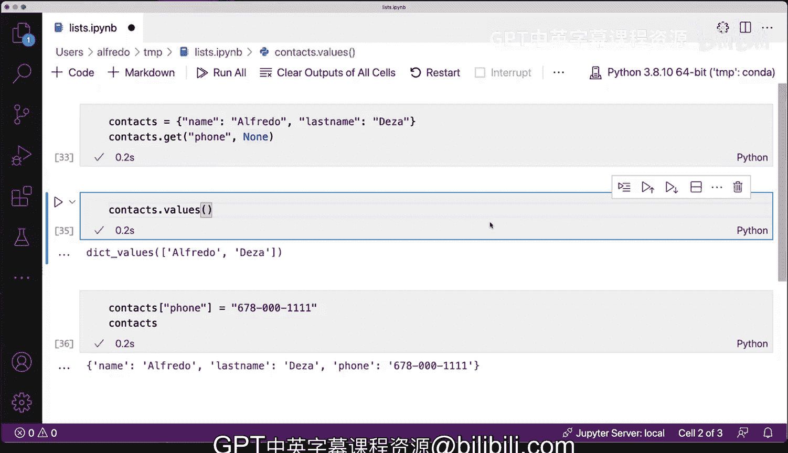

# 杜克大学｜Python、Bash和SQL数据工程基础2-4Python Bash and SQL Essentials for Data Engineering p74 07_01_05_使用字典在Python中保存与检索数据.zh_en -BV1XS421X7tw_p74-

Dictionaries help us map one thing to some other thing in our case。

 we call keys or in Python's case we call them keys and values。

 let's start by declaring an empty dictionary and see how that works In this case。

 I want to map some personal information so how about we declare this as contact information a contacts contacts is a perfect example on how to deal with or how to reason about dictionaries because if you think about your cell phone and you want to reach out to your contacts。

 there's a mapping between a name and a phone number so we could say we can let's declare a dictionary which is using the curly brackets and again we're using keys and values here So the key first key is going to be say for example。

 name。And it going to be， it's going to be Alfredo。 Sorry， this is not comma。 This is colon。

 So that's a mapping where name is Alfredo。 And we can say our last name。

We can say datas right there， So if we call these contacts at the very end and we run play。

 we get name Alfredo last name datas， but that doesn't really tell us doesn't tells us much about what's the nature of this data structure and why is it useful Well see it's useful because then we can create these containers where we can ask about information。

So how do you request information so let's assume that contact has already been declared as we have here at the top and you want to know you want to know the name so you are going to request this with a square brackets and you're going to get a value so when you're requesting something by a known key in this case name you're going to get a value so the value you're going to get in this case is of course just my name。

This is all very good and it also applies to any other key in the dictionary we're going to use last name here as well。

 and that is also going to retrieve that value for us。This is all very good。

 but what happens if you're requesting something that doesn't exist， So say， for example。

 you want to know about my phone number and that doesn't exist and we run these and we're going to get a key error Ph does not exist。

So this is kind of problematic if you're dealing with unstructured data and you want to normalize and you're expecting phone to be in there and somehow this contact gone in there and iss not present。

 what you could do besides dealing with the exception of the key error is to use the dot get。Method。

 so what happens if we use that get here， we are going to put phone in there。

 So it's it's a special method that allows us to retrieve the value for a key。 So in this case。

 I want to know what the phone is in the contacts。 And I know phone doesn't exist。

 But let's just assume that we want to have a fail a fail， we want to prevent a failure here。

 So we're gonna to run this again and Con is not gonna get anything。 So what's going on there。 Well。

 we're getting a none。 if we print this， if we print what we're getting back， we're getting a none。

s like there's nothing to return。 So there's no error。But you might be saying， well。

 is this really useful Well， wait a second， it is because we can say we can set a fallback。

 a fallback value。 So in this case， I want to get the phone value And if it's not present。

 just say unknown。 So if I do these and I run it， we're gonna get unknown because phone is not there。

 So this is a nice way that we can deal with things where we want to have a fallback in this can be anything really。

 it could be like we could say000 and that would also work fine by default。

 the fallback is a none and a none doesn doesn't print out unless we explicitly ask to print it out。

So how do we deal with some of these， some of these keys and values， Let's， let'。

 let's do a little bit more exploratory things with dictionaries。

 If we want to know what the keys are， show me all of the keys that are available， we can use the。

Thatt keys。Method like these。 And we'll get information about。

About what what's in there as a diic keys object， a diict or dictionary keys object is kind of like a list so you can iterate over it。

 but basically it's telling you every single key that is in there。And just as well。

 you can also do values。 if you want to know what the values are for the that dictionary。

 In this case， the values are Alfredo and des from from the keys。

 So that's that's a very useful way to， to lose some， some exploration。 Now， you might also want to。

Want to make some changes。 right， We， we know we don't have the phone key。

 And if you wanted to add that， that information， you can， you can do that by saying。

Pone here with square brackets and then add a value so how about we add a value let's to 67。

8 and let's just do some some example number00 dash1，1，1 number doesn't exist。And then。

We basically we're basically saying here， hey， create a key name。

 phone in the context and add this value to it。 And now if we。Ask for for the whole dictionary again。

 we'll， we'll see that phone is now in there。 So those are some of the the introductory introductory things that you can do with a dictionary besides declaring one。

You can can adapt， you can make some changes to it， you can add new information。

 you can retrieve information and like you saw with the that get method。

 you have some ways that you can declare a fall back belly in this case we play with none or a separate phone number。

 which is a nice way of not having to deal with that key error which can be problematic depending on what type of data work you're doing。

