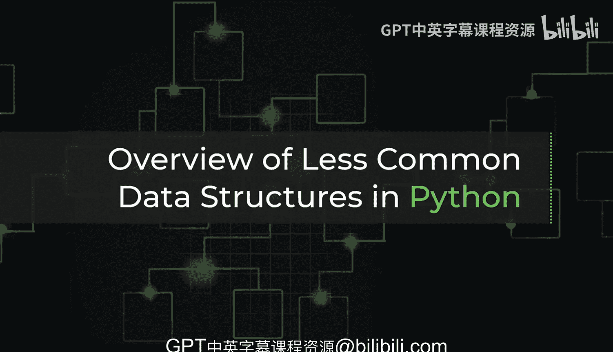
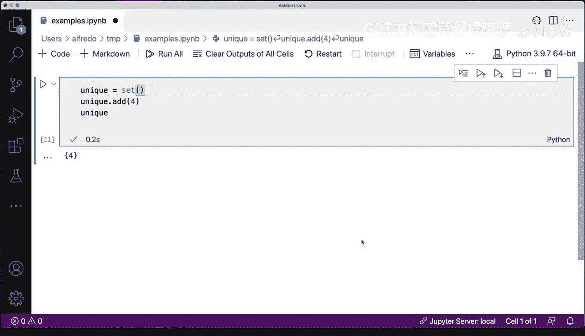

# 杜克大学｜Python、Bash和SQL数据工程基础2-4Python Bash and SQL Essentials for Data Engineering p75 08_01_06_Python非常见数据结构概览.zh_en -BV1XS421X7tw_p75-

There are some other less common data structures in Python。 One of them is the tuple or the tuple。

 depending on how you pronounce it。 these data structure， it's like a read only list。

 So we've seen lists before and the way you declare this is by using in par。

 So let's say this is read only and we're going to use not curly brackets we're going to use pra。

 and we're going to say。Item 1。And item 2。So once we've declared them like these。

 if we run these read only you'll see we're getting item1 and item two right there。

 but what about some of the things that we can do here well we can really do much once you declare a tuple you can modify it。

 it becomes read only you can retrieve items from it so we can say by index so0 would be item1 that's certainly allowed and you can say item index of index of one and that would get us item number two but we can really do say for example aend or x so we can say item3 and that would cost an error because tuple object has no attribute aend it is a read only object we cannot modify it so that's a tuple and the other the other data structure that we can。

Use is the set。 So we were talking about items。 So we the set will allow us to do。

Something that sometimes is useful， it will create unique only items。

 That means there's no repeated items。 So if we say unique and the way you declare and I know this might look confusing。

 curly brackets， just like dictionaries， you can say unique， you can say one，2，3。

 how about one again and another one over here， if we run these。It's basically like a list。

 but instead of like the square brackets， we're getting the curly brackets。 So this is。

 if we say type unique， we're going to get a set。 So what's the deal here， What happens if we。

If we call unique here to see what the contents are， What do you think will happen， Well。

 we're getting just 1，2 and 3。 It is getting rid of the。Duplicates， so I think unique has definitely。

 definitely some similar， similar methods as the list， but we have add so we can say， say。

 for example， at one。That's going to run perfectly。 And then we're gonna're going call unique again。

 and a is not going to do anything there。 But if we say at4。

 meaning like include this new item which is the integer 4 we'll see that4 is popping up So you might want to you set when when you're dealing with a situation that requires unique uniqueness in the type of items that you have in there。

 we saw how to create a set with curly brackets， but that's not necessary like if you want to create something that is empty。

 if you want to create something that is empty， you can call set directly note I didn't import anything no helper set is a built in function in Python and it's available in the global scope So if I run these only4 will show because set is now。

Empty so those are two useful data structures that are less common that you might find some good use for them。

