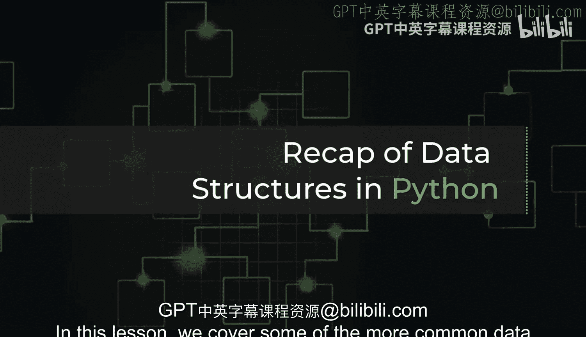

# 杜克大学｜Python、Bash和SQL数据工程基础2-4Python Bash and SQL Essentials for Data Engineering p76 09_01_08_Python数据结构回顾.zh_en -BV1XS421X7tw_p76-

In this lesson we cover some of the more common data structures that you will be using when working in Python from lists and dictionary as well to the less common data structures like tuples and sets depending on the type of work that you will be doing with data。

 you might want to use a list or perhaps if you're mapping keys and values。

 you can definitely be using a dictionary， but if you're looking for uniqueness probably a set or if you're looking to have a read only container that looks like a list。

 perhaps you will be choosing a tuple， these data structures will help you better manage your work loads in Python and be more effective at working with with Python and data。

