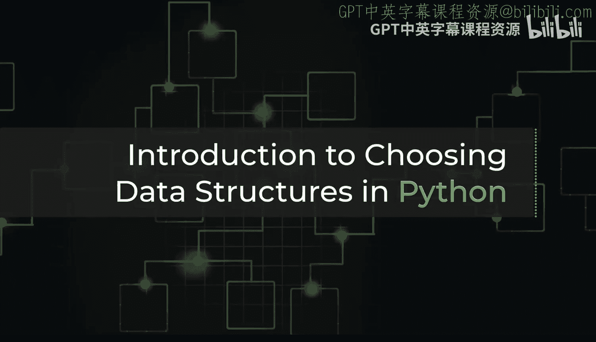

# 杜克大学｜Python、Bash和SQL数据工程基础2-4Python Bash and SQL Essentials for Data Engineering p77 10_01_02_Python数据结构选择入门.zh_en -BV1XS421X7tw_p77-

So how do you extract data from data structures Well that's what we're going to cover next we're going to be able to loop over some of these data structures extract information and perhaps even create new data structures that will hold our content This is very useful because you will allow you to basically work with data。

 effectively be working with data while you are speaking through the contents of data and making perhaps separations or distinctions of the data that you're trying to manipulate this will further allow you to create or persist data later on when you're done with iterating over several items in perhaps a list or a dictionary so let's see how that will work with some real worldor examples。

