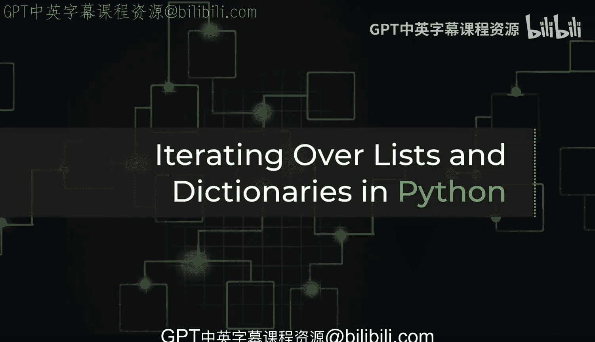
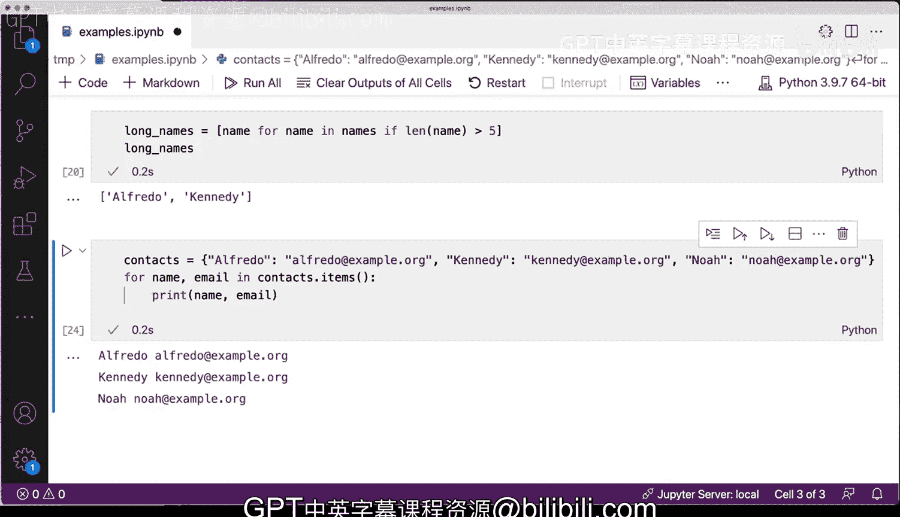

# 杜克大学｜Python、Bash和SQL数据工程基础2-4Python Bash and SQL Essentials for Data Engineering p78 11_01_03_Python中列表与字典的迭代操作.zh_en -BV1XS421X7tw_p78-

Let's work with iterations over data structures In this case。

 we're gonna do some for loops over lists and dictionary dictionaries but how does that work Well let's start with lists and we can say something like say for example we have a list of long names or actually just names let's just call them names and we're gonna to create a list of my name say noah and we're gonna say Kennedy and we're going to say say for example Jim and so to iterate over a list you would have a for loop construct how does that work well you start with a four keyword and notice I name the list I named it names so this allows me to have like a very readable construct here and I'm gonna do four name in names we can say print names so what that will allow us is like。

ha a very concise， very readable python here because we now know that a name belongs to a group of names Now that is how you would loop over a list you could have some more advanced constructs and restrictions and constraints when you're doing loops so say for example you could say something like if if the length of the name is larger than five then sure print the name。

 so then that would reduce the items just to these two names Now there's another way with lists which is called list comprehensions let's see how that looks if we're trying to do a list comprehension is like inlining the the loop so we are going to construct a new。

List called long names。 And when I call it， we're going to inline the for loopbe within the list。

 Now， this might look odd， but this is the way list comprehensions look。

 So we we're going to say name for naming names。If name or if length of name is larger than5。

 and then we're going to call long names， and we're going to see what the result is。

 So this is a good way， a very concise way of producing a single list with the for loop within that list。

 Do you think this is readable， I think it is readable if。

The for loop is kind of like short and not very involved。 Sometimes when there's a nested list。

 this can get out of hand and less readability does count if you're trying to do something useful。

 And if you're trying to produce robust code here， we only have two， two items， Alfredo and Kennedy。

 which is perfectly fine。 And we' we've managed to work with that now。

This is how you would loop over， over a list and you would do that with a list comprehension as well。

 But what happens if。You want to loop over a dictionary。 Well， a dictionary is is kind of similar。

 but it has some constraints depending on the type of data that you're going to be working with。

 So let's just construct a。A dictionary very quickly。

 we've used the example before of using a contacts so we can we can do we can do the same。

We can do the same thing here。 So we're going to say contacts。 and' to create a new dictionary。

 I'm going to say alfredo。 And that's the key。 we're going to say the the contact when I create。

You know， some， some， say， for example， some email， let's just say alfredo at example that org。

And then we're going to say。Kennedy， and then we're going to use。

Similar similar construct here with example example。

 org and finally NoAA is going to be NoAA at our email sample email like that so we have we have our dictionary here if we if we try to use that variable we're gonna print like the names and emails that's fine but now we want to loop over them well how do you loop over those items in contacts well again it depends on what you're trying to look for let's try to use the same construct as with it before with a regular plane for loop so we can say for contact in contacts。

And let's see what we get， we're going to say for contacting contacts print the contact and we're going to see what comes up and what comes up is the first names in this case。

 these names are the keys of the dictionary。So if you're trying to look for the keys in a dictionary。

 this is the way that you would do that， but of course a dictionary is a mapping between keys and values。

 what if you want to loop over the values only well in that case the construct we need to change a little bit so what you would do here is instead of saying for contacting contacts you would do for contact and contacts that value values。

So if you do that and I think you have to call these values， you will do these。And。

 and then you would run it。 And then you would get the values only。

 But note that I'm just looping over a single item。 What if you have some sort of。

Construct or constraint where you want to have or you want to work with both items in a dictionary。

 Well， in that case， you would do something like you would unpack while you are looping。

 What is unpacking。 Well， you're gonna use two variables for a single call。

 So I'm gonna say for a name email in contexts。That items， items provides。The key and the value。

 So it's going to provide both。 Im conveniently naming the the key name and the value email because I know how the data is structured。

 So instead of saying print contact， I'm going to say。Print name and then the email。

 and then let's see how that goes。 I'm going to run it。 and lo and behold， we're getting the key。

 which is the name and then the value， which is also the email。

So that is how you loop over lists and with list comprehensions and how you can loop over dictionaries as well。

 not only with the keys or the values， but also with both the keys and the values。

