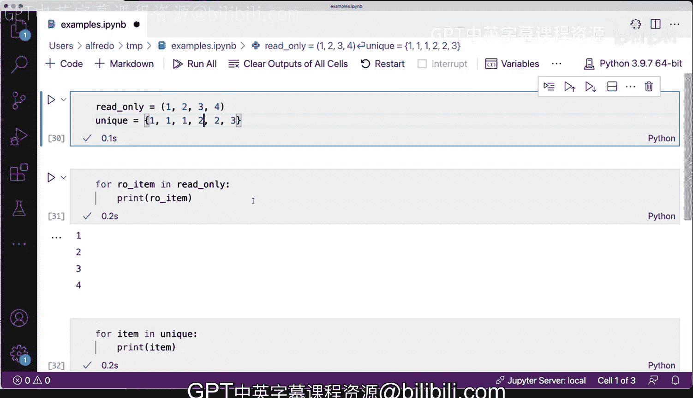

# 杜克大学｜Python、Bash和SQL数据工程基础2-4Python Bash and SQL Essentials for Data Engineering p79 12_01_04_Python中其他数据结构的迭代操作.zh_en -BV1XS421X7tw_p79-

Iterating over all other less common data structures is kind of similar to what we've seen before it becomes easier once you learn the four loop construct so let's define a couple of these variables that will hold some of these information we're going to create a read only variable that that is actually a tuple four items one。

2，3 and4 and then a unique set which has several repeated items in there it has the ones repeated and the two is repeated and let's see how different it is looping over these items then what it is repeating or looping over lists and dictionaries so let's start first by looping over the read only items in the tuple and the construct is very similar if not equal to looping over the list。

You can say for read only item in read only， we can say print。

R O item which stands for read only item， so that would effectively print 1，2，3 and 4。

 That's perfectly fine and pretty straightforward。 Now let's do something slightly different let's loop over the set so we can say for item。

 let's just call it something generic here for item in unique not a call there。

Print print item and let's see what we get here。 So we're getting one。

2 and three and why we're getting  one，2 and3。 Well， because the one is repeated。

 the two is repeated and there's the three。 So we're getting just one the two and three。

 those are the unique items in the set。 So very straightforward， not very complicated。

 you're basically looping over these items just like if it was a list。

 So if you know how to work with a list one of the most common data structures in Python you're going to be able to work and loop over data structures that are less common like tuples and sets。

