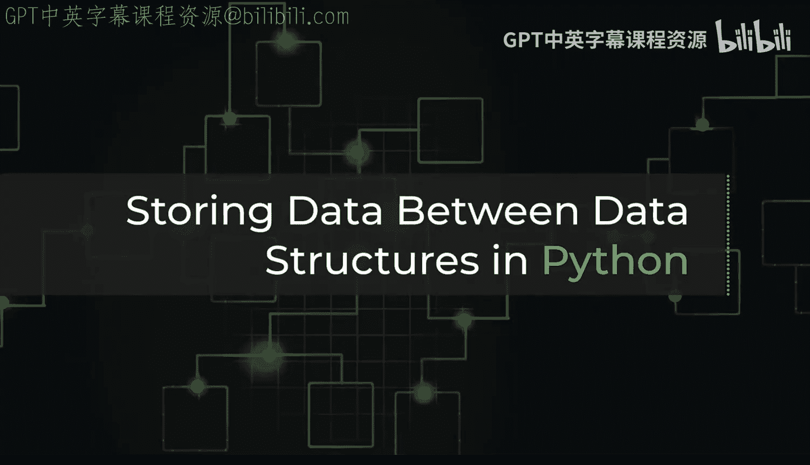
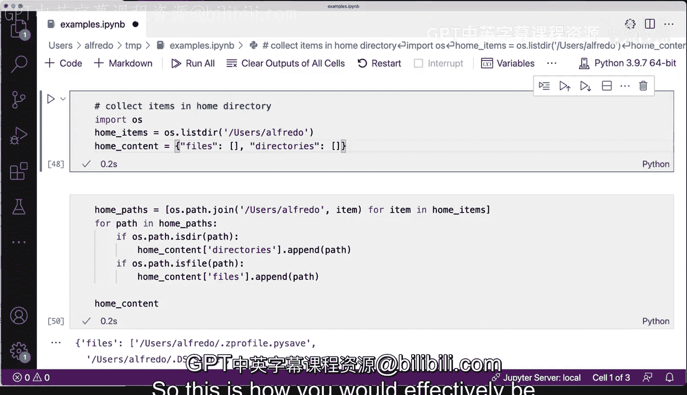

# 杜克大学｜Python、Bash和SQL数据工程基础2-4Python Bash and SQL Essentials for Data Engineering p80 13_01_05_Python数据结构间的数据存储.zh_en -BV1XS421X7tw_p80-

Sometimes you will have to loop over data structures and create new data structures or move data from one data structure to a new one or create separate grouping so let's define some constraints here I'm going to create a cell that will explain what we're going to be doing today which is going over the contents of my home directory and separateparating files from directories。

 so collect items in a home directory I'm going to import OS and I'm going to define these variable called home items and I'm going to list the contents of the user slash Alfredo path which is my home directory and then the home content is going to be a dictionary and I'm going to define files which is an empty dictionary in directories which is an empty list that way we're going to have a clear separation from files and directories。

So how do we exactly do these Well let's see what we're dealing with here let's see what the length of home items is and we're going to get 53 home items definitely have a lot of things and files and directories in my home directory but we are getting a home items if we just say home items here we are going to see the representation of a list we have several different things here and basically these are。

either files or directories inside my home items let's use these items here are just strings。

 but they're not absolute paths so if we check if these are files or directors when I get into trouble so let's improve these home items we can say。

Home home paths。 we're going to use a list comprehension。 We're gonna。

 we're going to improve the data here。 So we're going to say。嗯。O is that path that join。

 which is a way of joining paths and when I say users。

 Alfredo and when I I join it with an item and when I say four。Item in。Home items。

 So this is going to effectively create a list the same as before， but with the absolute path。

 So we' I say home paths here。We're gonna run this again and now we have we have several。

 several paths in here that are all basically full and absolute paths。

 So how do we separate them well now what we can do is loop over this home path and we can say for path in home paths。

 we can say。If always that path is there。Path。We can say， home content。

And then when to call directories。And we're going to say， append。The path。

 and let's see what happens to our home content here。 And we're going to run these。

And now we are having a clear separation。 we're gonna to run this again。

 we're going to have a clear separation of empty files and directories。

 so directories are now getting populated with all of my directories so dom fake is certainly a directory my Docker directory is that Docker path is definitely 100 percent directories so we're seeing some things that are directories。

 but we need to complete this with the path so we say if always that path is file and it's a path we are going to use a similar construct here and I'll explain how this is exactly working files that append path I'm going to run this again and if I run it we're going to get files。

 also prepopulated again now remember I created the home content。With empty files and directories。

So that effectively meant that I was assigneding an empty list to files and directories。

And then those got populated with this for loop。 So what I'm doing here is I'm creating this new separation。

 these new grouping of items that I've selected， given a certain condition。

 The condition is if it's a directory or if it's a file then it will go to separate containers。

 So now I can do other kinds of operations like for example。

 what's the variable here is home content， right So if I can say for item in home content files。

 then I'll know that I'm gonna get list I'm gonna say print item and then I can I can print that。

 And so these are all of the items。 So this is how you would generally work with different data going from one data structure to the other data structure。

 we started with a list。 So I'm going scroll all the way to。

top we started with a list with the OS that lister， the contents of my home directory。

 then we created a dictionary， signed another list and we did some separation we ended up with a dictionary with separation of files and directories and we were able to separate that data and loop over it and create new data so this is how you would effectively be storing data between data structures。

