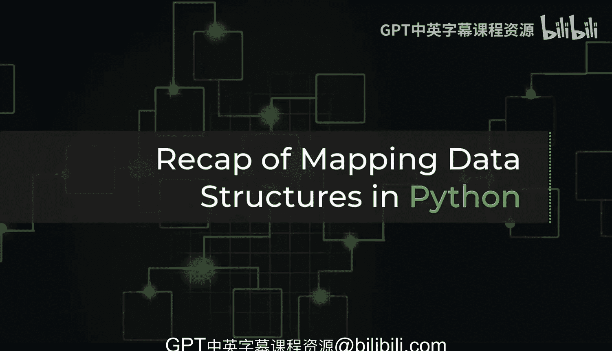

# 杜克大学｜Python、Bash和SQL数据工程基础2-4Python Bash and SQL Essentials for Data Engineering p81 14_01_06_Python数据结构映射回顾.zh_en -BV1XS421X7tw_p81-

We've covered how to loop over data and different types of data structures and also how to effectively create new groupings and new types of data structures that will hold content in a meaningful way when you're dealing with data this is essential because along the way you will find situations when you're going to have to look inside data determine some of its features and try to make decisions based on that so being able to extract data by looping over it is essential in your data engineering skills this will no doubt will help you make progress when you're having to look inside data and perhaps making some normalization tasks like changing the data or seeing if all the items in a given list or a data structure like a dictionary complies to your requirement。

是。