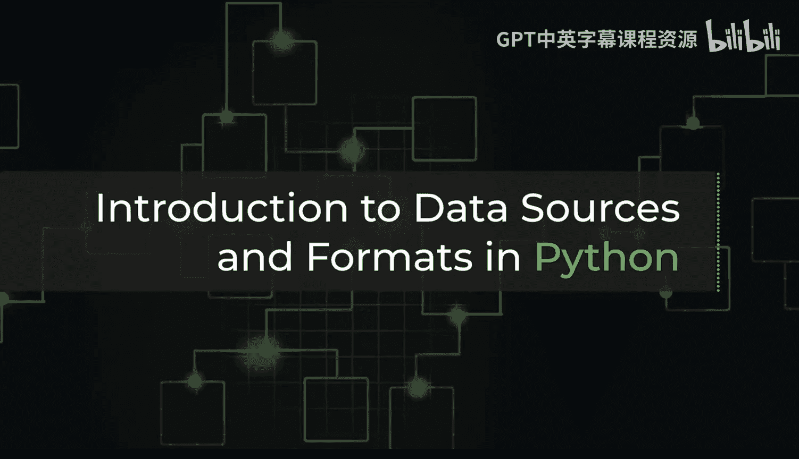

# 杜克大学｜Python、Bash和SQL数据工程基础2-4Python Bash and SQL Essentials for Data Engineering p82 15_01_02_Python数据源与格式入门.zh_en -BV1XS421X7tw_p82-

Reading files and loading data from files can be a little bit tricky depending on what you want to do and what libraries you have available。

 you'll either want to read them as a whole from Python or be using some library like in the case of CSB probably pandas or use the JSN module to read directly from the JN and load it into Python and speaking of JSN。

 we will also cover how to load JSON and Val JSN into Python data structures so you can operate into those data structures as well as how to take Python and Python data within Python data structures into Val JN and then save them to a file。

