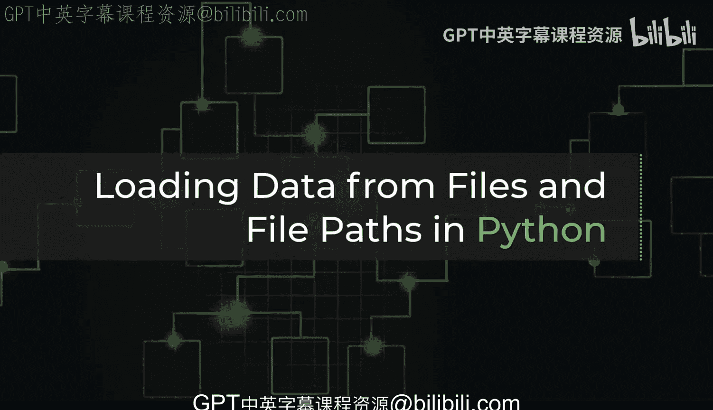
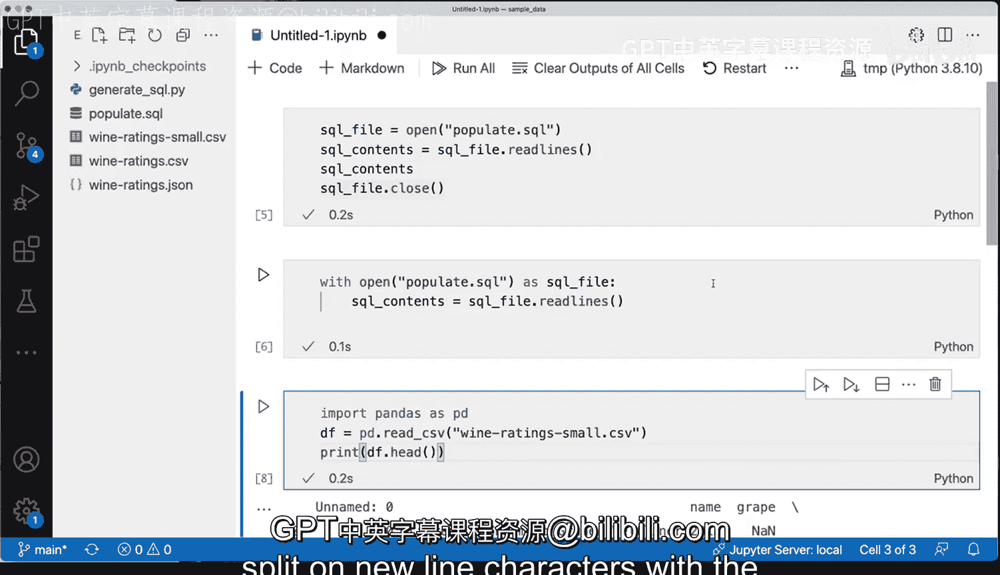

# 杜克大学｜Python、Bash和SQL数据工程基础2-4Python Bash and SQL Essentials for Data Engineering p83 16_01_03_从文件与文件路径加载数据到Python.zh_en -BV1XS421X7tw_p83-

Loading data from files and paths might get a little bit tricky in Python。

 depending on what you want to be doing with the data that you're going to be loading and if there is support either from Python or from a library within Python。

 So here I have a few files on the left I have a Python file， I have a SQL files。

 some CSB files and the JO file。 let's start with the most simple approach which would be reading a regular plain file in Python I'm going to use non- absolutesol paths。

 but if you wanted to make certain that you're opening the right path。 well。

 you would use an absolute path。 Im in the same directory as these files on the left。

 So I'm going to proceed just opening and reading them by providing their name。

 not their absolute path。 So you would see something like this in Python。Say， for example。

Let's say the SequL， the SQL file， I would say， open。Populate。At SQL。 So I could do that。

 And if I run these。The problem with this approach is that well not a problem。

 but you need to remember that you have to close the file once you're done with it with the actual file。

 so the contents SQL contents would be SQL file that read so if I do read。

 then I will read the whole contents of the populate that SQL file。If I run these。

 it will read everything， and then I can see what SQL contents has。

Go to run this again and I have a lot of output here。

 but it's all in a single single string you can see that there's some new line characters in there so if you want to process the contents line by line then this approach wouldn't work what you might want to do instead is to read lines if you do and use read lines。

 what happens is that you instead of getting a single string， what you will get is a list。

Let's see what happens if I run that perfect。 So we get a list and every single item mean that list is an item that has been separated by the new line character。

 so that's the difference between read and read lines if you want to process line by line certainly read lines is convenient if you're processing something that is separated with something that is not a new line character then you might want to use some other process so that is how you read a file。

 but I mentioned that you need to be closing the file so far I haven't done that when you're done processing。

 when you're done loading the information from a file you need to make sure you are closing the file so in that case how we do SQL file that close and call that and that would mean that I no longer have an open file the scripture in the server。

One different way of approaching the same problem is using a context manager。

 A context manager allows us to use the width statement。 So we can say with open。

 and I'll explain this in a second， but we can say populate， yeah populate。That sQL as。

Say SQL content choose to keep keep consistency。Or actually SQL file。

 let's just call a SQL file over here。 So I'm going to that and then in the next line。

 I can say SQL contents equals SQL underscore file that read lines So by doing these with open means that the open function will be able to close that open SQL file for me。

 so I no longer need to be doing that close as I was doing in the previous cell。

 So this is effectively the same the same process。 any works just fine。

 Now this is how you would read a file using regular plane Python with opening the file and then closing it but if you're relying with relying on on a library。

 a library might be doing doing it somewhat different。

 We have a couple of CSB files and I have pandas installed here and a pandas is a library that allows you。

To read and operate on large data sets and data sets in general， really， and CSB being one of them。

 so let's import pandas。We can do。Iorandas as PV as it's commonly done。

 and then we can say DF or data frame， we can do PV that read underscore CSV and I'm going to say wine rating small CSB if I do these。

I'll be reading the CSB file， no problem， and then I can call something like Df head。

 which will print the top， I think few lines from from the data set and there there you go you have some information coming up。

 So again， it really depends if you're dealing with something specific as a CSB and you have the ability of using a library like pandas or if you're reading a regular file in this case I use the SQL file。

 but it could be any file and you want to read the whole contents as a single string or line by line split on new line characters with the read lines that will come up as a list。

