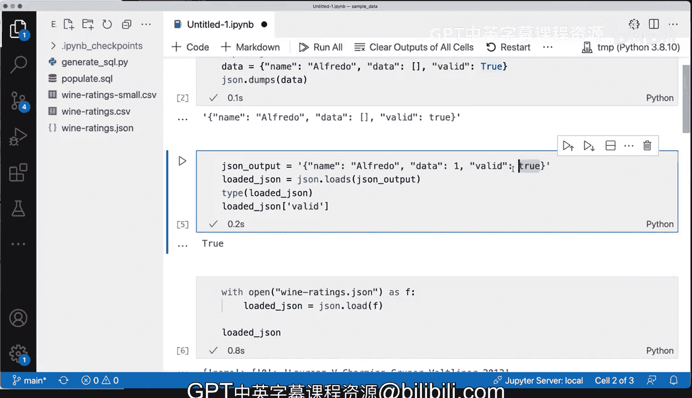

# 杜克大学｜Python、Bash和SQL数据工程基础2-4Python Bash and SQL Essentials for Data Engineering p84 17_01_04_Python中的JSON数据处理.zh_en -BV1XS421X7tw_p84-

When working with Jason in Python， you might be surprised to know that a lot of the JN data structures look very similar to those in Python。

 So say for example， a Python dictionary looks basically the same in Jason with some minor minor differences let's play a little bit around with the JN module which allows us to work with Jason in Python。

 So if you have if you have the JON module imported and then you want to say， for example。

 declares a Python dictionary， it would be something like data and you could say for example something very simple name Alfredo and then。

We could say other other data，'s it's an empty an empty list。 So a way to convert that to Valley J。

 you would use J dump S， which means dump the object data to to a string Jasonson string。

 So if I run these you can see here that what I'm getting back is a string。

 Now this looks very similar to the Python dictionary that I created and that is because theres they're very similar。

 So what you really want to be doing here is to work with the Json module。 So this is how you can。

Por something that is a Python data structure， either a dictionary or a list and some strings into an actual into an actual string now。

We could say some of the differences that I mentioned are are like hard to notice。

 but let's try and see if we can if we can manage to change something， we can say， for example。

 we can say valid just let's assume that this is some sort of like a flag here and if I run these you will see that the true that was capitalized in Python is' now all lower case。

 So those are some of the differences。 Now that's how you convert Python to valid JN。

But what happens if you want to load something that is。

That is JasonO like let's assume that you're getting these back so you want to work with it in Python so say for example we can say JsonN output is this string we can change some of these say for example this is a one and then we want to work with that so what we would do is we would say JN load S and load S instead of loads and notice I'm not saying loads or dumps it's because like it's a mnemonic for load string not loads as in the plural of load so now here you would pass in the object which is JN output and this would create a dictionary so just to make sure that you have a dictionary well I could say load let's assign this variable load JON we can say give me the type of the loaded adjacentN。

This again， I should be getting a dictionary that's perfect that's what I want and we can interact with that J data that was initially declared as a string over here now as a valid dictionary so we could say loaded Jason and we can get。

We can ask for valid and see if we get an actual true there。

 and we did we did get a true because now we're working with Jason now。

That is how you would be able to load that， but how about if we're dealing with a file here we have a file that is a JO file。

 it's called one dash ratings Jason what if we wanted to load that well we would be able to we should be able to read that from from the file and and open it and use instead of Json loads we will use Jasonson load so we're going to do with open and we're going to say wine ratings that Jason and we're going to say this as F or short for file and then instead of serializing this we can say loaded loaded J。

Equals Jason that load。 And we're gonna pass this F F means F right here。 This is the open file。

 So Python has opened the wine ratings that Jason is assigned the variable F。

 You can see there's an Iio wrapper。 It's like an I O object。 And we're to pass that to load。

 note that is's not load S， it's Jason that load。 So now the loaded Jason will have all of the contents。

 So we can say loaded Jason here。 and you will see it's it's a very large， very large dictionary。

 So there you go。 now you have 774 lines of Jason data that has been loaded。

 So that is how you are going to be。Working with Jason when we're just trying to load items and when you have J in Python。

 remember Jason will come as a string and when you're loading it and putting it into valid Python data structures。

 it will become an object depending on the data types that you're going to get。

 you're going to probably be dealing with a dictionary or a list and then some of these things。

 some of these values will change to actual types in Python。

