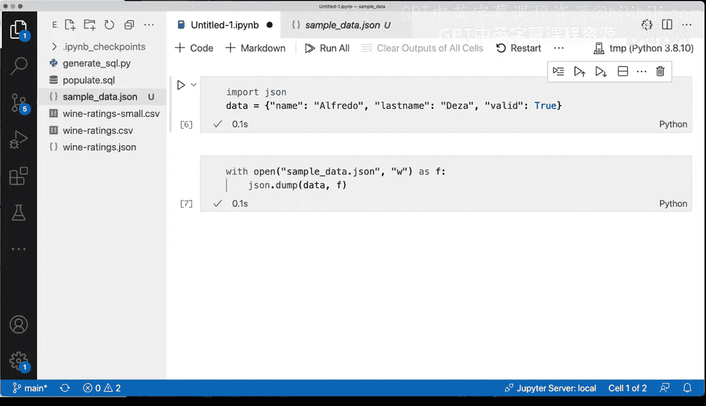

# 杜克大学｜Python、Bash和SQL数据工程基础2-4Python Bash and SQL Essentials for Data Engineering p85 18_01_05_将Python数据保存到磁盘.zh_en -BV1XS421X7tw_p85-

Let's work now with Jason and saving Jason from Python into a file。

 So lets let's use some of the Python data structures and use them to save them to a file。

 So the first thing we're going to do is again import Jason。

 Let's declare an anti dictionary over here。 let's run that。

 and the way we're going do these with the JsonN module is with similarly， as we've done before。

 we're going to open a new file， but instead of reading the file we're we're gonna open a file for writing。

 It requires a special flag。 So lets let's see how we can we can do that。

 we're gonna to say with open and we' we're to call this sample sample data。

The Jason and the special flag is going to be W。 The W means right， and we're going to assign that F。

 And then we're going to use Jason that dump。 And we're to passing the data object。

 So what's what's going on here。 Let's go very quickly。Very quickly what we're doing here。

 we're opening we're opening sample data Jason that JN file， we're passing the W flag。

 which means I am going to be writing into this new file I'm assigning that open file the F variable this can be named anything butm for the sake of this example I keeping it simple I'm just calling it F and then we're going to be using J the dump data note that I'm not using dumps or dump S which would allow me to basically convert that to a Python string or adjacent string rather and then dump is going to grab that data and save it to a file now this is missing the F variable which is the open file the scripture that comes from the open data。

So let's run these and see what we end up getting。Oh。

 so here I forgot to put I'm getting invalid syntax because I forgot to put as Now this is this is going to work。

 you have to be aware that some of these things may happen as you try some of these new constructs。

 So let's run this again and we should not get a problem anymore。

 Now I ran these and we are getting a new file over here。

 So let's let's click on that and see when where we get。 well。

 we get basically an empty object in ja or in。 this would be an empty object not no longer a dictionary。

 So let's just close these go back here and these would work with any types of data。 So say。

 for example， if we want to say。You know， name。Alfredo again。

 with my example of the contacts and then last name we can say Desa and we run these and we run this again。

 note that because I'm using W， it will overwrite the existing file， I'm going to run this。

And then sample data will have converted this into Jason One one quick note is that we can make sure that we really truly are saving Jason by saying checking if if some like。

Construct like， like a true， like using a bullolean in this case。

 Tru would be converted to lowercase， which would no longer make it valid Python。

 It would be actually。Actually J so you can see here that these change to underscore true so that is what you will be using。

 you will be using that dump method on the J module to save data from Python data structures to the file system using the J module。

 this should be pretty straightforward。

