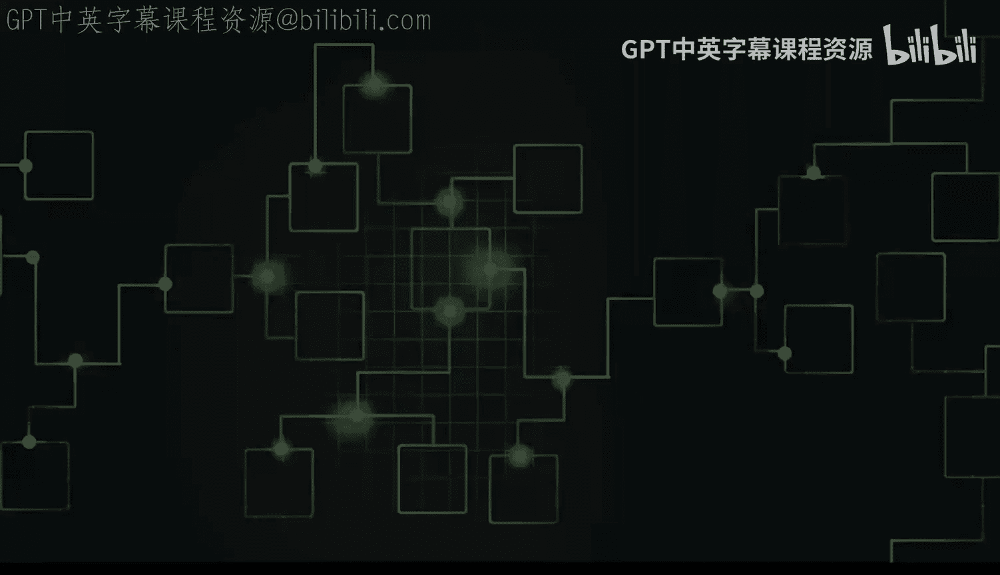
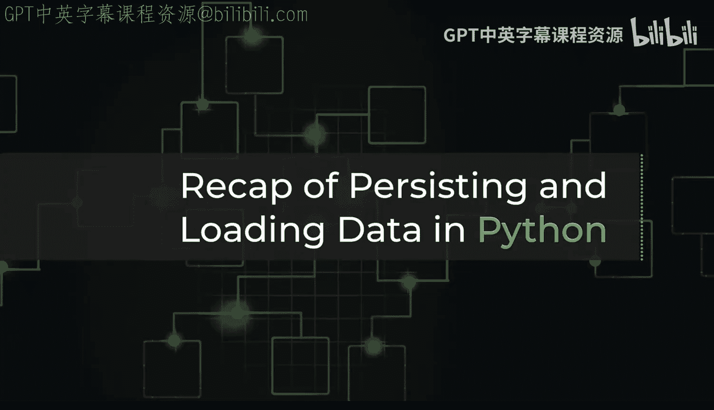

# 杜克大学｜Python、Bash和SQL数据工程基础2-4Python Bash and SQL Essentials for Data Engineering p86 19_01_06_Python数据持久化与加载回顾.zh_en -BV1XS421X7tw_p86-

We've covered how to work with JON and how to load data from files into Python This is essential again because now you have the power to read from files。

 load some information in Python and then work with that data in Python from files to doing a little bit of JN。

 also loading from JO files and saving data that will come from Python to a JO file or to adjacent data structure as a string in Python and finally we also covered a little bit of how you would work with CSP using the Pdas library。

