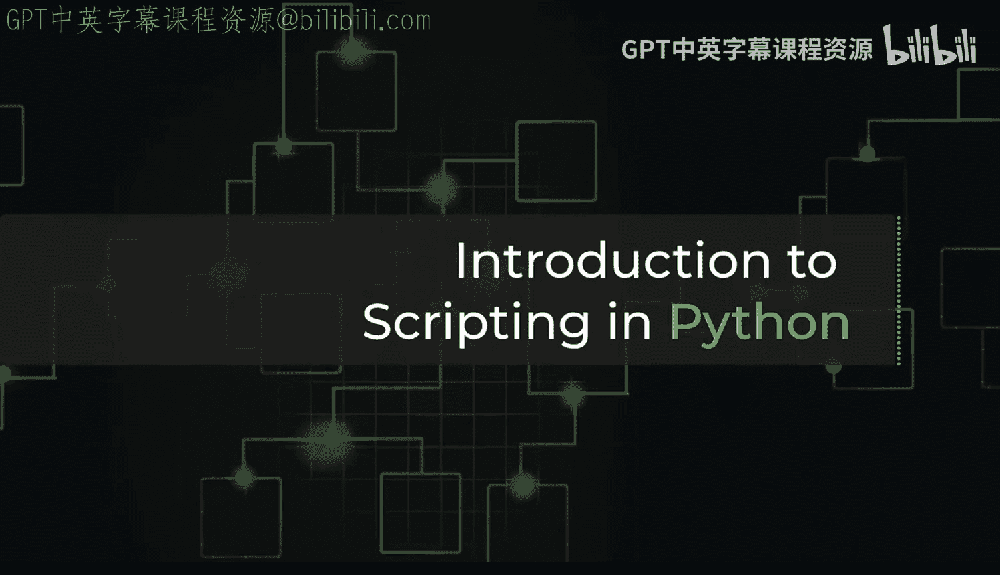

# 杜克大学｜Python、Bash和SQL数据工程基础2-4Python Bash and SQL Essentials for Data Engineering p88 21_02_03_Python脚本编程入门.zh_en -BV1XS421X7tw_p88-

Once you start getting comfortable with Python， you will want to use its scripting capabilities。

 Python is known as a scripting language， so one of the things you will be wanting to do is put together all of that knowledge。

 put it in a script and start doing useful things like data gathering and data processing in the command line in this lesson we will go through some of the basics。

 some of the things that you need to know and need to be aware of when when working with Python and creating Python scripts。

