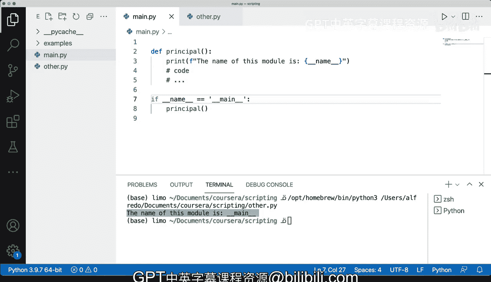

# 杜克大学｜Python、Bash和SQL数据工程基础2-4Python Bash and SQL Essentials for Data Engineering p89 22_02_04_在Python中创建模块化脚本.zh_en -BV1XS421X7tw_p89-

In Python， the way you create a module that you can run as a script is by effectively creating a Python file and just starting writing code in here I have like a single main Py file with one line that saysprint the name of this module is underscore underscore name underscore underscore I'm using a Ne string there。

 I'm using curly brackets and I'm effectively printing the variable name assigned to this file。

And I'll show you why this is important。 But first， let's try to run this and see what happens。

 So I'm going to run that。And。😊，The name of these module Python says this is the underscore underscore main underscore underscore。

 This has nothing to do with the fact that this is main thatt pi over here So what is what is actually going on well we can see a little bit of that behavior if we go to this other file over here and we're importing main So other that pi is going to import this other module I'm going to reset that and let's see what happens when I run this file over here。

 So I'm going to run is effectively running Python and I'm going to do other pi and if I run these you can see that the name has changed。

 the name of this module is main that is because the module now is no longer underscore underscore main。

 So I know this is a little bit confusing but even more so if I copy all of these。

Line and go here and paste it there， save the file。

And run it again in the terminal and I click run this。

 so I'm running from other and the name of this module is main and the name of this module is underscore underscore main。

 So these in other is actually being called underscore underscore main， This means that any file。

 any file in Python， any module in Python that you run from the terminal using Python。

We'll have these underscore， underscore main， underscore or Dunder main as well as how it's called in sometimes Python developers may call these Dunder main。

And so what happens here is that this is an important distinction because if we go back to main。

 you want to write some code， well you could write it precedurally like this and add you know more code here and you're going to preprocess some stuff。

 but what if you have this inside of a main function over there。And then you have to indent。

 of course。In that case， if I run these， then nothing will happen。And you want these to have to。

 to have some action。 Well， this is where all these。

Barable naming comes into play because here you can do if name。Es underscore and the。

Main then run the main function and again， the main function could be really anything right we could be this could be the secondary function or principle I actually it's called a principal principal function and then you can go here and say this is the principal function run run that so it doesn't matter and she's going to run that and then you can see here that we're getting the same behavior。

 but if we go to other Dpi and we're importing main。

 then we will not get the side effect behavior when we were running that code before we're just going to get。

This line which is effectively this line over here that says the name of this module is underscore name which is main so other Dpi has that over there Now let's just forget a little bit about order the pi we want to know how to run Python as a module and we do that here in main D pi we can create a main principle entry point function or or main function we're going to write our code there and we have this little snippet if you start looking a lot of python code you will see lines7 and8 well repeat it a lot sometimes there's other types of code at it like someone may do a try accept over here and do you know try accept any exception and then do some do some processing there I mean probably not a pass but it will do some work there to process the exception and whatnot so。

That is like the way you would treat a file in Python and then run it from the terminal with Python and then execute a call a function that would do some work and that would allow you to compose a file。

 a module that can do other things for you and you can expand on what you're going to be doing。

