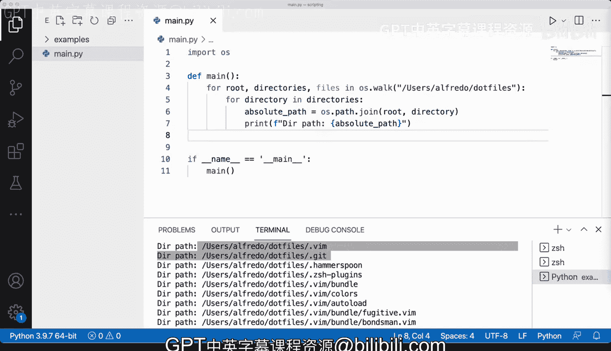

# 杜克大学｜Python、Bash和SQL数据工程基础2-4Python Bash and SQL Essentials for Data Engineering p90 23_02_05_使用Python脚本遍历文件系统.zh_en -BV1XS421X7tw_p90-

Now that we know how to write a。A Python script using a module。

 basically putting all of our code in a Python file。

 Let's just use that same structure to build a script that will traverse the file system that is it will walk through different directories and files。

 Python has a very useful module that has utilities that will help us here。

 that is these utilities are in the OS module。 So let's import it over here。

 and then OS will will help us and we'll write all of the most of the logic in the main function。

 and then we'll execute these and then we'll see how these all works。

 Basically what we want to do is use the walk the walk helper in OS。

 The walk helper will give us the main the root the directories and then the files when it's traversing the file system。

 So we're gonna do for root。Diirrectories。Fileles。In OS that walk。

 And I'm going to use my dot files directory over here。

And just to get started and to understand what's going on here。

 we are going to be printing these different these three things as it's traversing that path。

 So first， we're going to print。嗯。Let's bring the root。And then we will print。

 let's say this is a root so we can identify what's going on。

 then we're going to say we're going to print。Dirctories。

that and finally we're going to say the files files is going to be like that。

 So what is going on here is that always that walk is going to produce three groups of items one is the root then the directories and then the files and it's up to us to go through these variables and use them to find what we need to work with Now before I run these one thing that you have to be aware of is that if I use the short notation for the path that is abbreviating the path for my home directory with with these character this will not expand so if I run it。

Nothing will show it's basically the script running and that won't show so what we want here is to use absolute paths I'm going to use users Alfredo dot files I'm going to save these and if I run it you will see that I'm getting several several files and directories here that are getting a little bit interesting now these might look confusing I'm going to scroll all the way to the top you can see directories are nothing but there's a lot of files it says the root is these and then more directories。

And the trick here， this might feel very confusing。 The trick here is to。

Basically kind of like ignore the directories and if you want to work with files。

 then loop over the files themselves。 So files will always be you can see directories are and list here you have files is a list with one item if if you do that then the output will be a little bit better to digest。

 So let's loop over the files。 So I'm going to say。For file in in files， then you can do。You can do。

 for example， you can let's join the file and the and the route that will give you an absolute path so we can say。

Apps， absolute。Path is going to be OS。 We're going to use the OS module again。

 and we're going to use OS that path。 and we're going to say join。The root and the file。

That will give us the absolute path and we can say here print。嗯。Print the actual。

The actual files when to say。File path。And we're gonna do absolute。

Absolute path here in curly brackets。And then we're going to remove these things so that we can have better。

 better output， and we'm going to save that。And I hit clear over here so that we can run this again and get some nice。

 nice paths over there。 So now you can see that we're， we're traversing everything。

 I'm going to scroll all the way to the top。Well， this still has the annoying output。

 but now it's going to grab every single path and the root becomes effectively all the way up until the root of that file。

 So in this case， well， let's find another one that is a little bit more readable that is not using git modules。

 but you can see there's a lot of gi modules。 So， for example， these read me that RSD file。

 the root would be everything before that。 So slash user alphalfredo do files that chell plugins that would be the root。

 So by join that way you can you can definitely find that。

 Now if you were to want to process only directories well。

 you would you would do something you basically looping over the directories list that is produce you would do for。

Diiry。Yin。Diies。And then you would join instead of joining the file， you would join the directory。

And then the file path wouldn't be a file path that it would be directory path。

 So it would be their path。 and then I say that。And then I lease and then I run it。

And now I would be only getting directories produced and no longer files。

 all of these things are directories。 you can see here this is full of directories that then that get all of these are directories only so that is effectively how you create a script that uses the OS module to traverse the file system again very good tip is don't don't get into trouble by now using absolute paths here that might get you into trouble because things will not work and I'll show you I've shown you how to work with both directories and files using the OS module。

