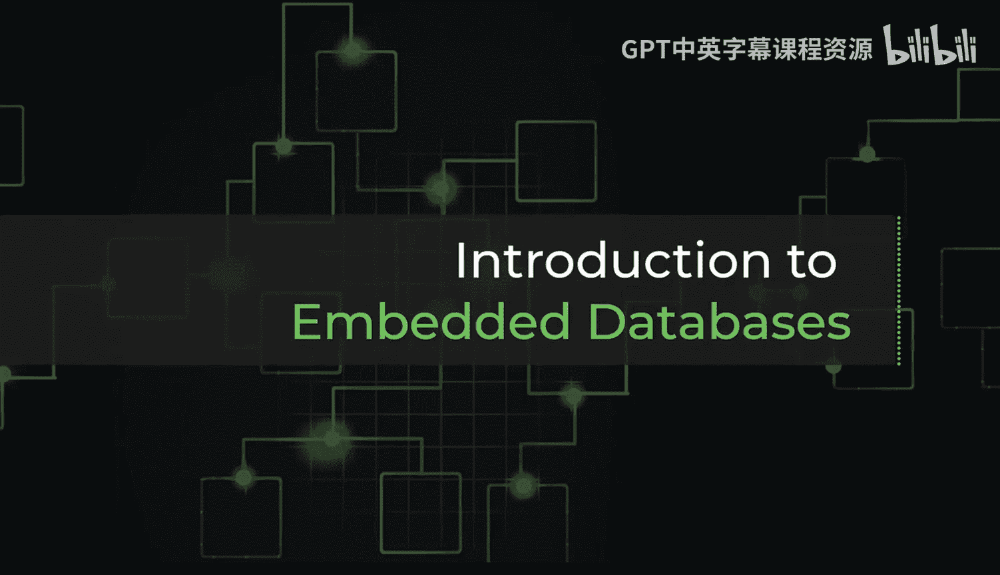

# 杜克大学｜Python、Bash和SQL数据工程基础2-4Python Bash and SQL Essentials for Data Engineering p92 25_02_03_嵌入式数据库入门.zh_en -BV1XS421X7tw_p92-

In this lesson I want to talk to you about embedded databases and in particular we will be working with SQLite。

 SQLite is an amazing， small and reliable database that works pretty much like any other regular database but with slight differences and will learn everything that there is on how to operate a SQLite database。

 either from the command line， but most importantly from Python so that you can work with data and a real database without having to worry much about setting up a bigger or larger database that might be more complicated。

