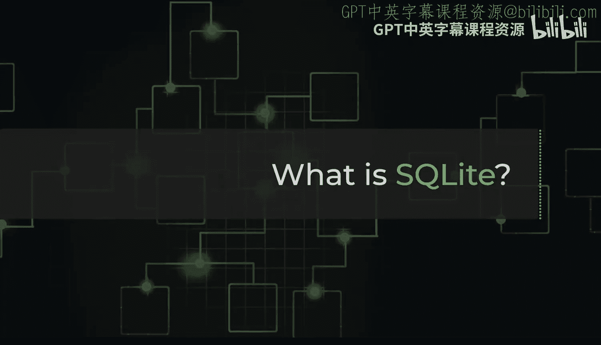

# 杜克大学｜Python、Bash和SQL数据工程基础2-4Python Bash and SQL Essentials for Data Engineering p93 26_02_04_什么是SQLite.zh_en -BV1XS421X7tw_p93-

So what is SQLite really like what is the difference why is it called an embedded database Well there are some key differences when working with SQLite that you will find in this lesson then say if you were working with a major database like Postgre SQL or MySQL even first off a SQLite database is represented by a file so you will see an actual file in the file system and this is a big difference because if you're dealing with a bigger database like say Postgre SQL。

 you won't find a single file and then dust the database。

Next is that there's no client server communication。

 that is when you're working with say Postq SQL or MySQL， you have a database server。

And then you're connecting to it via a client and the connection usually happens over the network also called over the wire so there is no there's no server。

 there's no process running you connect to a SQLite database directly without any configuration which is the other feature that an embedded database like SQLite has there's no configuration you don't need to set up anything specifically and what we will be seen in this lesson is that from Python the connection the setup and the interaction with SQLite is pretty straightforward there are some things that you need to know about and we'll see them next but pretty much everything else is very straightforward you don't need to worry about much and so it makes it a perfect option to work with data or with SQL。

storing data， retrieving data， working with queries and basically trying and SQL out and working with data and databases。

