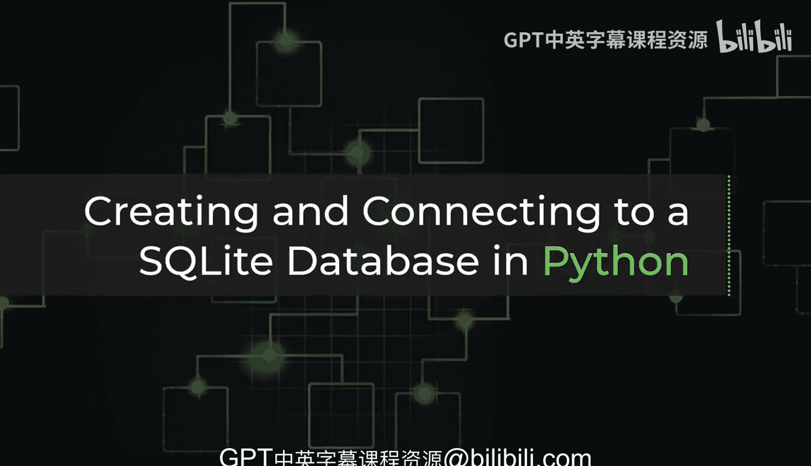
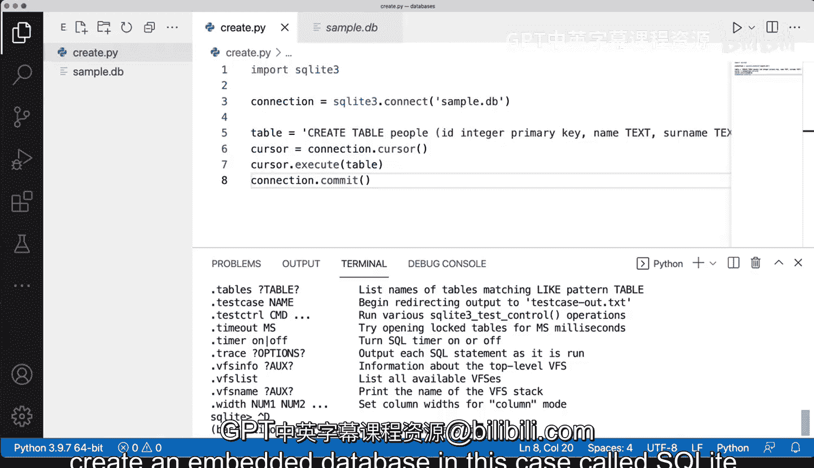

# 杜克大学｜Python、Bash和SQL数据工程基础2-4Python Bash and SQL Essentials for Data Engineering p94 27_02_05_在Python中创建与连接SQLite数据库.zh_en -BV1XS421X7tw_p94-

From within Python， we can。Connect to a SQLite database without much effort。

 There's actually we have a visual Studio code here open。

 you don't need anything special or any library installed to do that and I'll demonstrate here a little bit how that works First let's create a new file let's go create the P just plain plain vanilla Python I'm using Python 39 but really pretty much any other Python version should work。

The first thing we're going to do is import SQL light。

And SQL light 3 is the name of module that should just work and the SQL light3 module is available again。

Pretty much in any， any different Python version that you may have。

The next thing that you want to do is create a connection So when I do that here connection。

 create this connection as a variable and when I use the sQLite connect module and here you have a couple of different options you could create an inmeory database now this is pretty useful because if you do an inmemory database that is you create it in this way。

 it is a special special word or variable or string variable here that when I used to create an in memoryory this allows you to not it's not necessarily create a filebased database and you build an inmeory and when the program ends well the database goes away。

So that's one way to do it， but I want to show you how to create and everything else works the same as well。

 like if you're creating in memory versus a file， everything else works the same。

 the only one thing is that it doesn't persist on the file system， but I want to create an actual。

Daabase， and I'm gonna call it sample that D B。 like you can be named anything。 but in this case。

 I'm just going to name it sample that D B。 Next， I want to create a table。 So let's say。

I create a table。 I want to save information about people。 So let's do create。Table people。

 And I'm going say this is going to have an ID0， which is an integer。

 and I'm going to make it the primary key。 This is， of course， optional， but。

It's it's fine to have one and I'm creating one and then I'm going to say text for the name and then the surname。

It's also going to have texting here， so we have our query there。And we're specifying。

What we need there with a query next， we are going to create a cursor。

Csor connection that cursor gives us the cursor， we have to call that。嗯。And finally。

 what you want to do is。嗯。Finallyly， what what you want to do is you want to execute。

 you want to execute the query。 So for that， you would do cursor and execute。Well。

 the query in this case is a table。And once you do that， you have to commit。

And the way you commit in sQelite is by saying。Connection that commit。There are a few elements here。

We talked about the connection， then we created a query。

 we have a cursor and we are performing a commit the query itself is just plain text where we're just specifying that we want to create a table of people。

 we're going to have a primary key。And then a name， and then a surname。Next。

 we're going to create a cursor， which allows us to execute this table creation。

 and then we're going to commit it。 Now I'm going to save this file and I'm going to run it。

And running doesn't produce any output， but you can see here now I have a sample DB in there。

 Now the sample Db won't render by a fault on VS code， but you can now access it over the terminal。

 So if I head back to my terminal over here。SQL light3 will should be available in your system。

 so the what you want to do here is to use test SQL light。Command line tool。

 and then connect to your。To to the file this is how you connect to the file and you can see here I ran SQL I 3 and then the path to the database and I'm in SQL light already so in here youll have several different options and you will be able to operate on these on this database without any problem So if we had some data in there you could certainly use the command line tool to access it。

 so that's how you connect and create a database an embedded database in this case called SQL light。

