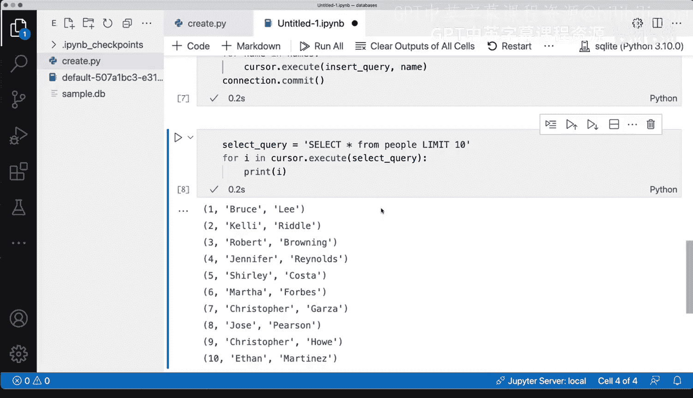

# 杜克大学｜Python、Bash和SQL数据工程基础2-4Python Bash and SQL Essentials for Data Engineering p95 28_02_06_在Python中保存与查询SQLite数据库.zh_en -BV1XS421X7tw_p95-

Now that we know how to create a database， an embedded database in this case， SQLite3。

 let's start saving and querying data from that database I have a Jupyter notebook here and what I want to do is I'm going to be using the same sample DB database from before I have a people。

Table， we have a surname and name and we insert some values before anything I want to insert values into the database。

 but before I do that I want to generate some data I've installed a library called faker and the way you install it is by running PP install faker。

And this library is not that important， but it will allow us to， to generate some random names。

 So what I'm going to do is I'm going to say from Bar import。Fakker in a capitalized form。

 and then I'm going to say names。ImGo to generate a few names here。

 I'm going to say name that's split。 and you'll see y in a second or I in range。 let's just say 100。

 so。We're going to。We're going to be doing that。And I'm going to say for I here， there we go。

So that and we need to initialize the faker。In this case， fake is。Fake like that。 Very good。 Alright。

 so if I run these。What happens is that now we have1100 names that we can use。 So if I release。

There you go。 So we have several， several ones that we can we can use Now you can see that some data here is having more than more than the first name and the last name that's fine。

 no no need to worry about that so we can we can normalize this is this is a data engineering problem。

 So let's let's normalize here and we're gonna reassign names and we're going to say。嗯。

Name for name in names， Eve length。Of name is。Is equal to 2。

And then we're gonna call names again and I just want a first name and a last name。 There we go。

 I ran it and now I have just just a two item name Why am I doing that Because if you remember when we were creating this we created a name and a surname in the table So now we need to have data that will have like a first name and a last name and that will help us now get into trouble next So now that that's now that we have the names we need to insert that into the database so let's just go ahead and do that with a little bit more code。

So as you know， first， we need to create a connection。

So the connection to the database is going to be。The connection is going to be well。

 first we need to import sQL light。Import sql I 3 and。

And then we're going to do our connection connection is equal to SQLi 3 that connect。

 and we're going to connect to our sample Db file that it's a preexist database where the table has been created already。

And now we're going to well let。Run that and create another cell here where we're going to define our our insert query。

 So let's， let's say insert query is equal to。Insert into people。

 So we're going to use the people table。 and we're going to say name and surname。

And we're going to say values values is question mark comma question mark。 Now this is。

 this looks very odd。 but the Python library that connects to the sQLite embedded sQLli databases uses this type of notation to connect and execute queries that will insert values。

 This is the value replacement mechanism。 So the library itself make sure that the values that you're passing the data you're passing will be properly replaced in this query when you're using it。

 So that's the insert query。 But how do we do this。 Well， we're going to be doing a loop。

 so we are going to loop over all of our names。 So we're going to say for。For name in names。

And we are going to。We are going to say。How about。How about for naming names。

 we need to execute the query， and we need to pass in。We need to pass in the valleys。

 so let's try and get this right we need the cursor。We can actually agree the cursor over here。

Csor equals connection to cursor。So in a half a cursor there。And for naming names。

 we are going to execute the query。Csor dad， execute。Inser。Insert query。And then the name。 Now。

 the name， each name is going to be a， a two item list。 And then at the end， we're going to the。

Connection that commit。So let's run these。And it completes pretty fast。 we have 100 names in there。

 and we've committed we have some data in there。But do we really know like if we have stuff in there well。

 we've inserted， but like we don't we haven't checked what's going on。

 So let's quickly try and run another query in this case。

 our query is going to say to get some some items back from that database。

 we still have our connection is's the same connection。

 we have a cursor so let's just create another query。 we're gonna say select query。

 and you can name this whatever you want， but I'm just for use of readability。

 I'm just gonna see a select。 So I'm going to say。Select everything。From people。

And then I'm going to say for I in cursor that execute。Select query。 So I'm the the select query。

 when you're running it， it will produce a two pole。 So when I say。When I print print what that is。

But because we have 100 items， let's just add a limit。Limit say1。So if I run these。

 you can see now I have each item is a three item to， one is the index。

 remember we created an index and behind the scenes Site is producing automatically an integer for us。

So we have all of our names here， so we verified that we are inserting things and now we're querying the database for some some of the things that we want so that's that's the way you would insert data into an embedded database in this case。

 our sample D if we were looking into the command line to and running on the sample D directly。

 you would see the same the same result as we are seeing here， actually。

We can we can run that very quickly if we go here and we say。If we say show a terminal。

Open new external terminal and。Well， probably not this one right here。

 but we'll run this in this terminal right here， we still have sQL Li 3 available。

But we want to use our sample D B。 So let's use。 I'm going clear this out so it looks better。

 and I make it a little bit bigger。 So I'm gonna say sQL light 3 and sample D B。

And we can use the same， the same query。 So we have select。

Everything from people limit 1090 and you have the same output that we saw when we're running Jupyter over here。

 so that is effectively you're effectively now working with SQLite and a database and storing data and you're able to query that data back from the SQLite database。

