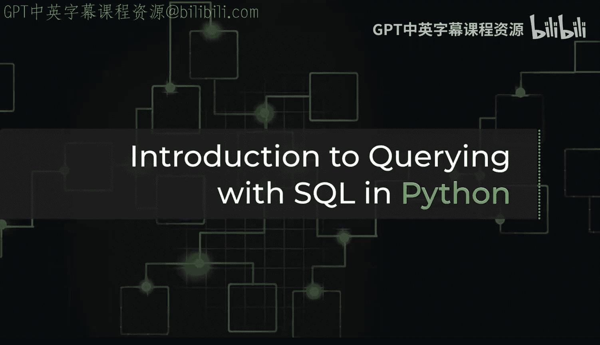

# 杜克大学｜Python、Bash和SQL数据工程基础2-4Python Bash and SQL Essentials for Data Engineering p97 30_02_02_Python中使用SQL查询入门.zh_en -BV1XS421X7tw_p97-

Beyond connecting to databases you can also run some basic queries in this lesson we'll cover some of the things that you can do to perform some basic queries to a database and extract some data and we'll see how you can operate on that data on the Python side sometimes queries can get very complicated and you'll learn when and how to use one or the other it basically boils down to using SQL statements will be far more efficient but perhaps readability and maintainability will suffer a little bit and on the other hand using processing in Python maybe it's slower that be much。

 much easier to maintain and filter that later and then finally we'll see how we can do some some searches and some of the wild cardss that are available in SQL so that we can extract data that kind of like matches things that we know。

A properties of the data that we're working with。