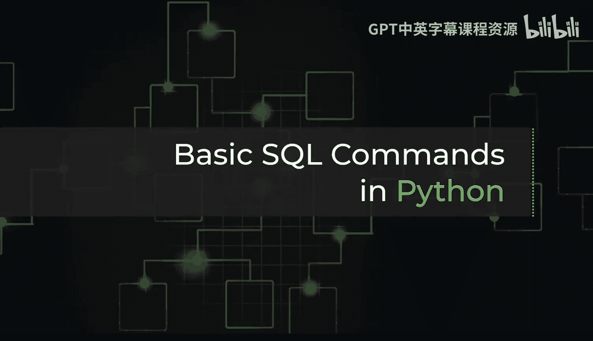
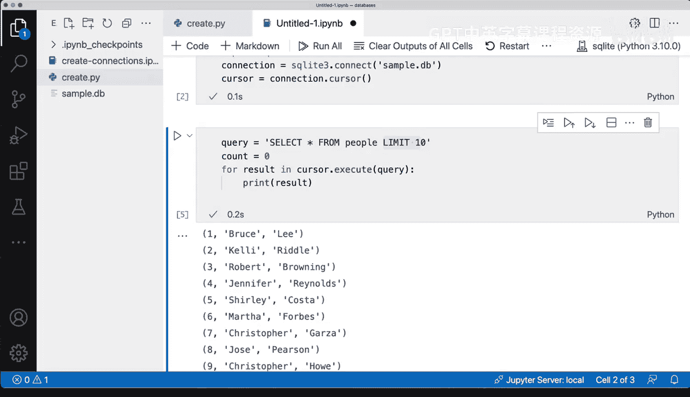

# 杜克大学｜Python、Bash和SQL数据工程基础2-4Python Bash and SQL Essentials for Data Engineering p98 31_02_03_Python中的基础SQL命令.zh_en -BV1XS421X7tw_p98-

We've already used a little bit of the basic commands for SQL to interact with data and once again。

 we're running Python here importing SQL I3， creating a connection and setting up our cursor to interact with a database This is the same sample that Db or the sample database that we have that has been prepopulated with first and last name so we're going to run this once again now we have a cursor and what are some of the basic elements in a SQL statement Well。

 we've already started with select So we know that and we're going to have to we're going to reuse these query variable here just like as we start trying out different queries that we can do and then we're going to reassign the contents of that query So here we're going to do a simple select just like we've done。

I'm using select star from so select means like what is it that we're going to be using。

 star means everything all of the fields and we'll dive a little bit more into what makes those fields unique and then we are going to be using from from means like the actual table we only have one table and our table is called people。

So select all from people。Is how you would do。The the most basic query really like select what fields and these fields are coming from what table will in this case from people and this will get us everything。

So。What we want to do here is。Execute this query。 So if we want to run it。

 we'll run it in the most basic way， we'll do。Psor that execute。Qurry。And then we'll do。

 we'll loop over the results for。嗯。For let's say for result in cursor that execute a query， print。

 result， but this is going to cause the several items in the output。

 Let's run it and see what happens。Yeah， so we're getting we're gonna to get pretty much everything that is's in the database right now and Jupyter right now is being super helpful and saying。

 hey， like I'm gonna to show you all of the output because issues too much。

 So one of the powerful things about this is that now you are in control or although you're actually calling absolutely everything you could because like now you're in Python。

 you could play a little bit around with data， So you could say for example。

 I mean you can always it's going to be always more efficient to do it with a query。

 but when the query is lacking or it's getting too complex， you can rely on Python。

 So say for example， if you wanted to limit that instead of doing it with SQL。

 you could say you could say count。Equals0。And then here， count plus plus equal  one。

 So you're keeping count of how many items you've printed。 and we can say if。If count。

 he's more than 10， we can break。And that will limit what we're running。

So we're going here and we have 11 items being processed now again。

 this is not super efficient and it's probably like is definitely not an efficient example。

 but it shows you the ability of sending the things that you need to do on the Python side instead of relying absolutely 100% on SQL statements or SQL queries rather。

So aside from select from people， we can certainly do we can use limit over here。And we can use say。

 for example， limit 10。And that will cause the same effect right So if I remove these out of the way and run these we'll have 10 items around here。

 So definitely this is more efficient， but this is a very simple query in a different very simple select statement when things get complicated you might want to draw down to Python and start doing some processing there。

Aside from a select star， select star means that we have， remember， we have three。3 columns here。

 We have the Id， the， the primary I。 We have the name and the surname。

 So you can do a query that is more。That is more towards the data that you want to be using。

 perhaps you don't care about you don't， you don't care about the I。

 you care about the the the first name。 so you could do select。namee。From people。Limit 10。

 and then we can copy very quickly this loop over here。

Paste it over here in a new line and then run that and see what we get。

And you can see now we're getting a single item。 So similarly。

 if you want to just select the surname。The surname would be like that。 and you run that。

 you you will get the last name from the database。 So these are some of the some of the the basic SQL commands that you can do to interact with a database store in a database。

 you're doing a select， can you can specify what table and you can definitely use a limit。

 And when things start getting way too complex， you can rely on Python to do some processing as I show you here when we were trying to limit instead of using that limit in in the SQL query。

 So that's it， that is the basic SQL commands that you can be using to interact with a database。

