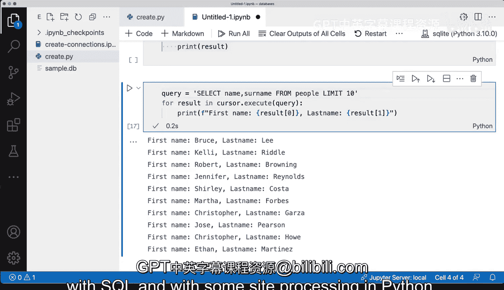

# 杜克大学｜Python、Bash和SQL数据工程基础2-4Python Bash and SQL Essentials for Data Engineering p99 32_02_04_使用SQL在Python中提取唯一数据.zh_en -BV1XS421X7tw_p99-

One of the things that you can do with SQL statements is to use the power of SQL to try to get。

The data that you're actually looking for， so when you're constructing your query。

 there's a few things that you can do。And I'll show you a couple of a couple of things that you can do。

 So let's let's use a， let's define our query here again from Python。

 and let's use a select statement once again。 So I'm going to use。Select everything from people。

And then， we're going to。We're going to be doing。 we're going to。We're going to order our results by。

嗯。Let's see order。By name。And we're going to make it go descending。

So we're going to do our same loop again for resulting cursor that execute a query。Print result。

And what we're doing here。What we're extracting distinct data is that we're saying let's order the output so that you can have it in a way that the name is going to start by in alphabetical order going down so you can see I'm starting with the name that starts with Z and it goes all the way until name says start with a。

So that's an ordering。 But how can we make that distinct well。What if you know。That well。

 first of all， you don't want the I， so you could actually say。You could actually say name。AS name。

I think that should work， oops， I think。That would be like this and then run it again Yeah。

 there you go。 So in a select you can do name and surname and then you can start having that。

But you can actually be very specific about the distinct data that you want to get。 So we could say。

 get me the name and from people。Order by name， but we could introduce and more specificity here in the query。

 we could say。呃。Where。Say， for example， name equals。James。We could do here a double quote。

 So we're not getting into trouble with a query。 If you're using single quotes outside of the outside of the query in the string。

 then you cannot use single quotes inside unless you escape them。 So let's see if this works。

 So there we go。 We have a couple of。Entries where the name is equal to James。So， similarly。

We could we could， we could remove some of these ordering and and just rely on the default ordering。

 So if you remove the ordering and this runs you will get the default the default ordering。

 So that is that is how you're getting distinct data And again。

 you can play around with the data once it comes back。 So instead of same print result。

 you could assume that you're gonna get a name and a surname so you could say。

You could say something like。I'm going to use a nesting here and I'm going to say first， first name。

And then we're to say。Ofcuror。0， which means index of 0 is like it will be this guy over here。

 And then I'm going to use the index of one for the surname。 So I'm going to that and then。Last name。

Last name is。Of course， Sir。1。Allright， and that should give us like a better and nicer representation here。

Oh， we cant we can use these because we we are having some trouble here because it doesn't allow us to split to split that that like that so we could say perhaps first。

Last equals。Oh， it that result。 I see。 So if we go and say。Not the cursor。

 but we want the result over here。So we do these and we get their result。And then run it。

 then we're basically telling that instead of like looping over all the results as a tuult。

 we're saying， hey， let's just get the first item， first name is James， last name is Hopkins。

 how about let's see we're getting a gym。W， we're not， not getting anything。 How about a。呃。

How about a Tom。 So now you're， you're dealing with， we're dealing with data and， and。

's say leave it 1 here and get some other output so Christopher， Jose。

 Ethan Shirley and now you're able to do a little bit of work here now I made a mistake using cursor cursor is not the one that you want to be using you want to be using the result whenever you're dealing with a result from the query in Python that's where you're going to have to be able to extract that And again things are can be processed in the Python side the Python side is going to be slower So that's the thing to remember when you're processing things on the Python side instead of using the power of queries。

 but you know sometimes it's just easier and more readable and more maintainable So if you don't care so much about performance you can definitely definitely rely on on Python to do some of the heavy lifting So that is some of the tips and tricks on。

How to do distinct data extraction with SQL and with some site processing in Python。

