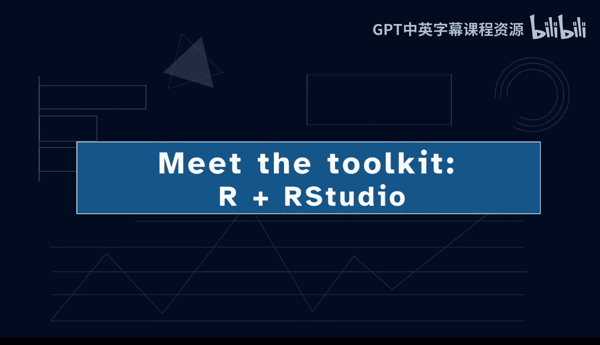
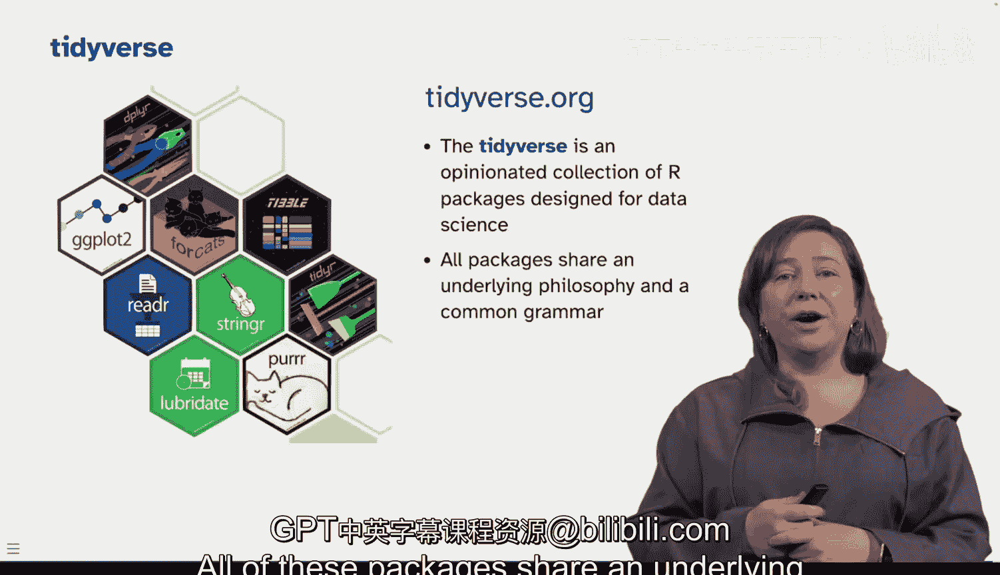

#  003：R与RStudio

🎼

在本课程以及整个专项课程中，我们将使用一系列现代数据科学工具。在本视频中，我们将认识其中两个：R与RStudio。

在认识它们之前，我们先回顾一下学习目标。到本课程结束时，你将能够从数据中获得洞察。更具体地说，是使用现代编程工具和技术从数据中获得洞察。再具体一点，是使用现代编程工具和技术，通过**文学化编程**可重复地从数据中获得洞察。或者，让我们说得更具体一些，是使用现代编程工具和技术，通过**文学化编程**和**版本控制**可重复地从数据中获得洞察。

不过，在本视频中，我们将专注于使用现代编程工具和技术从数据中获得洞察，也就是第一个要点。我们将使用R和RStudio来实现。

## 什么是R？

R是一种开源的统计编程语言。它也是一个用于统计计算和图形的环境。

## 什么是RStudio？

RStudio是R的一个便捷界面，称为**IDE**，即集成开发环境。例如，我可以说我在RStudio IDE中编写R代码。使用RStudio并非R编程的必需条件，但它被R程序员和数据科学家广泛使用。

一个关于R与RStudio的恰当比喻是汽车引擎与仪表盘。R就像引擎盖下的发动机。RStudio是一个仪表盘，通过它你可以与引擎以及R包进行交互。

## 什么是R包？

包是可重复R代码的基本单元。它们包含可重用的R函数、这些函数的文档以及示例数据。它们是R社区扩展R的方式。截至2024年4月，**CRAN**上有超过20，000个R包可用。CRAN是综合R存档网络。我们将使用其中一小部分但非常重要的包。

接下来，让我们来参观一下R和RStudio。

## RStudio界面导览

好的，这就是RStudio。我们在这里看到了什么？

首先，我们有**R控制台**。当我们打开RStudio时，可以看到我们可以访问R。它会告诉我正在使用的R版本。例如，如果你最近没有更新R版本，你这里的数字可能不同。在控制台中，我可以进行简单的算术运算。我可以输入类似 `2 + 2` 的代码，然后得到结果 `4`。这当然并不令人兴奋，但你可以看到我们可以在这里做这些简单的事情。

你还可以做一些事情，这些事情虽然也可以用计算器完成，但感觉开始有些不同了，那就是我们可以将值赋给对象。例如，我可以输入 `x <- 2`。一旦我这样做，我就可以在环境选项卡中看到我创建的对象及其值。然后我也可以用那个 `x` 进行算术运算。我一直在运算符之间加空格，但这完全是可选的。我也可以省略空格，写成 `x+2`。我喜欢加空格，这样代码看起来更宽松，更容易阅读，但在R中空格是可选的。

## 在R中处理数据

现在让我们开始在R中实际处理数据。我们将在课程中反复使用的一个包包含了一些关于企鹅的数据。要加载一个包，包名是 `palmerpenguins`。所以，要加载这个包，我会输入 `library(palmerpenguins)`。当我这样做时，你会发现好像什么都没发生。在使用R编程，以及其他语言时，需要习惯的一点是：没有响应并不总是意味着出错了。事实上，如果出错了，你会看到错误、警告或消息。在这种情况下，包已经加载了，只是我们没有要求R返回任何东西给我们，所以它只是说“我已经完成了需要做的事情，准备接受下一个命令”。我们知道它准备接受下一个命令，因为我们可以看到那个小小的回车符和光标在屏幕上闪烁。

在这个特定的包中，有一个名为 `penguins` 的数据框。我可以输入数据框的名称。我碰巧知道这个数据框存在，并且可以这样查看它。它被打印到我的屏幕上。看起来并不是所有内容都适合我的屏幕，例如，有一个名为 `year` 的变量我们实际上看不到。通常，当你有一个这样的数据框时，最好能以类似电子表格的视图查看它。所以，我还可以做一件事，输入 `View(penguins)`。这将在数据查看器中打开它。在处理数据时，我喜欢能够在数据查看器中打开并查看它。如果你有一个非常大的数据集，这个操作可能会很耗时，比如有数百万行或数千列。但当我们开始学习用R进行数据科学时，我们将处理的数据集虽然不是很小，但规模适中，应该总是可以在这里打开它们。

一旦在查看器中打开数据，就可以进行过滤等操作。例如，你可以开始与数据交互，你并没有改变它，只是查看它。可以通过点击列名按字母或数字顺序排列列。

## 访问数据框中的变量

我们如何访问这些列中的一个，也就是数据框中的一个变量呢？格式总是：数据框名称 + 美元符号 + 你感兴趣的变量名。当你在RStudio中编程时，它有一些辅助功能。它会显示数据框中存在的变量名。所以，如果我忘了企鹅的体重记录为 `body_mass_g`，我可以用箭头键从那里选择它，然后这样查看它们。

R是这样查看数据的好方法吗？我不想看到每只企鹅的体重。我可能想对这些数据做些什么，比如计算企鹅的平均体重。你知道它们有多大吗？让我们试着算一下。

## 计算平均值

在统计学中，当我们说“平均”时，我们指的是**均值**。在R中计算均值的函数就是 `mean`。你怎么会知道这个呢？你不一定知道。你可能会谷歌搜索“如何在R中计算均值”。许多（虽然不是全部）这些函数的命名都很贴切，所以你可能会猜一下，然后通过谷歌找到方法。

在R中，一旦我们输入函数名，后面就会加上括号。我们想要应用函数的内容放在括号里。我们想计算 `penguins$body_mass_g` 的均值。我们得到了一个 `NA` 作为响应。每当你得到像这样的意外结果时，最好先检查一下：我是不是做错了什么？同时也要快速思考：我想知道 `mean` 函数是如何工作的，可能出了什么问题？这意味着我们需要查看文档。我们有两种方法可以做到这一点。

我们可以在控制台中输入一个问号，然后输入函数名。这将在帮助菜单中弹出。或者，让我回到帮助菜单的主页，在帮助菜单的搜索栏中，我可以输入函数名。你可以看到它提供了一个函数列表。它提供给你的列表取决于你安装的包。所以，如果这是你使用R的第一天，你可能安装的包较少，呈现的选项也可能较少。但 `mean` 函数在基础R中，对所有人可用，我们不需要加载任何包就可以使用它。我们可以通过这种方式获得帮助。

一旦进入帮助页面，你将能看到函数名、它所在的包（如前所述，这是基础R）、函数功能的标题以及描述。如果我们往下看，我们可以看到函数的**参数**。第一个参数是 `x`，这是我们想要计算均值的对象。但我们也可以看到，我们有选项可以计算**修剪均值**，即修剪掉数据框中的极端值。还有一个名为 `na.rm` 的选项，它说这是一个逻辑值，指示在计算进行之前是否应去除 `NA` 值。我们可以看到，`na.rm` 参数的默认值是 `FALSE`。所以，如果我们的数据框中有任何 `NA` 值，也就是任何我们没有记录体重的企鹅，这个参数是关于我们是否应该在计算均值之前将它们移除。我们很可能想这样做。所以，让我们来试试看。我可以再次输入函数，添加这个参数。或者，让我回去，我可以用键盘上的上箭头键滚动浏览我最近编写的代码。所以，为了节省一些打字，我将回到这里，然后输入一个逗号，表示我要添加一个新参数：`na.rm = TRUE`。

现在我看到这些企鹅的平均体重大约是4202克。所以大约是4.2公斤。

## 回顾总结

作为回顾，我们可以使用R控制台作为计算器进行简单的算术运算或对象赋值，这些对象会显示在环境选项卡中。我们可以使用 `library` 函数加载包。我们可以使用 `View` 函数在数据查看器中查看数据集。我们可以使用美元符号访问数据框中的变量，格式是：数据框名称 + 美元符号 + 变量名。像 `mean` 这样的R函数后面跟着括号，括号里是我们想要应用函数的对象。当一个函数给出意外结果（比如我们得到的 `NA`）或错误时，最好的首选去处是函数文档，可以通过帮助窗格或输入问号后跟函数名来访问。函数的其他参数用逗号分隔。

## 当前R基础要点列表

现在让我们回顾一个简短的R基础要点列表：

*   **函数**：通常是动词，后面跟着它们将要应用的对象，这些对象放在括号里，例如“对这个做那个”或“对这个，对那个，用那些”。额外的参数用逗号分隔。
*   **包**：使用 `install.packages` 函数安装，使用 `library` 函数加载（每个会话一次）。
*   **数据框中的列或变量**：使用美元符号访问，格式为 `data_frame$variable_name`。
*   **对象文档**：使用问号访问，例如 `?mean`。

## 关于Tidyverse

最后，让我们谈谈 **tidyverse**。Tidyverse是一个为数据科学设计的、具有特定理念的R包集合。这些包将是我们在本课程和整个专项课程中最常使用的。所有这些包共享一个底层哲学和一套通用语法。

