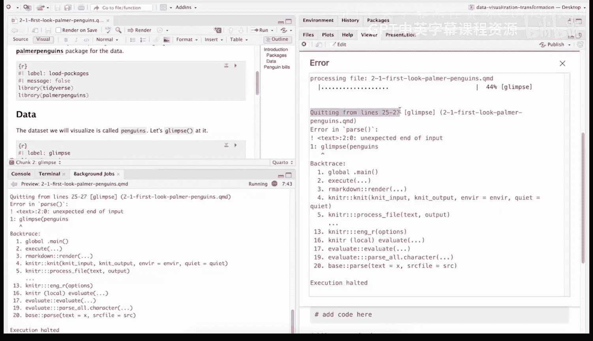
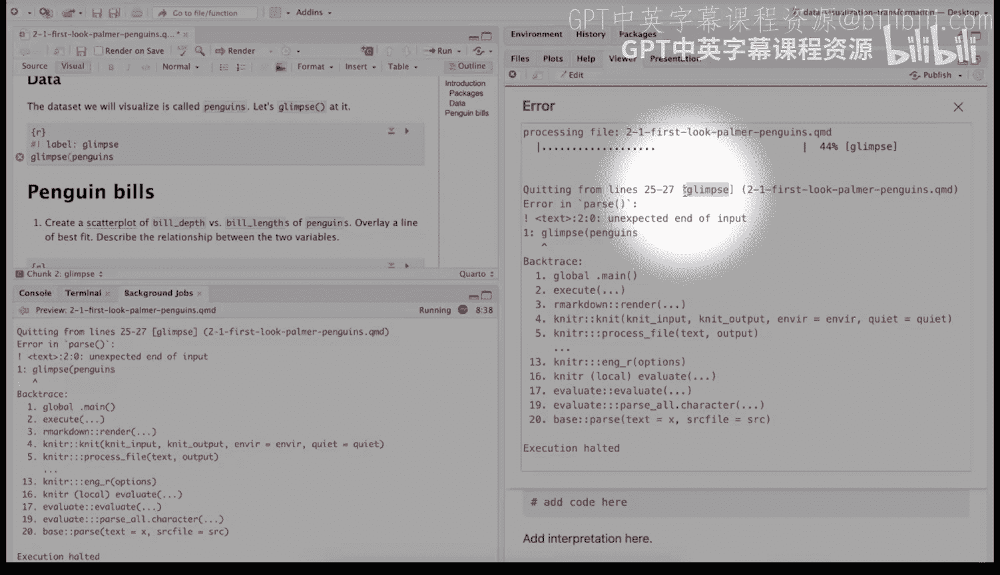
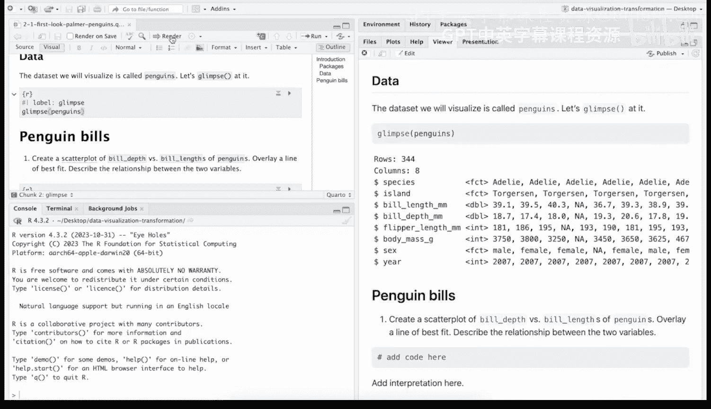
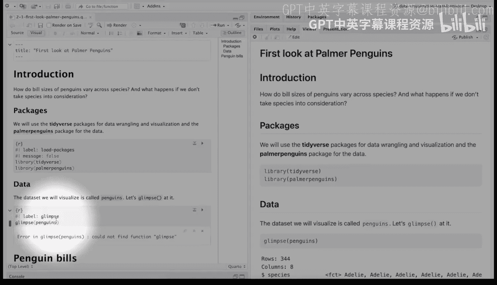
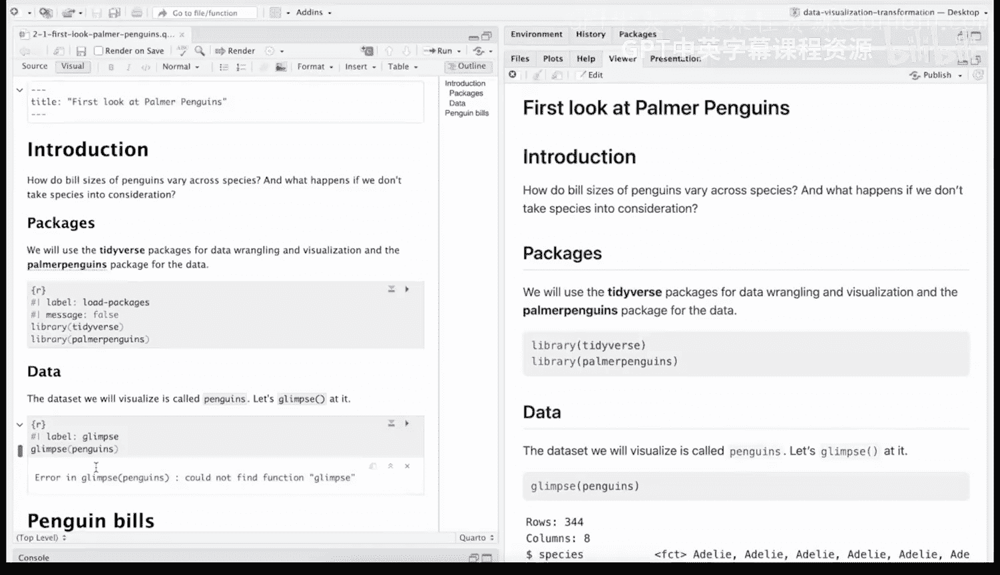
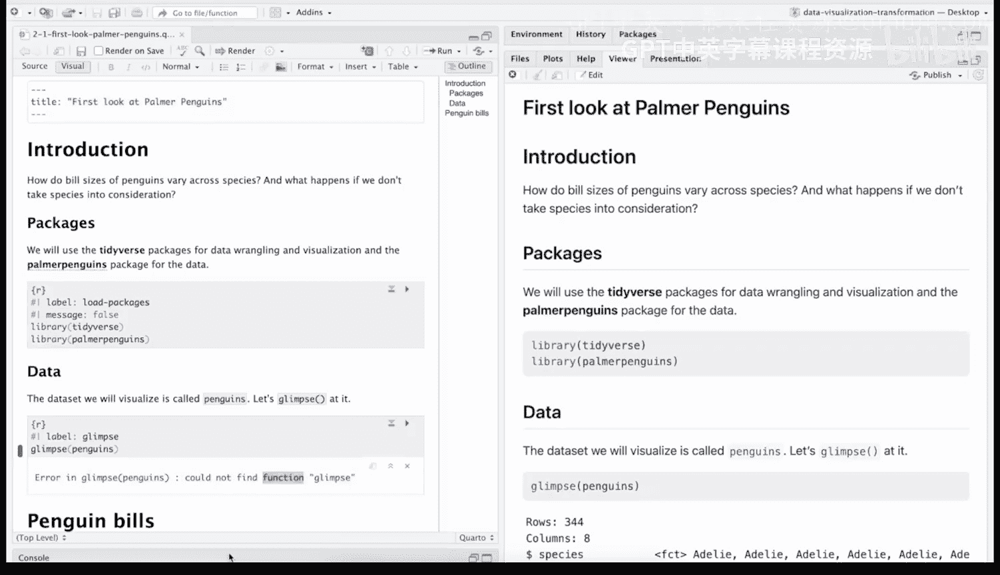
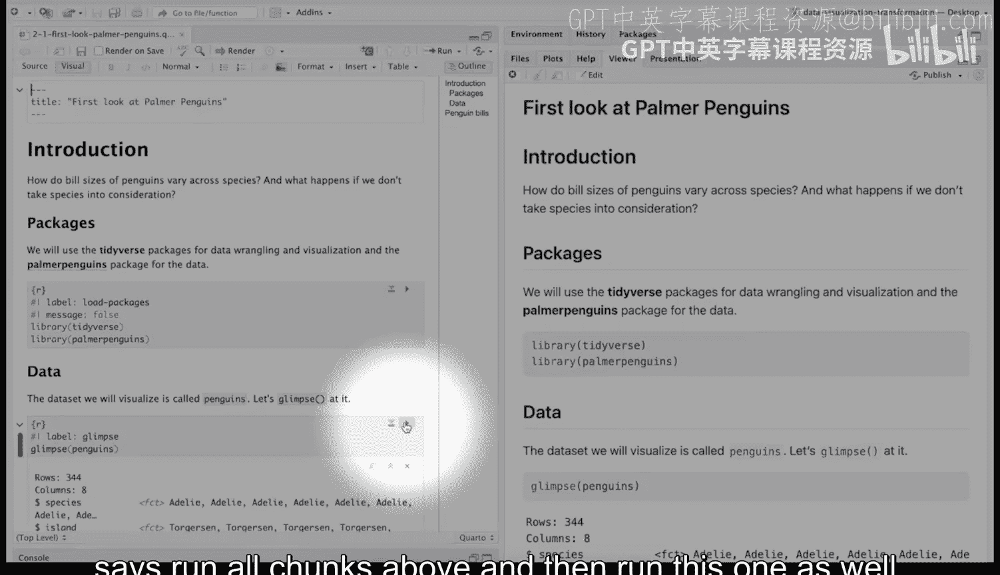
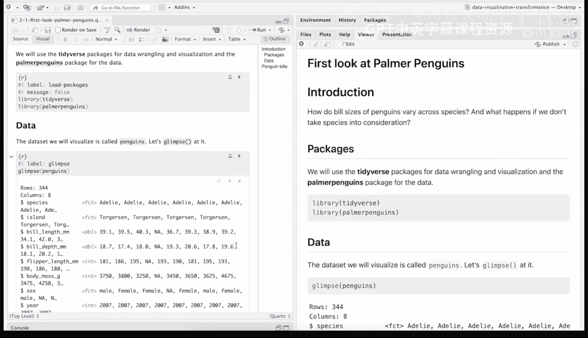
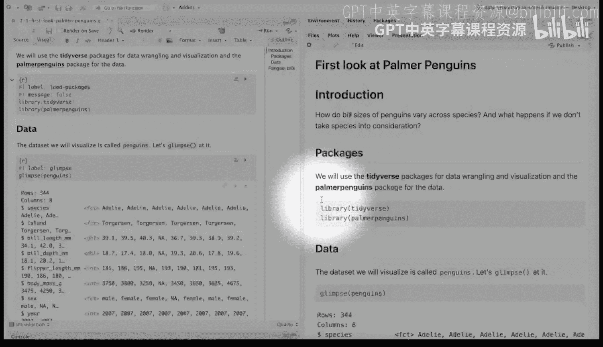
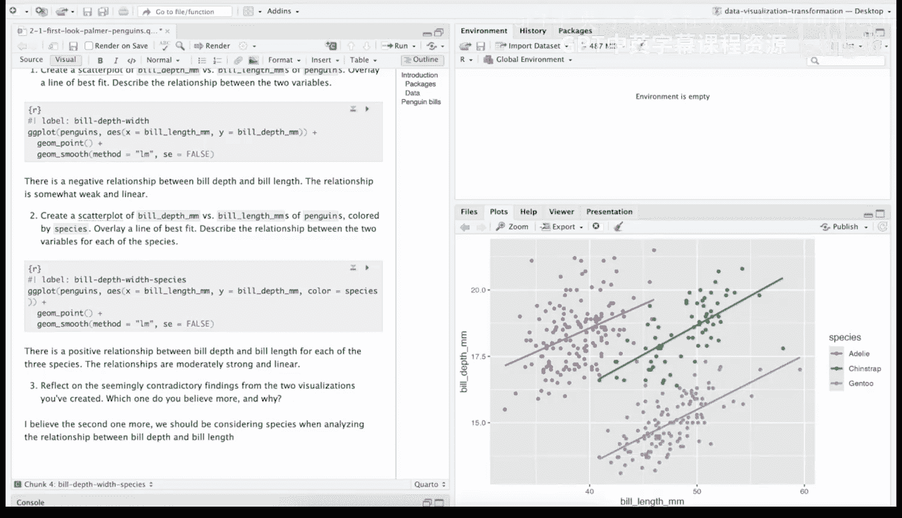

#  007：初探帕尔默企鹅数据集 🐧


在本节课中，我们将首次动手操作帕尔默企鹅数据集。我们将探索企鹅的喙部尺寸（喙的深度和长度）如何随物种变化，并思考如果不考虑物种因素会发生什么。

我们将使用两个R包：`tidyverse`包（提供强大的数据处理和可视化功能）和`palmerpenguins`包（包含我们需要的数据集）。我们将要可视化的数据集名为 `penguins`。

## 加载包与数据

首先，我们加载必要的包并查看数据。以下是加载包的代码块：

```r
library(tidyverse)
library(palmerpenguins)
```

加载`tidyverse`包时会显示一些信息，提示我们它加载了哪些核心包（如`dplyr`、`ggplot2`）以及可能存在的函数名冲突。例如，`dplyr`包中的`filter`函数会“覆盖”基础R中`stats`包的`filter`函数。这意味着之后调用`filter()`时，R会优先使用`dplyr`的版本。如果想使用特定包的函数，可以使用`包名::函数名()`的语法（如`stats::filter()`）。为了使输出更简洁，我们可以通过设置代码块选项`message = FALSE`来隐藏这些加载信息。

接下来，我们使用`glimpse()`函数快速查看`penguins`数据集的结构。


```r
glimpse(penguins)
```


输出显示，该数据集包含344只企鹅的观测记录，共有8个变量，包括物种、岛屿、喙长、喙深等信息。为代码块添加有意义的标签（如`glimpse-data`）有助于在冗长的文档中快速导航和调试。



## 可视化探索：不考虑物种



上一节我们加载了数据，本节中我们来看看如何创建可视化图表。首先，我们创建一个散点图来探索所有企鹅的喙深与喙长之间的关系，并添加一条最佳拟合线。



以下是创建该图的代码：
```r
ggplot(data = penguins, aes(x = bill_length_mm, y = bill_depth_mm)) +
  geom_point() +
  geom_smooth(method = "lm", se = FALSE)
```
*   **`ggplot(...)`**: 初始化绘图，指定数据源为`penguins`，并将`bill_length_mm`映射到x轴，`bill_depth_mm`映射到y轴。
*   **`geom_point()`**: 添加点图层，用散点表示数据。
*   **`geom_smooth(method = "lm", se = FALSE)`**: 添加平滑图层。`method = "lm"`指定使用线性模型拟合一条直线（最佳拟合线）。`se = FALSE`用于关闭表示不确定性的置信带。






生成的图表显示，喙长与喙深之间存在**微弱的负相关关系**，即随着喙的长度增加，其深度似乎略有减少。数据点围绕拟合线的散布较广。



## 可视化探索：按物种着色







上一节我们看到了一个总体的负相关趋势，但这有些反直觉。本节中我们来看看当引入物种信息后，关系是否会发生变化。现在，我们创建第二个散点图，这次根据物种对数据点进行着色，并为每个物种分别添加最佳拟合线。

以下是更新后的代码：
```r
ggplot(data = penguins, aes(x = bill_length_mm, y = bill_depth_mm, color = species)) +
  geom_point() +
  geom_smooth(method = "lm", se = FALSE)
```
*   **`aes(..., color = species)`**: 在美学映射中新增`color = species`，这意味着数据点的颜色和后续图层的颜色将根据`species`变量的不同值（阿德利企鹅、巴布亚企鹅、帽带企鹅）进行区分。

新的图表清晰地分成了三个簇，每个物种一个。关键的变化是：**在每个物种内部，喙长与喙深呈现出明确的正相关关系**，且相关性中等偏强。每个物种的数据点更紧密地围绕在各自的拟合线周围。

## 分析与总结：辛普森悖论

对比两个可视化结果，我们遇到了统计学中一个经典的现象——**辛普森悖论**。它描述的是这样一种情况：当忽略某个重要变量（此处为`species`）时，两个变量（`bill_length_mm`和`bill_depth_mm`）之间呈现出某种关系（负相关）；而一旦将这个“混杂变量”纳入考虑，群体内部的关系却完全相反（正相关）。

这并不是说第一个分析是错误的，而是它**不完整**。物种是理解企鹅喙部形态的关键因素。不同物种的企鹅，其喙的尺寸范围本就不同。当把所有数据混合在一起时，物种间的差异掩盖了物种内部真实的正相关关系。



因此，我们更应相信第二个分析的结果。在进行数据分析时，始终保持对潜在混杂变量的警觉至关重要。如果可能，咨询相关领域的专家也能帮助我们识别这些关键变量。

本节课中我们一起学习了：
1.  如何加载`tidyverse`和`palmerpenguins`包并查看数据。
2.  如何使用`ggplot2`创建散点图并添加线性拟合线。
3.  如何通过颜色美学将第三个变量（物种）引入可视化。
4.  认识了**辛普森悖论**，并理解了在数据分析中考虑潜在混杂变量的重要性。