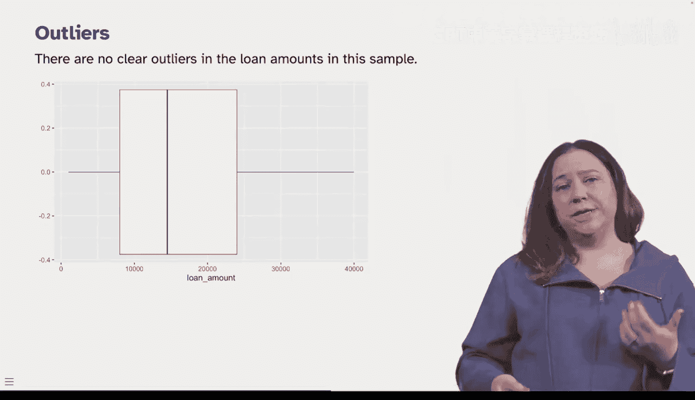
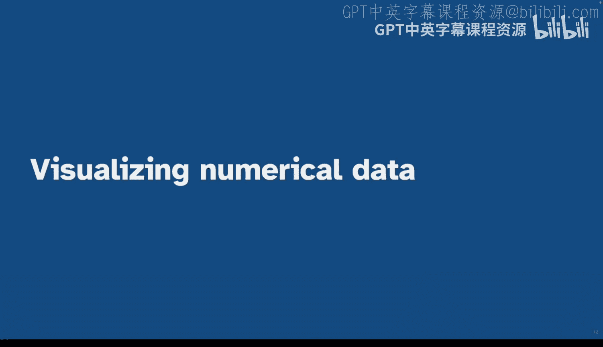
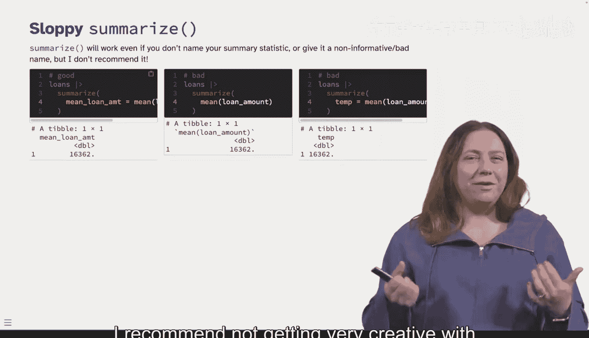

#  013：数值数据的可视化与摘要统计


## 概述
在本节课中，我们将学习如何对数值型数据进行可视化呈现和摘要统计。我们将介绍描述数据分布的关键特征，并学习使用R语言中的`ggplot2`等工具来创建直方图、密度图和箱线图，以及如何计算均值、中位数、分位数等摘要统计量。

---

## 数据分布的特征
在讨论数值变量的分布时，我们通常关注四个关键特征：形状、中心、离散程度和异常值。

*   **形状**：指分布的形态。我们关注其**模态**，即它是单峰的（有一个明显的峰）、双峰的（有两个明显的峰）还是多峰的。
*   **中心**：指分布的中心位置。对于对称分布，通常使用**均值**来描述中心；对于偏态分布，特别是严重偏态的分布，**中位数**是更好的中心度量，因为它对极端值不敏感。
*   **离散程度**：指数据的分散情况。对于对称分布，我们使用**标准差**；对于偏态分布，我们使用**四分位距**，它给出了中间50%数据的范围。
*   **异常值**：指明显偏离其他数据点的观测值。我们需要指出它们是否存在，以及位于分布的高端还是低端。最好能识别并探究这些异常值出现的原因。

上一节我们介绍了描述数据分布的理论框架，本节中我们来看看如何通过可视化来观察这些特征。

---

## 数值数据的可视化

### 直方图
直方图有助于识别分布的形状，让我们能够观察模态和偏态。创建直方图需要仔细选择**条柱宽度**。

以下是创建直方图的步骤。首先，我们使用`ggplot()`函数并指定数据框和映射到x轴的变量。

```r
ggplot(loans, aes(x = loan_amount))
```

然后，我们添加`geom_histogram()`几何对象来绘制直方图。默认情况下，`ggplot2`会使用30个条柱，但通常会建议我们手动设置更合适的`binwidth`参数。

```r
ggplot(loans, aes(x = loan_amount)) +
  geom_histogram(binwidth = 5000)
```





选择条柱宽度是一门艺术也是一门科学。宽度太小会导致图形过于“尖刺”，宽度太大则会丢失细节。需要根据数据背景和可视化目标进行尝试，直到找到一个能清晰展示分布形态的宽度。

创建直方图后，我们通常需要对其进行一些自定义以增强可读性。

```r
ggplot(loans, aes(x = loan_amount)) +
  geom_histogram(binwidth = 5000) +
  labs(
    title = "Distribution of Loan Amounts",
    x = "Loan Amount (USD)",
    y = "Count"
  ) +
  scale_x_continuous(labels = label_dollar()) +
  scale_y_continuous(labels = label_number(big.mark = ","))
```

在上面的代码中，我们使用`labs()`函数添加了标题和坐标轴标签。通过`scales`包中的`label_dollar()`和`label_number()`函数，我们可以让坐标轴标签的格式更美观（例如，为金额添加美元符号和千位分隔符）。

### 密度图
密度图是另一种可视化数值数据分布形状（模态和偏态）的方法。与直方图类似，你可以通过`adjust`参数控制曲线的平滑程度。

```r
ggplot(loans, aes(x = loan_amount)) +
  geom_density(adjust = 0.5)
```

`adjust`参数的值越小，密度曲线越紧密地跟随数据的细节（可能更“崎岖”）；值越大，曲线越平滑。同样，需要尝试不同的值，以找到在数据背景下最有意义的可视化效果。

### 箱线图
箱线图对于识别数据的特定标记点非常有用，包括最小值、最大值、第25百分位数（箱体底部）、中位数（箱体内的粗线）和第75百分位数（箱体顶部）。

此外，箱线图也有助于识别分布的偏态。**须线**较长的一侧就是分布偏斜的方向。然而，箱线图无法展示分布的模态（即“峰”的数量）。

箱线图的一个显著优点是，它能根据严格的异常值定义，清晰地显示出异常值。

```r
# 绘制贷款金额的箱线图
ggplot(loans, aes(y = loan_amount)) +
  geom_boxplot()

# 绘制利率的箱线图，可以看到高端有一些异常值点
ggplot(loans, aes(y = interest_rate)) +
  geom_boxplot()
```

要可视化不同的变量，只需更改美学映射中的变量名即可。

我们也可以像自定义直方图一样自定义箱线图。

```r
ggplot(loans, aes(y = interest_rate)) +
  geom_boxplot() +
  labs(
    title = "Distribution of Interest Rates",
    x = "" # 箱线图的x轴标签通常无信息，可留空
  ) +
  theme(
    axis.text.y = element_blank(), # 移除y轴刻度文本
    axis.ticks.y = element_blank() # 移除y轴刻度线
  )
```

在箱线图中，y轴的刻度位置和范围并不传达关于数据分布的具体信息（箱体宽度和位置才是关键），因此有时可以将其隐藏以使图形更简洁。

我们已经探讨了如何可视化数值数据，现在让我们学习如何用数字来概括它。

---

## 数值数据的摘要统计

### 使用`summarize`函数
`summarize`函数用于计算数据中所有观测值的摘要统计量。

以下代码计算数据集中贷款金额的均值。

```r
loans %>%
  summarize(mean_loan_amount = mean(loan_amount))
```

你可以使用`summarize`函数一次性计算多个摘要统计量。

```r
loans %>%
  summarize(
    q25 = quantile(loan_amount, 0.25), # 第25百分位数
    q75 = quantile(loan_amount, 0.75)  # 第75百分位数
  )
```

这段代码计算了第25和第75百分位数，它们定义了箱线图中箱体的上下边界，也就是中间50%数据的范围。

### 为统计量命名的最佳实践
虽然`summarize`函数在不命名或使用非信息性名称时也能工作，但不推荐这样做。

**不推荐的写法：**
```r
# 名称无意义
loans %>% summarize(temp = mean(loan_amount))
# 不命名，列标题会成为复杂的表达式
loans %>% summarize(mean(loan_amount))
```

**推荐的写法：**
```r
loans %>% summarize(mean_loan_amt = mean(loan_amount))
```

为摘要统计量起一个简短且具有描述性的名称是很好的实践。这能让你在日后回顾代码时，立即明白每个数字代表什么，从而提高代码的可读性和可维护性。

---



## 总结
本节课中，我们一起学习了数值数据的可视化与摘要统计。我们首先了解了描述数据分布的四个关键特征：形状、中心、离散程度和异常值。接着，我们实践了如何使用直方图、密度图和箱线图来可视化这些特征，并学习了如何通过`ggplot2`和`scales`包来创建和美化这些图形。最后，我们掌握了使用`summarize`函数计算均值、分位数等摘要统计量的方法，并强调了为统计结果起一个清晰名称的重要性。掌握这些技能是进行数据探索和分析的基础。