#  015：深入探索帕尔默企鹅数据集 🐧


在本节课中，我们将深入探索帕尔默企鹅数据集。我们将学习如何使用R语言和`tidyverse`包进行数据整理与可视化，并引入`ggbeeswarm`扩展包来绘制新的图形。我们将通过回答诸如“企鹅体型在不同物种、岛屿和性别间有何差异？”等问题，来实践单变量、双变量及多变量分析。

## 概述

我们之前接触过帕尔默企鹅数据集，但仅停留在表面。本次代码实践将深入探索`penguins`数据框，分析企鹅体型（如体重）如何随物种、岛屿和性别变化，以及其他特征。我们将使用`tidyverse`包进行数据处理和可视化，并引入`ggbeeswarm`包作为`ggplot2`扩展包的例子，它提供了一个`ggplot2`本身未包含的新几何对象（geom）。

首先，让我们加载所需的包和数据。

```r
# 加载必要的包
library(tidyverse)
library(ggbeeswarm)
library(palmerpenguins)

# 查看数据框结构
glimpse(penguins)
```

数据框包含344只企鹅的观测记录，共有8列变量信息。

## 单变量分析：企鹅体重

单变量分析指对单个变量进行分析。我们首先可视化企鹅体重的分布。请注意，体重记录单位为克（grams）。

### 绘制直方图

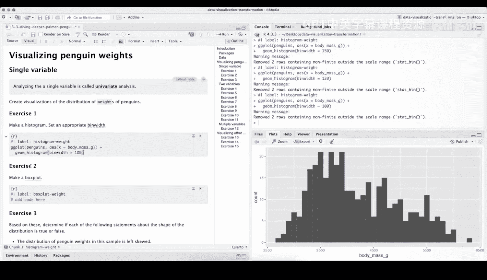

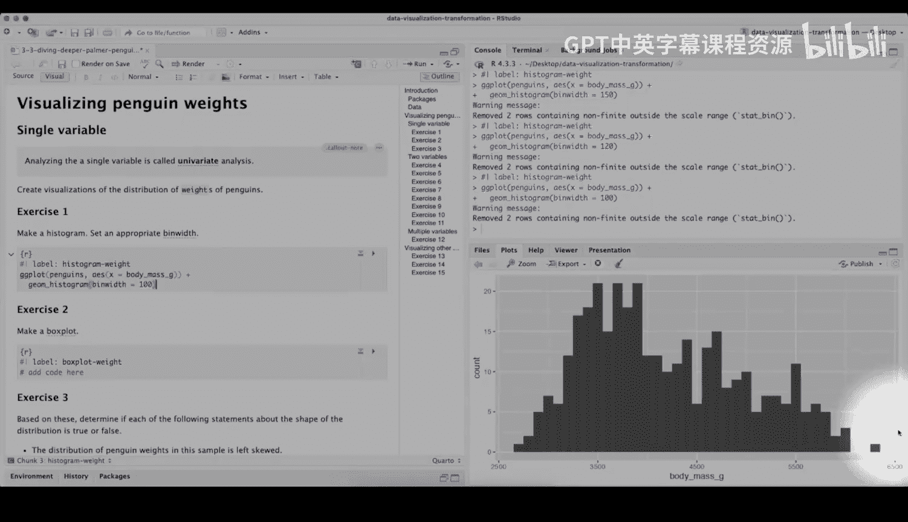

我们使用`ggplot2`绘制体重的直方图。

```r
# 绘制体重直方图
ggplot(data = penguins, aes(x = body_mass_g)) +
  geom_histogram()
```

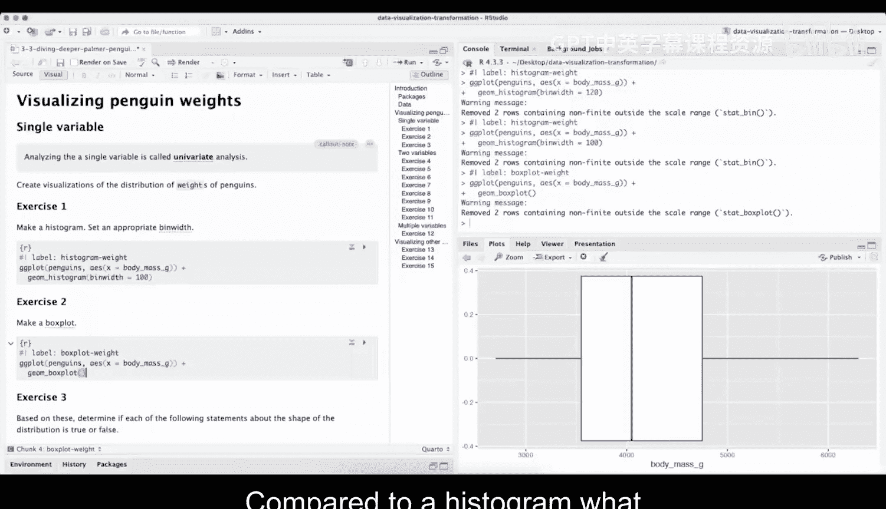

运行代码后，我们会得到一个直方图，并看到两条警告信息。一条提示移除了2行包含缺失值（NA）的数据；另一条提示默认使用了`bins = 30`来划分数据区间，并建议我们手动选择更合适的区间宽度（带宽）。

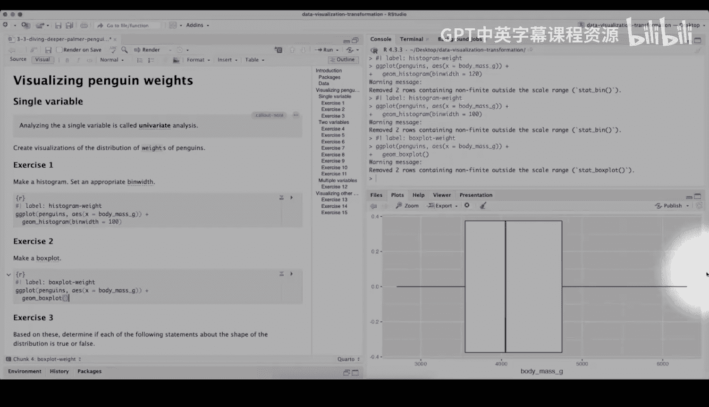

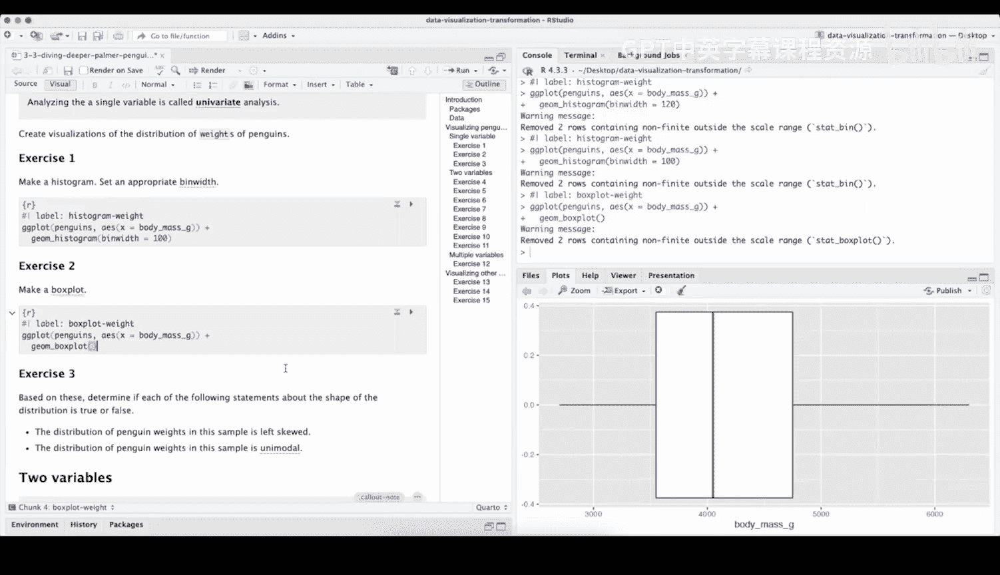

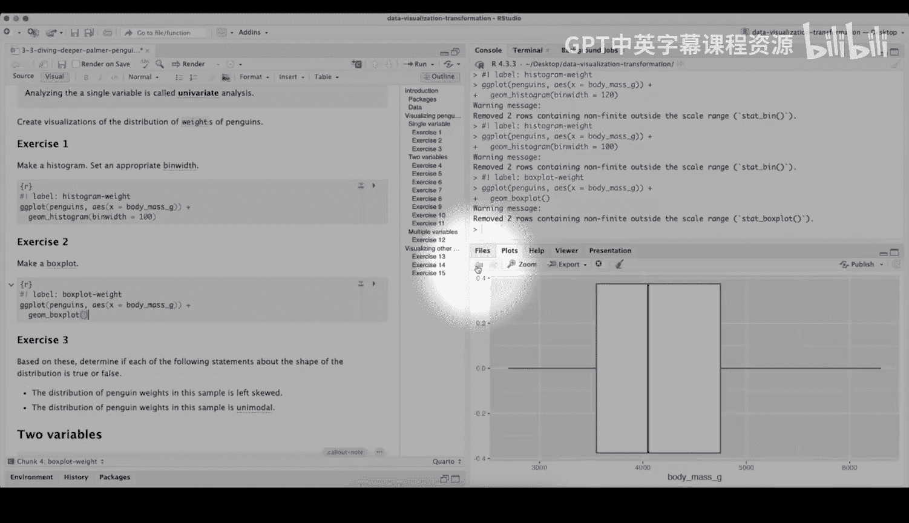

选择带宽是科学与艺术的结合。我们可以尝试不同的值，例如1000、10、100或150，观察图形变化，并选择在数据背景下有意义的、易于解释的整数值（如100）。

```r
# 尝试不同带宽的直方图
ggplot(data = penguins, aes(x = body_mass_g)) +
  geom_histogram(binwidth = 100)
```

从直方图可以看出，体重分布呈右偏态，典型体重约在3500克左右，右侧（较高体重）的尾部比左侧更长。

### 绘制箱线图

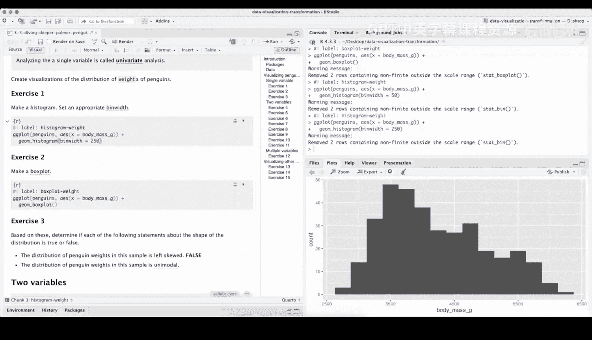

接下来，我们绘制同一变量（体重）的箱线图。

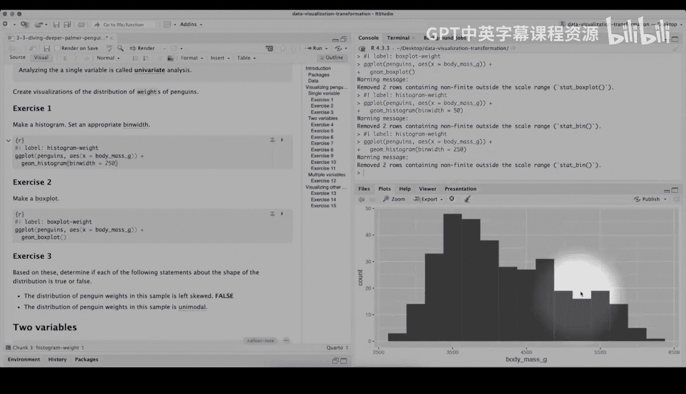

```r
# 绘制体重箱线图
ggplot(data = penguins, aes(x = body_mass_g)) +
  geom_boxplot()
```

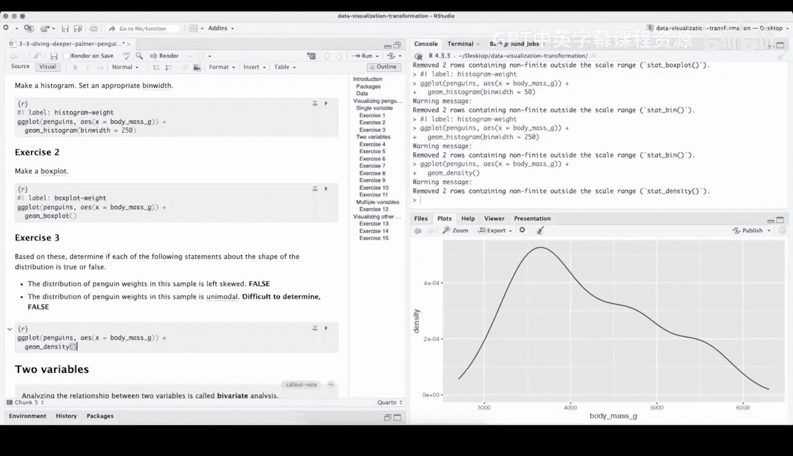

箱线图能更清晰地显示中位数（约4000克）、四分位距（箱体的宽度）以及数据的范围。图中未显示异常值。

### 判断分布形态

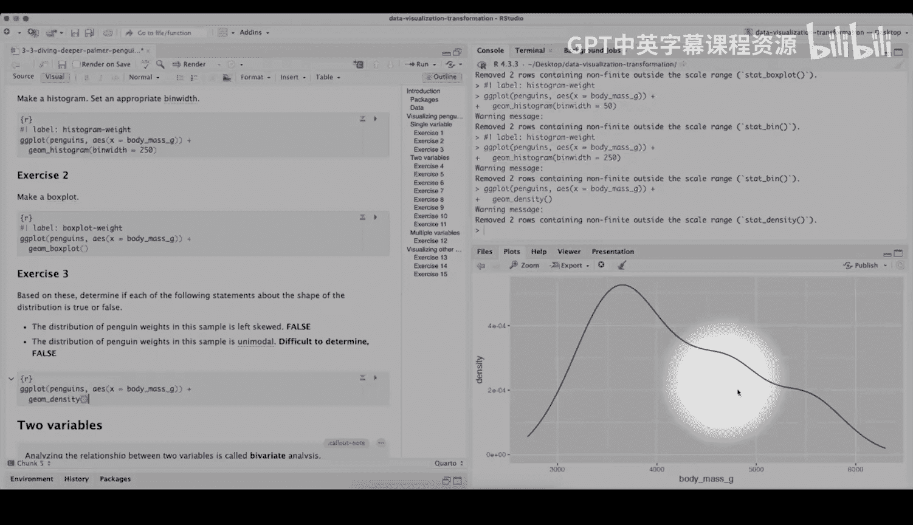

基于直方图和箱线图，判断以下关于分布形态的陈述是否正确：

1.  **样本中企鹅体重的分布是左偏的。**  
    **答案：错误。** 从直方图可见，分布有一个更长的右侧尾部，属于右偏分布。

2.  **样本中企鹅体重的分布是单峰的。**  
    **答案：难以确定。** 仅从直方图判断峰态（modality）较为困难。调整带宽后，图形可能显示一个主峰（约3500克）和另一个潜在的小峰。为了进一步探究，我们可以尝试密度图。

```r
# 绘制体重密度图
ggplot(data = penguins, aes(x = body_mass_g)) +
  geom_density()
```

密度图可能显示存在不止一个峰值，这提示我们可能需要引入另一个变量进行深入分析。

## 双变量分析：体重与物种

双变量分析探索两个变量之间的关系。现在我们分析体重如何随物种变化。

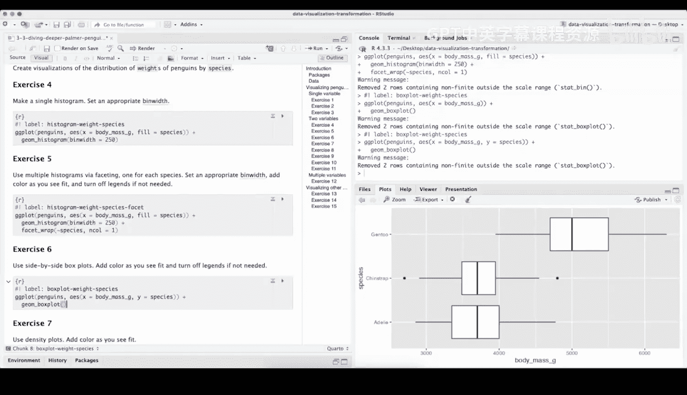

### 分面直方图

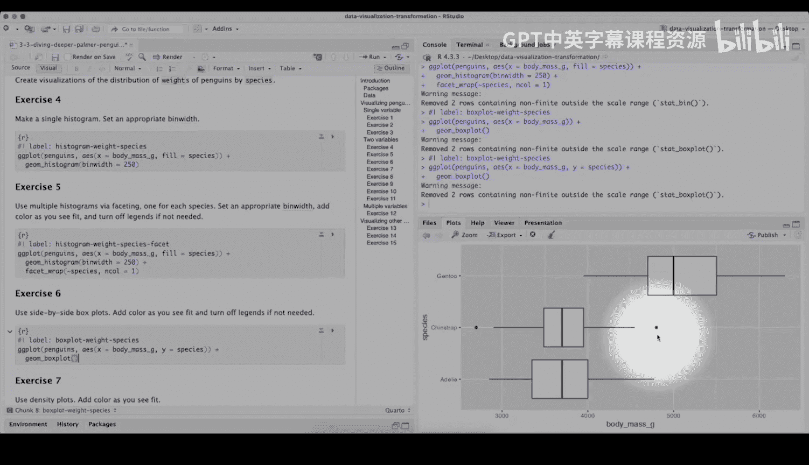

首先，我们创建一个包含物种信息的直方图，并使用`fill`美学映射为不同物种着色。

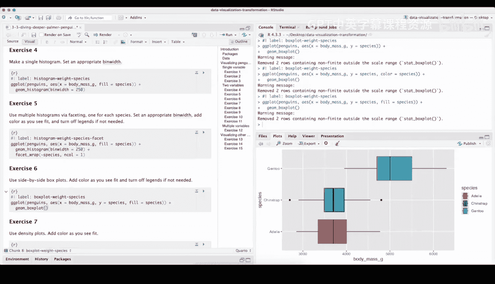

```r
# 按物种填充颜色的直方图
ggplot(data = penguins, aes(x = body_mass_g, fill = species)) +
  geom_histogram(binwidth = 100)
```

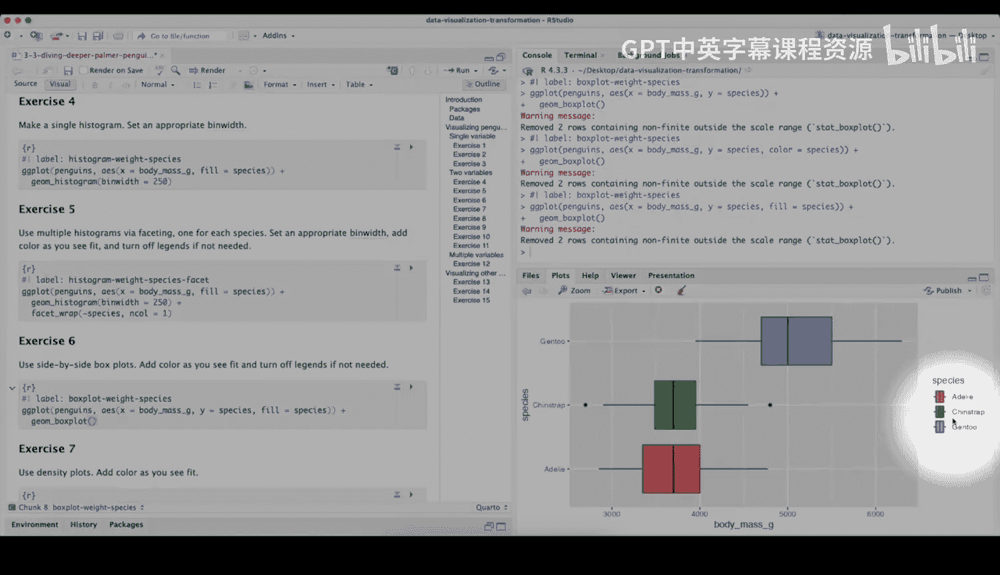

由于条形重叠，难以看清。我们可以使用`facet_wrap`将不同物种的直方图分开显示，并排成一列以便比较。

```r
# 按物种分面的直方图
ggplot(data = penguins, aes(x = body_mass_g)) +
  geom_histogram(binwidth = 100) +
  facet_wrap(~ species, ncol = 1)
```

从图中可以看出，阿德利企鹅（Adelie）和帽带企鹅（Chinstrap）的体重峰值接近，而金图企鹅（Gentoo）的峰值明显更高，平均体型更大。这或许解释了之前单变量密度图中看到的潜在多峰现象。

### 并排箱线图

另一种可视化数值变量（体重）与分类变量（物种）关系的方法是并排箱线图。

```r
# 按物种分组的箱线图
ggplot(data = penguins, aes(x = body_mass_g, y = species)) +
  geom_boxplot()
```

箱线图清晰地显示了金图企鹅的中位数体重远高于其他两种。我们还可以添加颜色并移除冗余的图例。

```r
# 添加颜色并隐藏图例的箱线图
ggplot(data = penguins, aes(x = body_mass_g, y = species, color = species)) +
  geom_boxplot(show.legend = FALSE)
```

### 密度曲线图

我们可以绘制按物种填充的密度曲线图。为了避免曲线相互遮挡，可以设置透明度（alpha）。

```r
# 按物种着色的密度曲线图（带透明度）
ggplot(data = penguins, aes(x = body_mass_g, fill = species)) +
  geom_density(alpha = 0.5)
```

### 小提琴图

小提琴图是另一种展示数值与分类变量关系的图形，它结合了箱线图和密度图的信息。

```r
# 小提琴图
ggplot(data = penguins, aes(x = body_mass_g, y = species)) +
  geom_violin()
```

我们可以进一步添加颜色和填充，并调整透明度。

```r
# 添加美学映射的小提琴图
ggplot(data = penguins, aes(x = body_mass_g, y = species)) +
  geom_violin(aes(color = species, fill = species), alpha = 0.5, show.legend = FALSE)
```

### 抖动散点图与蜂群图

当数据点大量重叠时，可以使用抖动散点图或蜂群图。

**抖动散点图**：通过添加随机噪声来避免点重叠。为了确保结果可重现，可以设置随机种子。

```r
# 设置随机种子以保证可重现性
set.seed(123)

# 抖动散点图
ggplot(data = penguins, aes(x = species, y = body_mass_g)) +
  geom_jitter(width = 0.2, alpha = 0.5)
```

**蜂群图**：使用`ggbeeswarm`包的`geom_beeswarm`，它能在高密度区域更智能地排列点，形似蜂群。

```r
# 蜂群图
ggplot(data = penguins, aes(x = species, y = body_mass_g)) +
  geom_beeswarm(aes(color = species), show.legend = FALSE)
```

## 多图层与多变量分析

我们可以在一个图形上叠加多个几何对象（geoms）。需要注意图层的绘制顺序。

### 组合多个几何对象

例如，我们可以将小提琴图、蜂群图和箱线图组合在一起。为了避免全局美学映射干扰，我们将其定义在各自的几何对象层中。

```r
# 组合小提琴图、蜂群图和箱线图
ggplot(data = penguins, aes(x = body_mass_g, y = species)) +
  geom_violin(aes(color = species, fill = species), alpha = 0.2, show.legend = FALSE) +
  geom_boxplot(width = 0.1, show.legend = FALSE) +
  geom_beeswarm(aes(color = species), size = 0.8, show.legend = FALSE)
```

在迭代构建图形时，应定期检查并清理那些不再需要或无效的代码。

### 按岛屿分面

现在，我们引入第三个变量：岛屿。将上一节创建的图形按岛屿进行分面。

```r
# 按岛屿分面，并添加标签
ggplot(data = penguins, aes(x = body_mass_g, y = species)) +
  geom_violin(aes(color = species, fill = species), alpha = 0.2, show.legend = FALSE) +
  geom_beeswarm(aes(color = species), size = 0.8, show.legend = FALSE) +
  facet_wrap(~ island, ncol = 1) +
  labs(
    x = "体重 (克)",
    y = "物种",
    title = "不同物种和岛屿上企鹅的体重分布"
  )
```

分面图显示，不同岛屿上的物种组成不同（例如，Bisco岛有金图企鹅和阿德利企鹅，而Dream岛有帽带企鹅和阿德利企鹅）。

## 图形输出与代码块选项

渲染文档时，我们可能希望控制图形大小并隐藏重复的警告信息。

*   **全局设置**：在文档顶部的代码块选项中设置，可应用于所有图形。
    ```r
    # 在文档开头的代码块选项中设置
    knitr::opts_chunk$set(
      warning = FALSE,      # 隐藏警告
      fig.width = 6,        # 图形宽度
      fig.asp = 0.618       # 图形宽高比（黄金比例）
    )
    ```
*   **局部设置**：在单个代码块中设置，仅对该图形生效。
    ```r
    # 在特定代码块中设置
    # {r, fig.asp=0.3}
    ggplot(...) + ...
    ```

## 总结

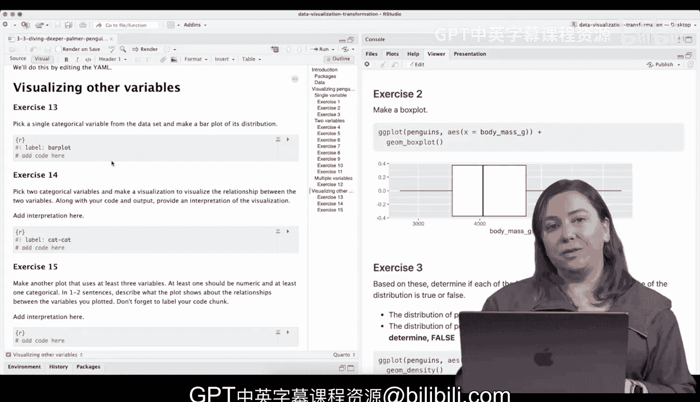

本节课中，我们一起深入探索了帕尔默企鹅数据集。我们从单变量分析（体重分布）开始，学习了直方图、箱线图和密度图的绘制与解读。接着，我们进行了双变量分析，探索了体重与物种的关系，并实践了分面直方图、并排箱线图、小提琴图、抖动散点图和蜂群图等多种可视化方法。最后，我们引入了第三个变量（岛屿），通过分面和组合多个几何对象进行了多变量分析，并学习了如何控制图形输出与处理警告信息。这些技能将帮助你更有效地探索和呈现数据中的模式与关系。