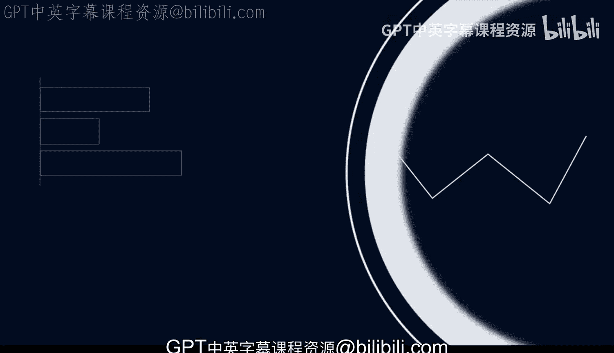
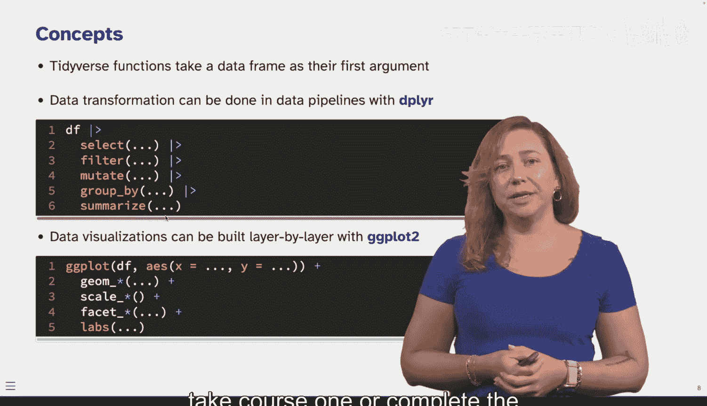
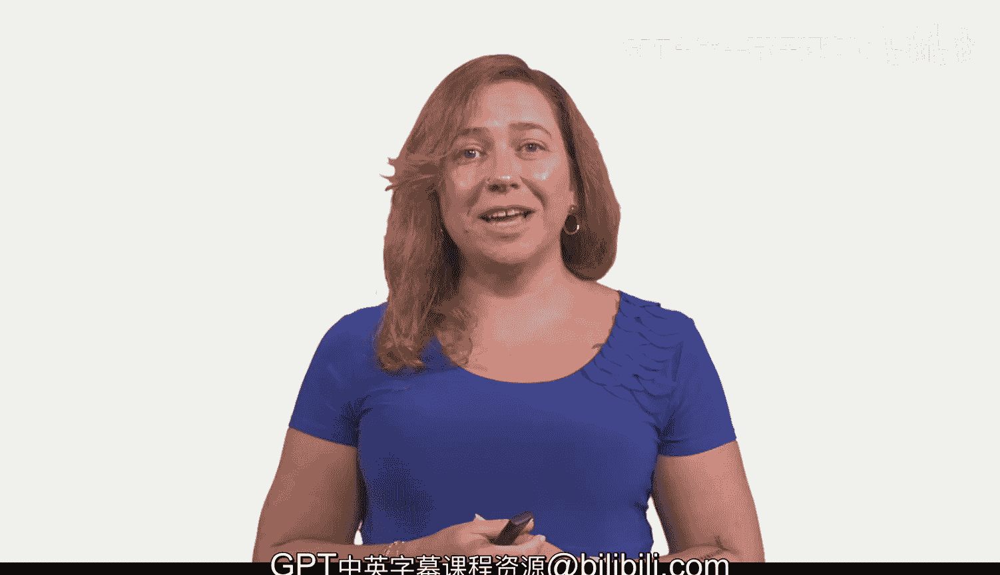

**R语言数据科学：课程2：数据整理与导入**

**概述**

在本课程中，我们将继续探索数据科学流程，重点学习数据整理、数据导入以及从网络获取数据的方法。这是系列课程的第二门，旨在帮助你将原始数据转化为可用于分析的整洁格式。

上一节我们介绍了数据科学循环的整体框架。本节中，我们来看看本课程的具体学习目标。

**课程内容**

本课程将延续对数据转换的探索，正式介绍**数据整理**。数据整理通常涉及重塑和连接数据。随后，我们将进一步回溯，学习如何导入数据集，并讨论将数据导入R时需考虑的诸多因素和挑战。

我们将从处理矩形数据（如CSV文件和Excel电子表格）开始，然后进一步学习如何通过**网络爬虫**从网络上获取非结构化数据。

**预备知识**

既然这是系列课程的第二门，你需要具备哪些预备知识呢？即使你已经完成了第一门课程“数据可视化与转换”，也建议你回顾以下内容。

以下是进入本课程前应掌握的基本工具和概念：

*   **R与RStudio**：对R语言和RStudio集成开发环境有基本了解。
*   **Quarto**：具备使用Quarto编写简单可重复文档的经验。
*   **Tidyverse工具**：拥有使用Tidyverse工具（主要是`ggplot2`和`dplyr`）进行数据可视化和转换的经验。

Tidyverse功能强大，可应对众多数据科学任务，其中许多超出了本课程范围。目前，只要你了解以下几点，就应该可以顺利学习：

*   大多数Tidyverse函数将**数据框**作为其第一个参数。
*   可以使用`dplyr`在**数据管道**中进行数据转换。
*   可以使用`ggplot2`**逐层构建**数据可视化。

如果你需要对这些内容进行入门学习或复习，建议先完成第一门课程或阅读推荐材料。

**总结**

本节课我们一起学习了本课程“数据整理与导入”的概述、核心内容以及所需的预备知识。如果你已准备就绪，让我们开始深入学习吧。