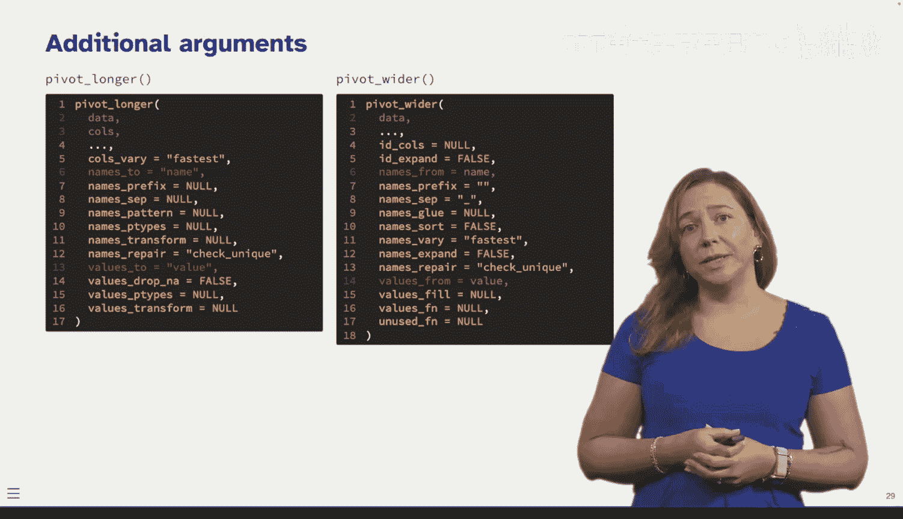

R语言数据科学：03_01_02：数据整理

在本节课中，我们将要学习数据整理的核心概念，特别是如何通过“数据透视”来重塑数据，使其从“宽”格式转换为“长”格式，或反之。我们将使用 `tidyverse` 包中的工具来完成这些操作。

我们首先定义了什么是整洁的数据。接下来，让我们谈谈如何整理数据。

这并不意味着原始数据本身是混乱的。它只是意味着数据以不适合我们想要进行的分析的方式组织。通常，为此目的整理数据涉及重塑其结构，这正是我们将在本视频中介绍的内容。

我们拥有的数据以不适合分析的方式组织。我们希望重新组织数据以继续进行分析。当然，我们将使用 `tidyverse` 中值得信赖的工具来完成这项工作。

我们拥有的数据是关于杂货销售的。每一行代表一个顾客。数据中有两位顾客。每一列是他们购买的商品。顾客1购买了三种商品：面包、牛奶和香蕉。顾客2购买了两件商品：牛奶和厕纸。在这种格式下，回答诸如“有多少顾客购买了牛奶？”或“最受欢迎的商品是什么？”等问题会非常麻烦。

相反，我们希望将数据转换为“每位顾客每件商品一行”的格式。

为此，我们将使用 `tidyverse` 工具包中的一个新工具：`tidyr` 包。这个包的目标是通过“数据透视”在宽数据与长数据之间转换，从而帮助您整理数据。我们稍后将更详细地讨论宽数据和长数据的含义。该包还涉及拆分和合并字符列、嵌套与非嵌套列，以及阐明在进行这些操作时应如何处理 `NA` 值。

让我们谈谈将数据从宽格式透视到长格式，或从长格式透视到宽格式。那么，我所说的“透视”是什么意思呢？不是这个（指舞蹈动作）。看过《老友记》的朋友可能会理解这个梗。而是指重组数据的行和列，使相同的信息被记录在多行或多列中。

在宽格式中，我们拥有的原始数据里，每位顾客购买的商品被组织在多列中。数据框更“宽”，因为它有更多的列。在我们希望看到的格式中，购买的商品被组织在多行中。数据框更“长”，因为它有更多的行。

首先，让我们谈谈如何从宽数据变成长数据。要从宽数据变成长数据，我们将使用一个恰如其名的函数：`pivot_longer`。该函数的第一个参数是数据，这与大多数 `tidyverse` 函数一样。然后，我们指定要透视哪些列。在下一个参数中，我们指定一个列名，用于存放被透视变量的原始列名。让我们暂停一下，这有点拗口。请记住，在原始数据中，我们有像 `item1`、`item2`、`item3` 这样的列名。这个参数指定了如何组织它们，即给它们将要进入的列起什么名字。

请注意，这是一个字符串。它不是我们数据中已经存在的变量，因此我们将要创建的变量名称作为字符串提供。

在第四个也是最后一个参数中，我们命名一个列，用于存放被透视变量中的数据值。同样，由于变量尚未创建，我们以字符串形式提供要创建的变量名称。

综上所述，我们想要透视名为 `item1` 到 `item3` 的列（冒号运算符表示“到”或“通过”，是列出这些变量之间每个变量名的快捷方式）。原始数据中的列名（`item1`、`item2` 和 `item3`）将被组织到一个名为 `item_no` 的新列中。而商品本身，即原始数据单元格中的值，将被组织到一个名为 `item` 的列中。

结果是一个 6 行 3 列的数据框。但是请注意，最后一行有一个 `NA`，因为顾客2只购买了两件商品。当数据是这种格式时，为不存在的 `item3` 保留一行似乎很傻。所以让我们处理那个 `NA`。我们可以在 `pivot_longer` 函数中添加另一个参数：`values_drop_na`，以指定如何处理这一行。这里我们将其设置为 `TRUE`，意味着我们希望删除在 `values_to` 列中只包含 `NA` 的行。

那么结果就是一个 5 行 3 列的数据框：顾客1的三件商品，顾客2的两件商品。

将所有内容整合在一起，并将得到的长数据框命名为 `purchases`，我们得到一个数据框，其中每一行对应一个顾客-商品组合。这个数据框的行数更多（5行对比2行），列数更少（3列对比4列），因此比我们开始的宽数据框更长。

请注意，我们并没有制定关于什么是宽或长数据框的硬性规定。因此，我们说“更宽”或“更长”是相对于我们原始的起点而言的。

那么，为什么要进行数据透视呢？很可能是因为你分析的下一步需要它。例如，假设我们有一个单独的商品价格数据框。我们可以将这两个数据框连接到我们的 `purchases` 数据。我们很快就会讲到连接，但你可以将其理解为将价格信息引入我们的 `purchases` 数据框中。

既然你已经了解了如何透视为长数据，让我们考虑从长数据透视回宽数据的场景。我们将从创建的 `purchases` 数据开始，将其透视回宽格式，即每位顾客一行，商品组织在各列中的原始格式。

为此，我们使用 `pivot_wider` 函数，其中第一个参数照例是数据。第二个参数是 `names_from`，它告诉我们长格式中的哪一列（或哪些列）包含的内容应成为宽格式中的列名。第三个也是最后一个参数是 `values_from`，它告诉我们长格式中的哪一列（或哪些列）包含的内容应成为宽格式中新列的值。

在本视频中，我们介绍了从宽到长和从长到宽的数据透视。我们还定义了 `pivot_longer` 和 `pivot_wider` 函数的基本参数。我们甚至提到了一个可选参数，它告诉我们如何处理 `NA` 值。这两个函数都有大量的参数，其中一些我们会在课程中介绍，另一些在你继续使用这些函数时可能会发现很有用。和往常一样，阅读函数文档是熟悉这些附加参数的最佳方式。

本节课中我们一起学习了数据整理的核心操作——数据透视。我们掌握了如何使用 `pivot_longer` 将宽格式数据转换为更易于分析的长格式，以及如何使用 `pivot_wider` 将长格式数据转换回宽格式。理解并应用这些函数是进行有效数据清洗和准备的关键步骤。