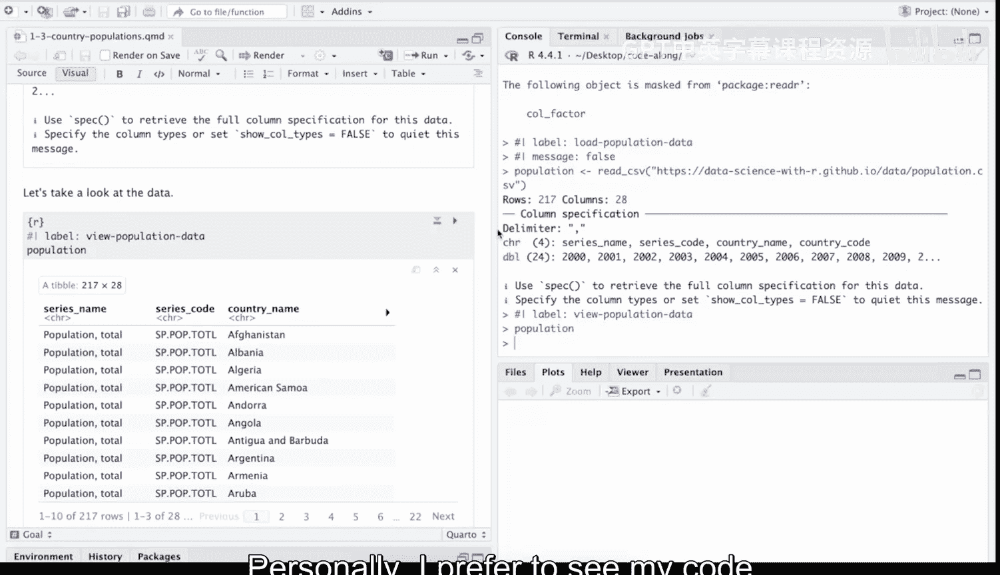
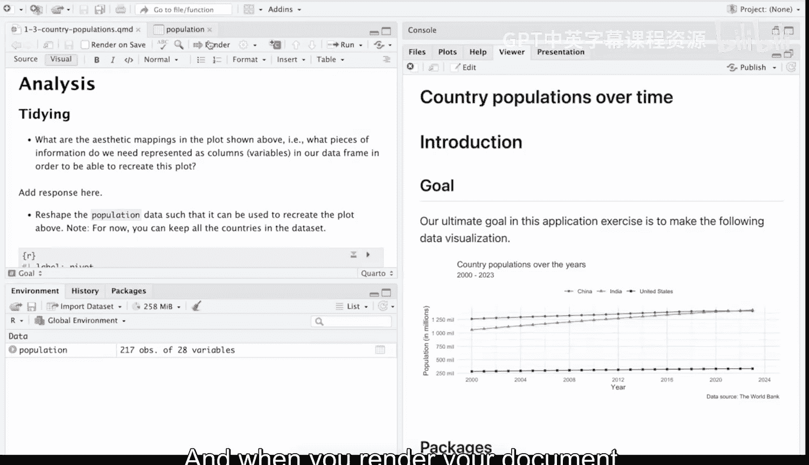
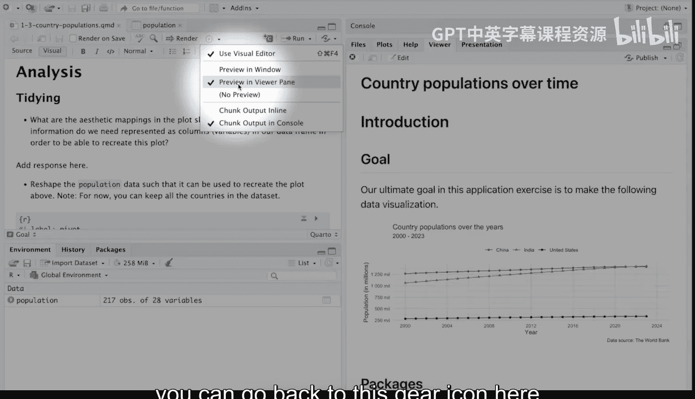
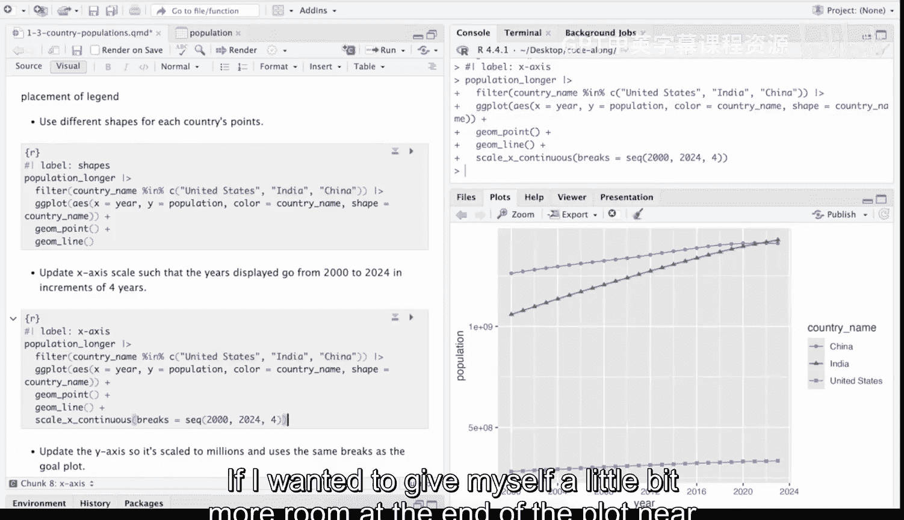
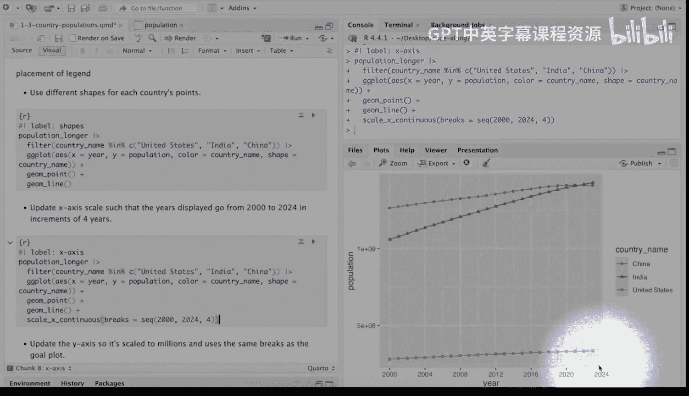
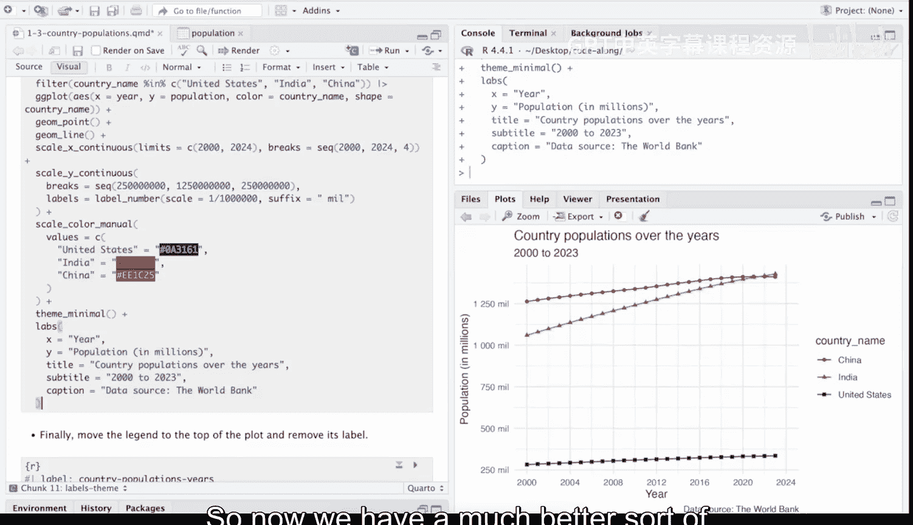
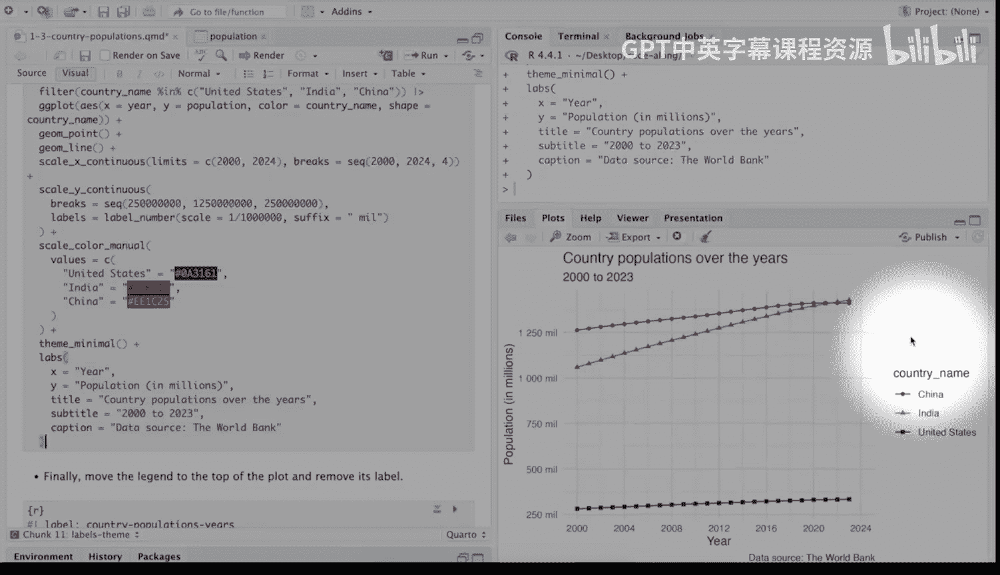
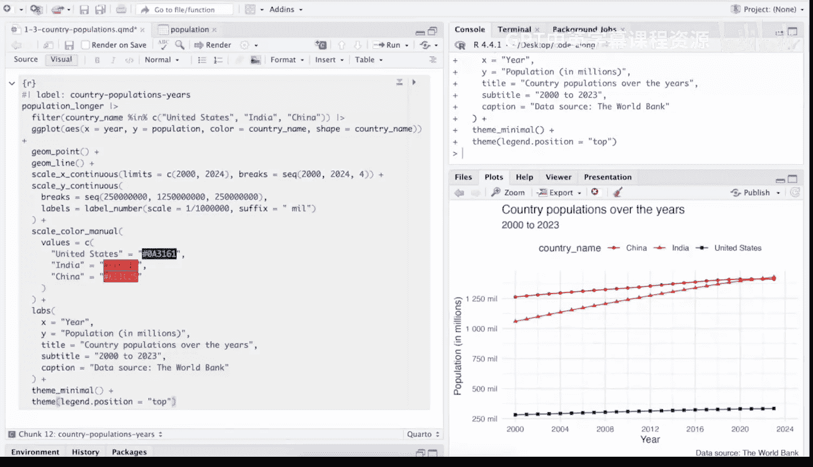
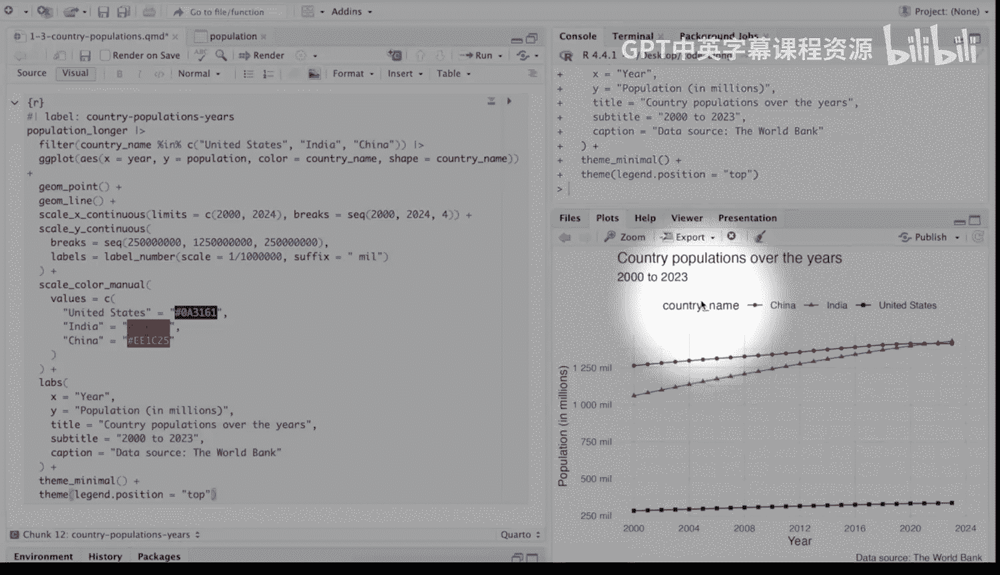
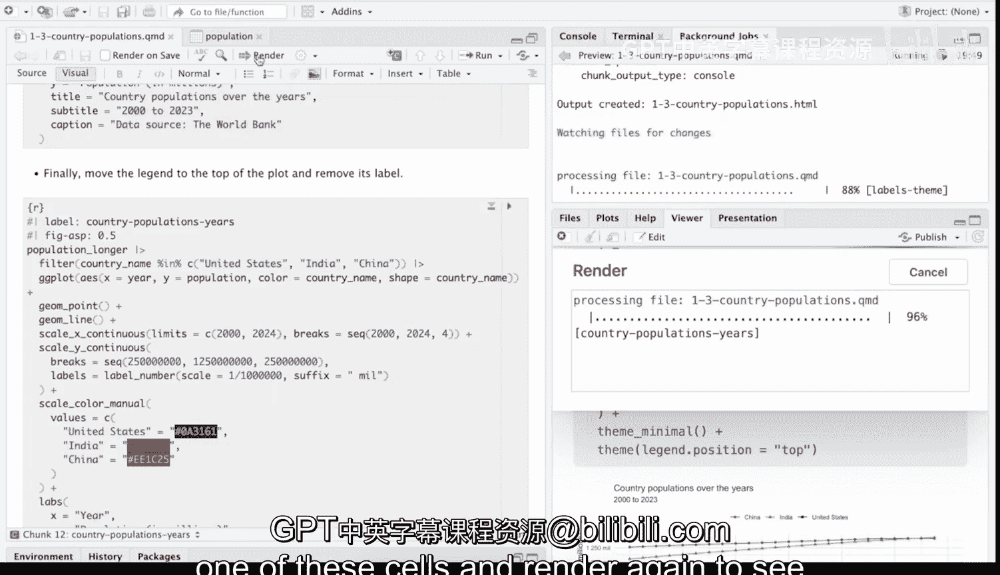

#  020：随时间变化的国家人口 📈


在本节课中，我们将学习如何使用R语言和`ggplot2`包，重现一个展示美国、印度和中国从2000年到2023年人口变化的折线图。我们将从读取世界银行的数据开始，逐步完成数据整理、可视化以及图表美化的全过程。

## 加载必要的包

首先，我们需要加载用于数据处理和可视化的核心包。`tidyverse`包集成了多个数据处理和图形工具，而`scales`包则用于优化图表标签的显示格式。

```r
library(tidyverse)
library(scales)
```

## 读取数据

我们的数据来源于世界银行，包含了2000年至2023年各国的人口估计值。数据以宽格式存储，即每个年份的人口数据是一个单独的列。

```r
population <- read_csv("https://central_repository_url/population_data.csv")
```

查看数据的前几行，我们可以看到数据结构：包含国家名称、国家代码以及从`2000`到`2023`的多个列。




```r
head(population)
```

## 理解目标图表

我们的目标是重现一个折线图。该图表的X轴是年份，Y轴是人口（以百万计），并且用不同的颜色和形状区分美国、印度和中国这三个国家。





这意味着，为了使用`ggplot2`绘图，我们的数据框需要包含三个核心变量：`year`（年份）、`population`（人口）和`country_name`（国家名称）。

## 数据重塑：从宽格式到长格式

目前，我们的数据是宽格式的。为了绘图，我们需要将其转换为长格式，即所有年份的人口数据合并到一个`population`列中，并创建一个`year`列来标识年份。这个操作称为“数据透视”或“变长”。

```r
population_longer <- population %>%
  pivot_longer(
    cols = `2000`:`2023`,        # 指定要转换的列
    names_to = "year",           # 将列名（年份）存入新列“year”
    values_to = "population",    # 将列值（人口）存入新列“population”
    names_transform = as.numeric # 将“year”列从字符型转换为数值型
  )
```

转换后，数据框变得“更长”，每一行代表一个国家在特定年份的人口数据。

## 筛选目标国家

我们只关注美国、印度和中国这三个国家。使用`filter`函数从长格式数据中筛选出这些国家的数据。

```r
countries_of_interest <- c("United States", "India", "China")
population_filtered <- population_longer %>%
  filter(country_name %in% countries_of_interest)
```

## 创建基础图表

现在，我们可以开始绘制基础图表。使用`ggplot()`函数，将筛选后的数据映射到X轴（`year`）、Y轴（`population`）和颜色（`country_name`）上，并添加点和线。

```r
population_filtered %>%
  ggplot(aes(x = year, y = population, color = country_name)) +
  geom_point() +
  geom_line()
```

## 优化图表细节

基础图表已经成型，但我们需要进行一系列优化，使其更接近目标图表。以下是需要调整的方面：

*   **X轴和Y轴刻度**：调整刻度的范围和标签。
*   **形状映射**：除了颜色，也用形状区分国家。
*   **颜色设置**：手动指定与国家国旗相关的颜色。
*   **标签和标题**：添加清晰的轴标签、标题和说明。
*   **主题和布局**：使用简洁的主题，并调整图例位置。

我们将逐步添加这些优化层。

### 1. 添加形状映射并调整X轴

在`aes()`映射中添加`shape = country_name`，并使用`scale_x_continuous`设置X轴刻度从2000年到2024年，每4年一个刻度。

```r
population_filtered %>%
  ggplot(aes(x = year, y = population, color = country_name, shape = country_name)) +
  geom_point() +
  geom_line() +
  scale_x_continuous(breaks = seq(2000, 2024, by = 4), limits = c(2000, 2024))
```

### 2. 调整Y轴刻度与标签

使用`scale_y_continuous`设置Y轴刻度，并使用`scales::label_number`函数将人口数值除以一百万，并添加“M”（代表百万）后缀，使标签更易读。

```r
population_filtered %>%
  ggplot(aes(x = year, y = population, color = country_name, shape = country_name)) +
  geom_point() +
  geom_line() +
  scale_x_continuous(breaks = seq(2000, 2024, by = 4), limits = c(2000, 2024)) +
  scale_y_continuous(
    breaks = seq(250000000, 1500000000, by = 250000000),
    labels = label_number(scale = 1e-6, suffix = "M")
  )
```





### 3. 手动设置颜色

创建一个命名向量，为每个国家指定颜色，并通过`scale_color_manual`应用这些颜色。

```r
country_colors <- c("United States" = "#3C3B6E", "India" = "#FF9933", "China" = "#DE2910")

population_filtered %>%
  ggplot(aes(x = year, y = population, color = country_name, shape = country_name)) +
  geom_point() +
  geom_line() +
  scale_x_continuous(breaks = seq(2000, 2024, by = 4), limits = c(2000, 2024)) +
  scale_y_continuous(
    breaks = seq(250000000, 1500000000, by = 250000000),
    labels = label_number(scale = 1e-6, suffix = "M")
  ) +
  scale_color_manual(values = country_colors)
```

### 4. 应用主题并添加标签

使用`theme_minimal()`应用简洁主题，并通过`labs()`函数添加图表标题、副标题、坐标轴标签和数据来源说明。

```r
population_filtered %>%
  ggplot(aes(x = year, y = population, color = country_name, shape = country_name)) +
  geom_point() +
  geom_line() +
  scale_x_continuous(breaks = seq(2000, 2024, by = 4), limits = c(2000, 2024)) +
  scale_y_continuous(
    breaks = seq(250000000, 1500000000, by = 250000000),
    labels = label_number(scale = 1e-6, suffix = "M")
  ) +
  scale_color_manual(values = country_colors) +
  theme_minimal() +
  labs(
    title = "Country Populations Over the Years",
    subtitle = "2000 to 2023",
    x = "Year",
    y = "Population (in millions)",
    caption = "Data Source: World Bank"
  )
```

### 5. 最终调整：图例位置与标题

最后，将图例移动到图表顶部，并通过在`scale_color_manual`和`scale_shape_manual`中设置`name = NULL`来移除图例标题。





```r
final_plot <- population_filtered %>%
  ggplot(aes(x = year, y = population, color = country_name, shape = country_name)) +
  geom_point() +
  geom_line() +
  scale_x_continuous(breaks = seq(2000, 2024, by = 4), limits = c(2000, 2024)) +
  scale_y_continuous(
    breaks = seq(250000000, 1500000000, by = 250000000),
    labels = label_number(scale = 1e-6, suffix = "M")
  ) +
  scale_color_manual(values = country_colors, name = NULL) +
  scale_shape_manual(values = c(16, 17, 15), name = NULL) + # 16=圆点，17=三角，15=方点
  theme_minimal() +
  theme(legend.position = "top") +
  labs(
    title = "Country Populations Over the Years",
    subtitle = "2000 to 2023",
    x = "Year",
    y = "Population (in millions)",
    caption = "Data Source: World Bank"
  )





print(final_plot)
```

## 总结



本节课中，我们一起学习了如何利用R语言重现一个复杂的数据可视化图表。我们首先使用`pivot_longer`函数将宽格式数据转换为适合`ggplot2`绘图的长格式数据。接着，通过筛选、映射美学属性（颜色、形状）、精细调整坐标轴刻度与标签、手动配置颜色、应用主题以及优化图例布局等一系列步骤，逐步将一个基础图表优化为信息清晰、视觉美观的最终成果。这个过程涵盖了数据科学中从数据整理到可视化呈现的核心工作流。