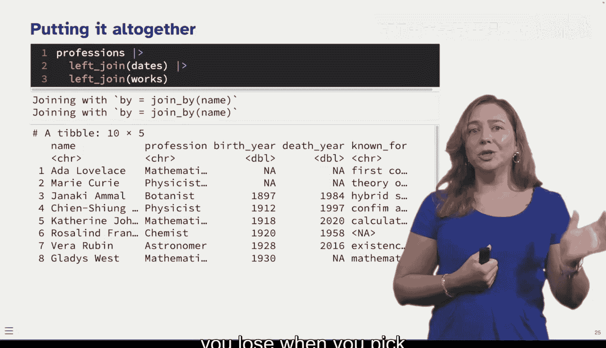

#  021：数据连接 🧩


在本节课中，我们将学习如何将多个数据框基于共同信息连接在一起。我们将使用 `tidyverse` 包中的函数，特别是那些以 `_join` 结尾的函数，来合并数据。

## 概述

到目前为止，我们主要使用 `dplyr` 和 `tidyr` 包处理单个数据框。本节将介绍如何连接多个数据框，以整合来自不同来源的信息。我们将使用一个关于10位改变世界的女科学家的数据集作为示例。

## 数据背景

我们的数据来自《发现》杂志的一篇文章，包含三位科学家的信息，分布在三个数据框中：
*   `professions`：包含10位科学家的姓名和职业。
*   `dates`：包含8位科学家的出生和去世年份（部分科学家仍健在，去世年份为 `NA`）。
*   `works`：包含9位科学家的姓名及其主要成就。

我们的目标是创建一个包含10行数据（每位科学家一行）的最终数据框，整合姓名、职业、出生年份、去世年份和主要成就。由于信息不完整，最终结果中会出现 `NA` 值。

## 连接函数简介

`tidyverse` 提供了一系列以 `_join` 结尾的函数，用于连接数据框。函数名的第一个词指明了连接的类型。例如：
*   `left_join()`：保留左侧数据框的所有行。
*   `right_join()`：保留右侧数据框的所有行。
*   `full_join()`：保留两个数据框的所有行。
*   `inner_join()`：仅保留两个数据框共有的行。
*   `semi_join()`：筛选出左侧数据框中与右侧数据框匹配的行，但不引入右侧数据框的列。
*   `anti_join()`：筛选出左侧数据框中与右侧数据框**不**匹配的行。

为了更清晰地理解这些函数，我们将使用一个简单的示例数据。

### 示例数据

定义两个小型数据框 `x` 和 `y`：
```r
x <- tibble(id = c(1, 2, 3), value_x = c("x1", "x2", "x3"))
y <- tibble(id = c(1, 2, 4), value_y = c("y1", "y2", "y4"))
```
数据框 `x` 包含 id 1, 2, 3；数据框 `y` 包含 id 1, 2, 4。id 1 和 2 是两个数据框共有的。

## 各类连接操作详解

上一节我们介绍了连接的基本概念，本节我们将通过示例数据具体看看每种连接的操作和结果。

### 左连接 (`left_join`)

左连接保留左侧数据框（`x`）的所有行，并从右侧数据框（`y`）匹配相应的行。对于 `x` 中存在但 `y` 中不存在的行，来自 `y` 的列将用 `NA` 填充。

以下是左连接的代码和结果：
```r
left_join(x, y)
```
结果将包含 id 为 1, 2, 3 的行。id 3 对应的 `value_y` 为 `NA`。

现在，让我们将左连接应用于科学家数据。我们将 `professions` 与 `dates` 进行左连接，这意味着我们希望保留 `professions` 中的所有科学家，并尝试从 `dates` 中添加他们的日期信息。
```r
professions %>%
  left_join(dates)
```
执行此操作后，我们将得到一个包含10行的数据框（来自 `professions`），其中8位在 `dates` 中有记录的科学家将获得出生和去世年份，而另外2位科学家（如 Ada Lovelace）的日期列将为 `NA`。

请注意代码中管道运算符 `%>%` 的使用，它使代码更易读。`left_join(professions, dates)` 与 `professions %>% left_join(dates)` 是等价的。

### 右连接 (`right_join`)

右连接与左连接相反，它保留右侧数据框（`y`）的所有行，并从左侧数据框（`x`）匹配相应的行。

以下是右连接的代码和结果：
```r
right_join(x, y)
```
结果将包含 id 为 1, 2, 4 的行。id 4 对应的 `value_x` 为 `NA`。

在科学家数据的例子中，对 `professions` 和 `dates` 进行右连接，将只保留 `dates` 中的8位科学家，并添加他们的职业信息（由于这8位科学家都在 `professions` 中，因此不会有 `NA`）。

### 全连接 (`full_join`)

全连接保留两个数据框中的所有行。如果一个观测只存在于一个数据框中，则来自另一个数据框的列将用 `NA` 填充。

以下是全连接的代码和结果：
```r
full_join(x, y)
```
结果将包含 id 为 1, 2, 3, 4 的所有行。id 3 的 `value_y` 和 id 4 的 `value_x` 为 `NA`。

对 `professions` 和 `dates` 进行全连接，将得到所有10位科学家和8位有日期记录的科学家，总共10行，缺失日期信息的行用 `NA` 表示。

### 内连接 (`inner_join`)

内连接只保留两个数据框中共有的行。

以下是内连接的代码和结果：
```r
inner_join(x, y)
```
结果将只包含 id 为 1 和 2 的行。

在科学家数据中，对 `professions` 和 `dates` 进行内连接，将只得到那8位在两个数据框中都存在的科学家的信息。

### 半连接 (`semi_join`)

半连接根据右侧数据框筛选左侧数据框的行，但**不**将右侧数据框的任何列引入结果中。它只检查匹配关系。

以下是半连接的代码和结果：
```r
semi_join(x, y)
```
结果将只包含 id 为 1 和 2 的行，且只显示 `value_x` 列。

在科学家数据中，`semi_join(professions, dates)` 可用于找出 `professions` 中哪些科学家也出现在 `dates` 中，而不引入具体的日期信息。

### 反连接 (`anti_join`)

反连接是内连接的反面。它返回左侧数据框中那些在右侧数据框中**没有**匹配项的行。

以下是反连接的代码和结果：
```r
anti_join(x, y)
```
结果将只包含 id 为 3 的行。

在科学家数据中，`anti_join(professions, dates)` 会告诉我们哪些科学家在 `professions` 中有记录，但在 `dates` 中没有。这在数据准备阶段非常有用，可以提示我们需要查找并补充哪些科学家的日期信息。

## 连接键与注意事项

在执行连接时，R 会自动查找两个数据框中共有的列名作为连接键（例如 `name` 列）。如果列名不同，需要使用 `by` 参数明确指定，例如 `left_join(x, y, by = c("id_x" = "id_y"))`。

连接键的值必须完全一致（包括大小写和空格），连接才能成功匹配。

## 整合科学家数据

现在，让我们将所有科学家的信息整合到一个数据框中。我们的策略是：首先将 `professions` 与 `dates` 左连接，然后将结果再与 `works` 进行左连接。
```r
complete_scientists <- professions %>%
  left_join(dates) %>%
  left_join(works)
```
这段代码意味着：我们首先保留 `professions` 中的所有科学家，并加入他们的日期信息；然后，在这个结果的基础上，再次保留所有行，并加入他们的成就信息。最终，我们将得到一个包含10行、5列（姓名、职业、出生年、去世年、成就）的数据框，缺失信息处显示为 `NA`。

## 如何选择连接类型

如果你不确定该使用哪种连接，建议从 `left_join` 开始，然后尝试 `right_join` 和 `full_join`，以观察数据的变化。在数据量较小、易于直观检查时，正确的选择通常比较明显。当数据量变大时，则需要仔细思考选择某种连接类型会导致丢失哪些观测。

## 总结



本节课中，我们一起学习了如何使用 `tidyverse` 中的 `*_join` 系列函数来连接多个数据框。我们详细探讨了左连接、右连接、全连接、内连接、半连接和反连接的区别与应用场景，并成功将分散在三个数据框中的科学家信息整合到了一起。掌握数据连接是进行复杂数据分析的关键步骤。