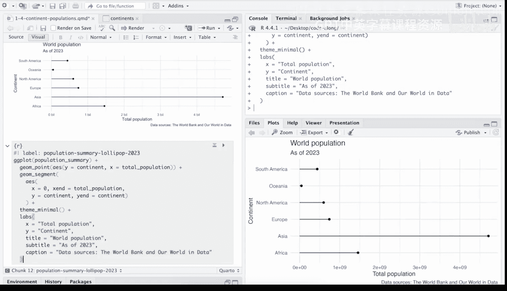
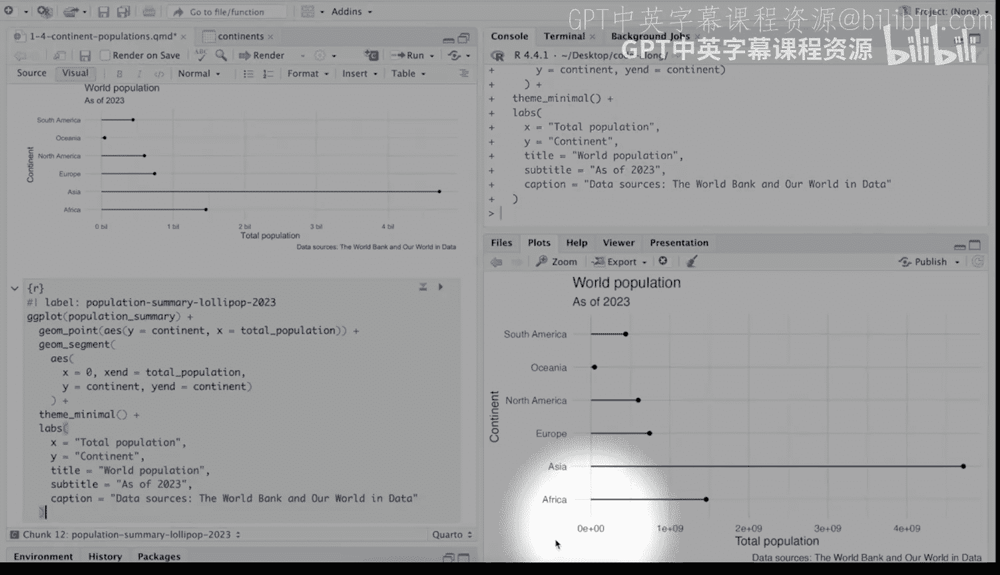
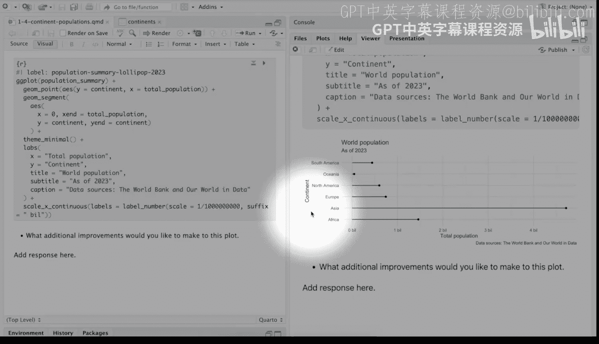
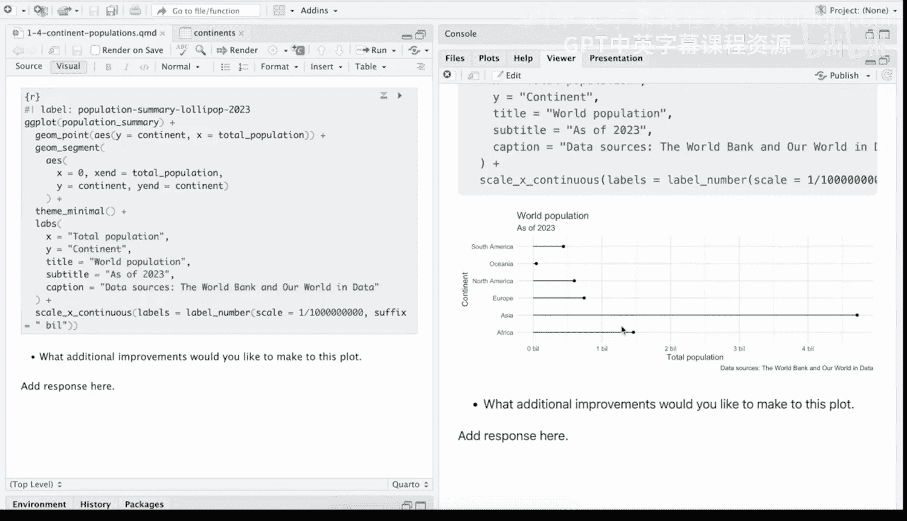
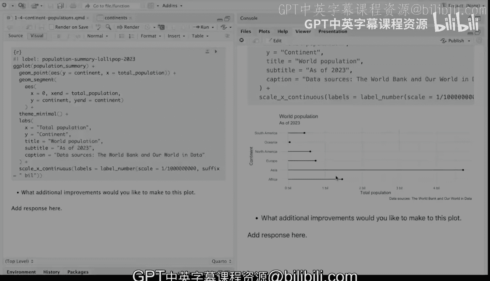

#  022：大洲人口 🌍📊


在本节课中，我们将继续探索人口数据，并引入关于各国所在大洲的新信息，学习如何进行数据连接。我们的最终目标是创建一个展示各大洲总人口的条形图。我们将使用两个输入数据集：`countries_and_populations` 和 `countries_and_continents`。这两个数据集都包含国家信息，我们将以此为基础进行连接。

我们将使用 `tidyverse` 和 `scales` 这两个R包。`tidyverse` 用于数据处理和绘图，`scales` 包则用于美化图表中的坐标轴标签。

## 数据准备

在分析和可视化数据之前，我们需要进行一些数据准备工作。本次分析聚焦于最新的可用人口数据（2023年），因此我们需要修改人口数据框。

首先，我们只选择2023年的人口数据。由于不同年份的数据分布在不同的列中，我们使用 `select` 语句来筛选列。

以下是需要选择的列：
*   所有标识信息列（从 `series_name` 到 `country_code`）
*   2023年的人口数据列（由于列名是数字，需要用反引号 `` `2023` `` 引用）

```r
population_2023 <- population %>%
  select(series_name, series_code, country_name, country_code, `2023`)
```

接下来，为了后续引用方便，我们将 `2023` 列重命名为 `population`。

```r
population_2023 <- population_2023 %>%
  rename(population = `2023`)
```

## 数据连接

现在，我们需要将人口数据与大洲数据连接起来。首先，查看两个数据框的列名，以确定用于连接的共同变量。

*   `population_2023` 包含：`series_name`, `series_code`, `country_name`, `country_code`, `population`
*   `continents` 包含：`entity`, `code`, `year`, `continent`

两个数据框的共同信息可以是国家名称或国家代码。建议尽可能使用代码进行连接，因为代码通常是标准化的，可以避免因国家名称拼写差异或历史变更导致的问题。

因此，我们将使用 `population_2023` 中的 `country_code` 变量和 `continents` 中的 `code` 变量进行连接。

我们希望创建一个新的数据框，保留 `population_2023` 中的所有行和列，并从 `continents` 数据框中引入对应的大洲信息。这需要使用左连接（`left_join`）。

```r
population_continents <- population_2023 %>%
  left_join(continents, by = c("country_code" = "code"))
```

连接后，我们可能只关心 `continent` 列。可以在连接时或连接后选择所需的列，以简化数据框。

## 处理缺失值

连接后，检查新创建的 `population_continents` 数据框。有些国家在 `continents` 数据框中没有对应记录，导致其 `continent` 变量为 `NA`。

我们可以通过筛选 `is.na(continent)` 来识别这些国家。

```r
population_continents %>%
  filter(is.na(continent))
```

结果显示有两个这样的国家：Kosovo 和 Channel Islands。这可能是因为它们在 `continents` 数据框中的代码与 `population_2023` 中的 `country_code` 不完全匹配。

为了解决这个问题，我们需要在连接前修改 `population_2023` 数据框中的 `country_code`，使其与 `continents` 数据框中的代码匹配。

我们使用 `mutate` 函数和 `case_when` 语句来条件性地修改代码：
*   如果国家名是 “Kosovo”，则使用 `continents` 中对应的代码（例如 “OWID_KOS”）。
*   如果国家名是 “Channel Islands”，则使用 `continents` 中对应的代码（例如 “OWID_CIS”）。
*   对于其他国家，保持原 `country_code` 不变。

```r
population_2023_modified <- population_2023 %>%
  mutate(country_code = case_when(
    country_name == "Kosovo" ~ "OWID_KOS",
    country_name == "Channel Islands" ~ "OWID_CIS",
    .default = country_code
  ))
```

修改后，再次执行左连接，并检查是否还存在 `NA` 值。

```r
population_continents <- population_2023_modified %>%
  left_join(continents, by = c("country_code" = "code"))

population_continents %>%
  filter(is.na(continent)) # 现在应该返回0行
```

## 数据汇总

我们的目标是创建一个按大洲汇总总人口的数据框。这需要先按 `continent` 分组，然后对 `population` 列求和。

```r
p_summary <- population_continents %>%
  group_by(continent) %>%
  summarise(total_population = sum(population))
```

`p_summary` 数据框现在包含每个大洲及其总人口。

## 创建条形图

现在，我们可以使用 `p_summary` 数据框创建条形图。在X轴上放置 `continent`，在Y轴上放置 `total_population`。

由于我们已经计算好了每个条形的高度（即总人口），我们使用 `geom_col()` 而不是 `geom_bar()`。

```r
ggplot(p_summary, aes(x = continent, y = total_population)) +
  geom_col()
```

这样就得到了一个基本的条形图，展示了各大洲的总人口。

## 创建棒棒糖图

接下来，我们尝试重新创建一个棒棒糖图（lollipop chart）。在这种图表中，数据以点和连接到点的线段形式表示，人口在X轴，大洲在Y轴。

首先，我们翻转坐标轴，将 `continent` 映射到Y轴，`total_population` 映射到X轴。然后，我们添加点图层（`geom_point()`）和线段图层（`geom_segment()`）。

对于 `geom_segment()`，我们需要定义线段的起点和终点：
*   起点：`x = 0`, `y = continent`
*   终点：`x = total_population`, `y = continent`

为了提高代码可读性，我们将美学映射定义在各自的图层中，而不是全局 `aes()` 中。

```r
ggplot(p_summary) +
  geom_segment(aes(x = 0, xend = total_population, y = continent, yend = continent)) +
  geom_point(aes(x = total_population, y = continent))
```

## 美化图表





最后，我们对图表进行美化，使其更接近目标样式：
1.  使用 `theme_minimal()` 改变主题。
2.  添加适当的标签：X轴（总人口）、Y轴（大洲）、标题（世界人口）、副标题（截至2023年）和说明（数据来源）。
3.  使用 `scales` 包的 `label_number()` 函数格式化X轴标签，将数字以“十亿”为单位显示。

```r
ggplot(p_summary) +
  geom_segment(aes(x = 0, xend = total_population, y = continent, yend = continent)) +
  geom_point(aes(x = total_population, y = continent)) +
  theme_minimal() +
  labs(
    x = "Total Population",
    y = "Continent",
    title = "World Population",
    subtitle = "as of 2023",
    caption = "Data sources: The World Bank and Our World in Data"
  ) +
  scale_x_continuous(labels = label_number(scale = 1e-9, suffix = " B"))
```

渲染整个文档以确保没有错误，并且可视化效果良好。


## 总结







本节课中，我们一起学习了如何连接两个相关的数据集（人口和大洲信息），处理连接时出现的缺失值问题，按类别对数据进行汇总，并创建了两种类型的图表（条形图和棒棒糖图）来可视化各大洲的总人口。我们还学习了如何使用 `scales` 包来格式化坐标轴标签，以及如何通过添加图层和修改主题来美化 `ggplot2` 图形。