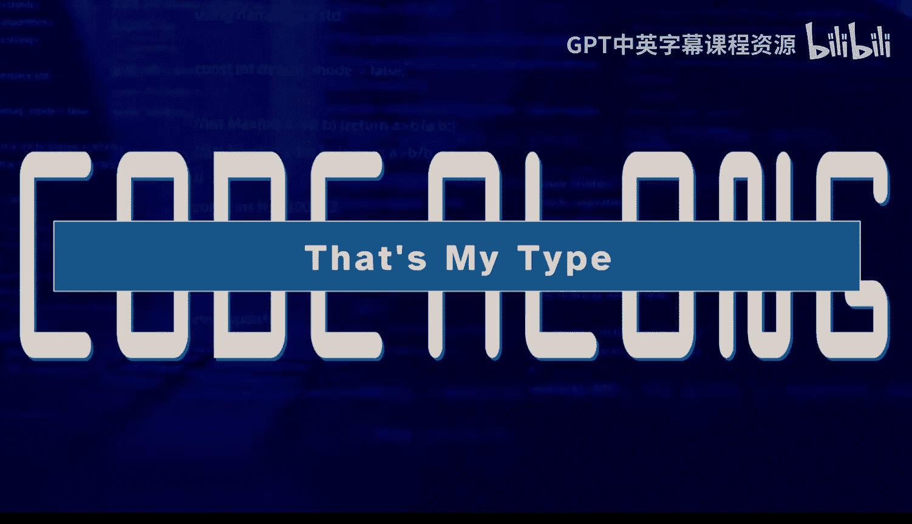
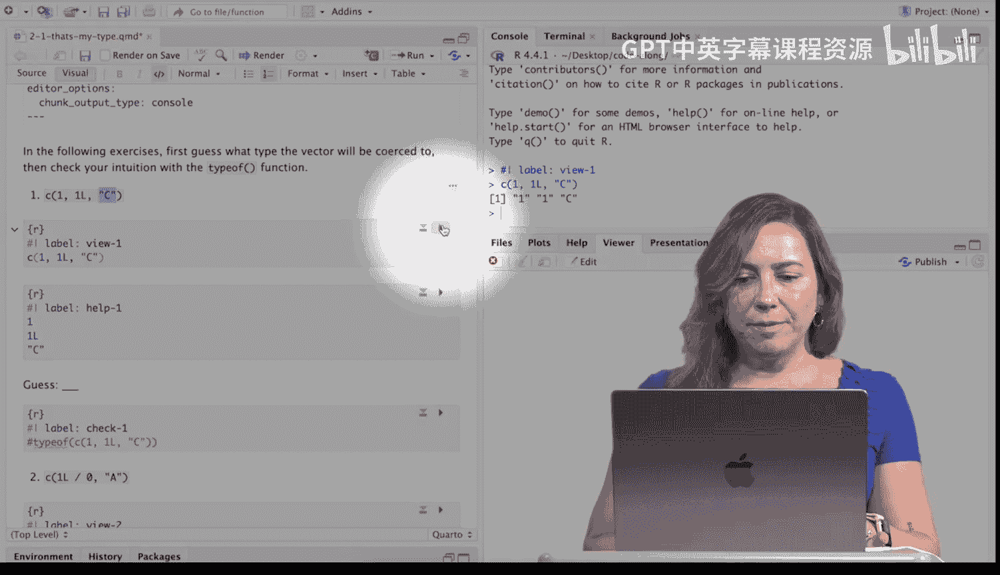
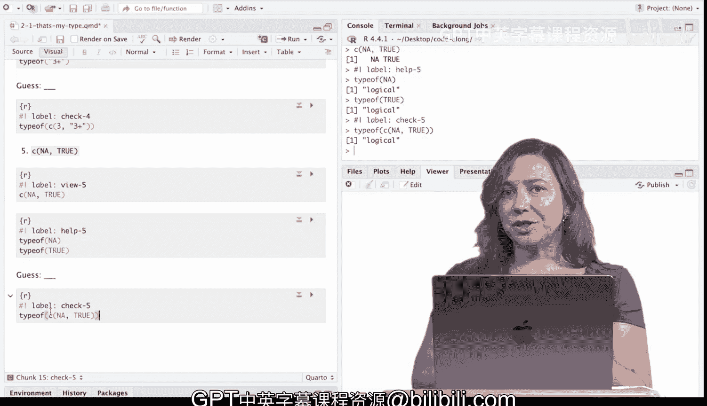

#  024：这是我的类型 🧩




在本节课程中，我们将回顾R语言中关于数据类型的知识，并特别聚焦于**隐式强制转换**。我们将通过五个具体的向量示例，来理解当不同类型的数据组合在一起时，R语言会如何处理它们。理解这一点对于数据科学家至关重要，因为它经常在后台自动发生，可能导致意想不到的结果。当你发现数据行为异常时，或许可以思考：“是不是发生了隐式类型转换？”

---

## 概述

我们将逐一分析五个包含不同数据类型的向量。对于每个向量，我们会先尝试猜测其最终的数据类型，然后使用R代码进行验证。核心方法是使用 `typeof()` 函数来检查每个元素以及整个向量的类型。

---

## 示例一：数字与字符的混合

首先，我们来看一个包含数字和字符的向量。

以下是构成该向量的元素：
*   `1`：一个双精度浮点数。
*   `1L`：一个整数。
*   `"c"`：一个字符。

让我们检查每个元素的类型：

```r
typeof(1)   # 输出："double"
typeof(1L)  # 输出："integer"
typeof("c") # 输出："character"
```

这个向量包含了一个双精度数、一个整数和一个字符。那么，整个向量的类型会是什么呢？

我的猜测是：它会被强制转换为**字符**类型。因为数字可以轻松地加上引号变成字符，但字符无法直接变成数字。

现在，我们来验证一下：

```r
vec1 <- c(1, 1L, "c")
typeof(vec1) # 输出："character"
```

结果证实了我们的猜测。当字符出现在向量中时，其他所有元素通常都会被强制转换为字符类型。

---



## 示例二：运算结果与字符的混合

上一节我们看到了字符的强大“同化”能力。本节中，我们来看一个更复杂的例子。

这个向量包含：
*   `1L / 0`：一个整数除以零的运算结果。
*   `"a"`：一个字符。

我们先看看这个向量长什么样，并检查每个部分的类型：

```r
vec2 <- c(1L / 0, "a")
print(vec2) # 输出：[1] "Inf" "a"

typeof(1L / 0) # 输出："double"
typeof("a")    # 输出："character"
```

`1L / 0` 的结果是无穷大（`Inf`），其类型是双精度浮点数。另一个元素是字符。那么，当双精度数和字符结合时，结果会是什么？

根据之前的经验，字符类型会胜出。让我们验证：

```r
typeof(vec2) # 输出："character"
```

再次证明，一旦向量中混入字符，整体类型就是字符。

---

## 为什么这很重要？

你可能会问，解决这些“谜题”有什么实际意义？除了有趣和帮助我们理解R语言的特性，更重要的是实际应用。

在数据分析中，我们经常处理数据框。数据框的每一列本质上都是一个向量。如果某一列中混合了不同类型的数据（例如，在调查问卷中，有些人用数字“3”回答，有些人用文字“三”或“3+”回答），那么在读取数据时，R语言会进行隐式强制转换，通常会将整列都转换为字符类型。这可能会影响后续的数值计算和分析。因此，了解类型转换的规则，有助于我们在数据清洗和预处理阶段发现问题。

---

## 示例三：整数与双精度数的混合

现在，我们来看一个不涉及字符的例子。

这个向量包含：
*   `1:3`：一个从1到3的整数序列。
*   `5`：一个数字。

它们看起来都是整数。我们来检查一下：

```r
typeof(1:3) # 输出："integer"
typeof(5)   # 输出："double"
```

有趣！`1:3` 生成了一个整数序列，但单独的数字 `5` 在R中默认是双精度浮点数。所以，我们实际上是在混合整数和双精度数。

那么，当整数和双精度数结合时，会发生什么？R语言会将整数“升级”为双精度数，因为所有整数都可以无损地表示为双精度数（例如，1变成1.0），但反过来则不行。因此，整体类型应该是双精度数。

验证一下：

```r
vec3 <- c(1:3, 5)
typeof(vec3) # 输出："double"
```

我们的直觉是正确的。

---

## 示例四：数字与数字字符的混合

这个例子模拟了真实数据中常见的情况。

向量包含：
*   `3`：一个数字。
*   `"3+"`：一个看起来像数字的字符。

我们先检查类型：

```r
typeof(3)    # 输出："double"
typeof("3+") # 输出："character"
```

一个是双精度数，一个是字符。这和我们第一个例子类似。请猜测一下最终类型。

根据规则，字符类型会主导。让我们确认：

```r
vec4 <- c(3, "3+")
typeof(vec4) # 输出："character"
```

再次印证了之前的规律。

---

## 示例五：逻辑值的组合

最后，我们来看一个简单的例子。

这个向量包含两个逻辑值：
*   `NA`：代表缺失值。
*   `TRUE`：逻辑真。

你可能知道 `NA` 很特殊，但它也有自己的类型。让我们检查：

```r
typeof(NA)   # 输出："logical"
typeof(TRUE) # 输出："logical"
```

原来 `NA` 在默认情况下也是逻辑类型。那么，由两个逻辑值组成的向量，其类型应该毫无疑问是逻辑型。

验证一下：

```r
vec5 <- c(NA, TRUE)
typeof(vec5) # 输出："logical"
```

这里不需要任何强制转换，同类相聚，结果依然是同类。

---

## 总结

本节课中，我们一起通过五个示例深入探讨了R语言中的**隐式强制转换**。我们了解到：

1.  **字符类型**具有最高的“强制力”。一旦向量中出现字符，其他所有元素（无论是数字、逻辑值还是其他）通常都会被转换为字符类型。
2.  在**数值类型**内部，当整数和双精度数混合时，整数会被“升级”为双精度数。
3.  **同类数据**组合时，不会发生类型转换，例如两个逻辑值组成的向量依然是逻辑型。



理解这些规则有助于你预测R代码的行为，并在数据出现异常时，能够快速想到类型转换可能是问题的根源。记住，在数据分析的开始阶段，仔细检查每一列的数据类型是一个好习惯。