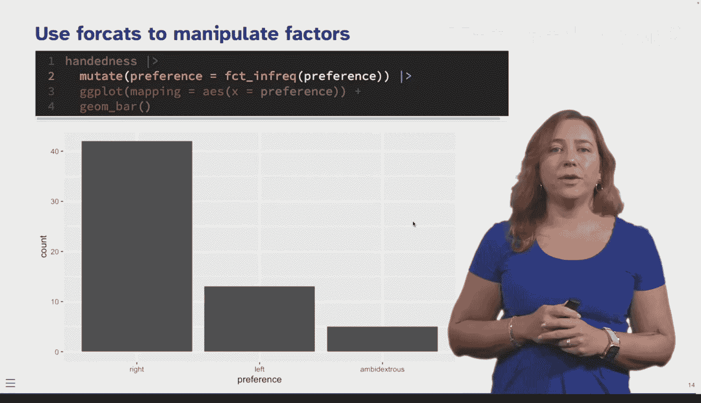
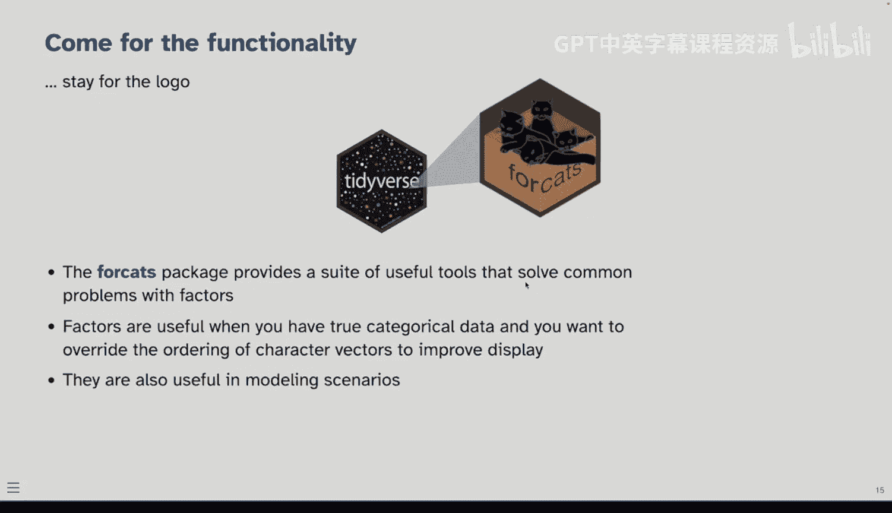

#  025：数据类


在本节课中，我们将要学习R语言中几种重要的数据类。理解这些数据类对于有效地操作和分析数据至关重要。我们将重点介绍因子、日期和数据框这三种核心数据结构。

上一节我们介绍了数据类型，本节中我们来看看数据类。向量就像是乐高积木，我们可以将它们组合在一起，构建更复杂的数据结构。对象的类属性决定了其行为方式，我们将探讨几种在数据处理中常见且重要的类。

## 因子

R语言使用因子来处理分类变量。分类变量具有一组固定且已知的可能取值。

例如，这里有一个表示教育程度的因子变量`x`：
```r
x <- factor(c("BS", "MS", "PhD", "MS"))
```
当我们打印这个向量时，它不仅显示具体的值，还会告诉我们该因子具有的**水平**：BS、MS和PhD。这些水平是该向量中所有可能的唯一取值。

因子的类型是整数，这初看起来可能难以理解。因子的类则是“factor”。一个因子由两部分组成：表示因子水平标签的**字符向量**，以及表示水平编号的**整数向量**。这两部分在内部是“粘合”在一起的。

如果我们查看刚才创建的向量，会发现它是一个具有三个水平（BS、MS、PhD）的因子，其内部值实际上是1、2、3、2。这些整数是R在幕后为每个观测值分配的编号，而标签则是像“BS”、“MS”、“PhD”这样的字符串。R可以方便地在因子和整数之间进行转换。

在处理统计背景下的分类数据时，因子非常重要。我们稍后会给出一个例子。

## 日期

现在让我们看看另一个数据类：日期。这里我有一个看起来像日期的字符串“2025-01-01”，并使用`as.Date`函数将其转换为日期。

```r
y <- as.Date("2025-01-01")
```
如果只打印它，它看起来像一个普通的字符串。但如果询问其类型，会发现它是“double”（双精度浮点数）。为什么日期会是双精度数呢？如果询问其类，则会得到“Date”。我们可以将日期理解为两个部分“粘合”在一起：一个表示自**原点**以来的天数（整数），以及原点日期本身。

例如，查看`y`值（2025年1月1日），将其转换为整数会得到20089。如果将此数字除以365（大约每年的天数），会得到大约55年，这正是1970年到2025年之间的年数。简而言之，在R中构建日期时，可以将这两部分信息（原点1970年1月1日和自原点以来的天数）视为粘合在一起。

## 数据框与列表

另一个我们感兴趣的数据类是数据框。数据框可以看作是**等长向量粘合在一起**形成的。

例如，这里有一个包含两个变量`x`和`y`的数据框，每个变量有两个观测值。如果检查数据框的类型，会发现它是“list”（列表），而其类是“data.frame”。在某种程度上，两个向量粘合在一起就构成了一个数据框。

我们刚刚提到了列表，让我们更仔细地看看它。列表是通用的向量容器，任何类型的向量都可以放入其中。

例如，这里有一个包含三个元素的列表：一个是整数，一个是字符，另一个是逻辑值。
```r
l <- list(1:3, c("a", "b", "c"), c(TRUE, FALSE, TRUE))
```
R允许你将它们全部放入一个名为`l`的对象中，而无需进行任何类型强制转换以使这些向量彼此相似。这就是为什么我们称列表为通用向量容器。如果这些向量长度相等，我们实际上可以将它们组合成一个数据框，而数据框正是我们经常遇到的数据形式。

你可以将数据框视为一种特殊的列表，它包含长度相等的向量。使用`pull`函数，我们可以从数据框中提取向量。虽然我们喜欢将数据保存在数据框中以便在数据管道中处理，但有时将变量（一个向量）从数据框中提取出来也很有用，例如，作为分析的最后一步。

## 因子应用示例

现在我们已经回顾了在R中处理数据时常见的各种数据类，让我们举一个涉及因子操作的例子。

假设我们有一个关于利手习惯的调查数据框。对于每个受访者，我们知道他们的姓名和偏好（是右利手、左利手还是双利手）。这两个变量最初都是字符变量。

我们可以为这些数据制作条形图。在创建条形图时，R在幕后会将偏好向量强制转换为因子，并**按字母顺序**排列该因子的水平。然而，字母顺序很少是最有意义的顺序。

我们可以使用`forcats`包中的`fct_infreq()`函数，按照频率的降序重新排列水平。这个函数会修改偏好变量，并按频率降序重新排序其水平。`forcats`包专门用于处理因子，并提供了许多函数来解决因子的常见问题。



当你拥有真正的分类数据，并且希望覆盖字符向量的默认排序以改善其显示效果时，因子非常有用。否则，所有内容都会按字母顺序排列，这很少是数据可视化或数据摘要所需要的。因子在建模场景中也很有用，我们将在后续的专业课程中涉及这一点。

---



本节课中我们一起学习了R语言中三种核心的数据类：因子、日期和数据框。我们了解了因子的结构和在分类数据中的应用，日期在R内部的表示方式，以及数据框作为等长向量集合的本质。理解这些数据类的特性和行为，是进行有效数据操作和分析的基础。