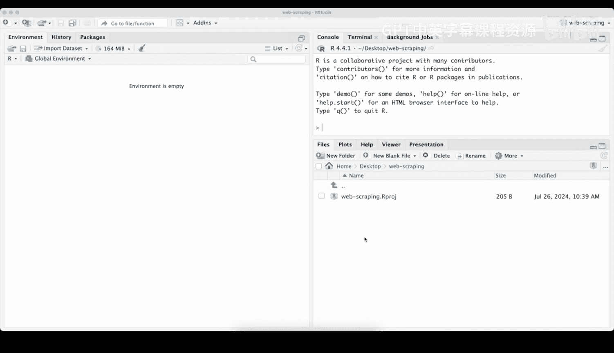
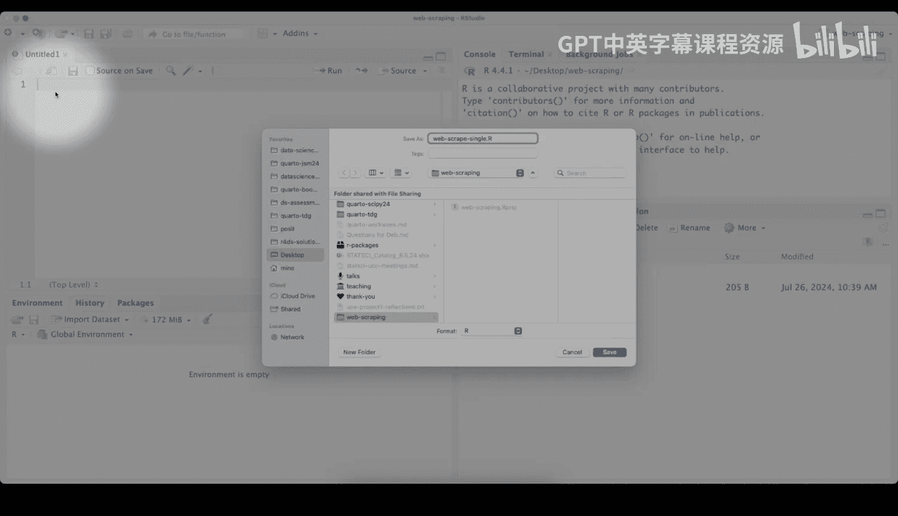
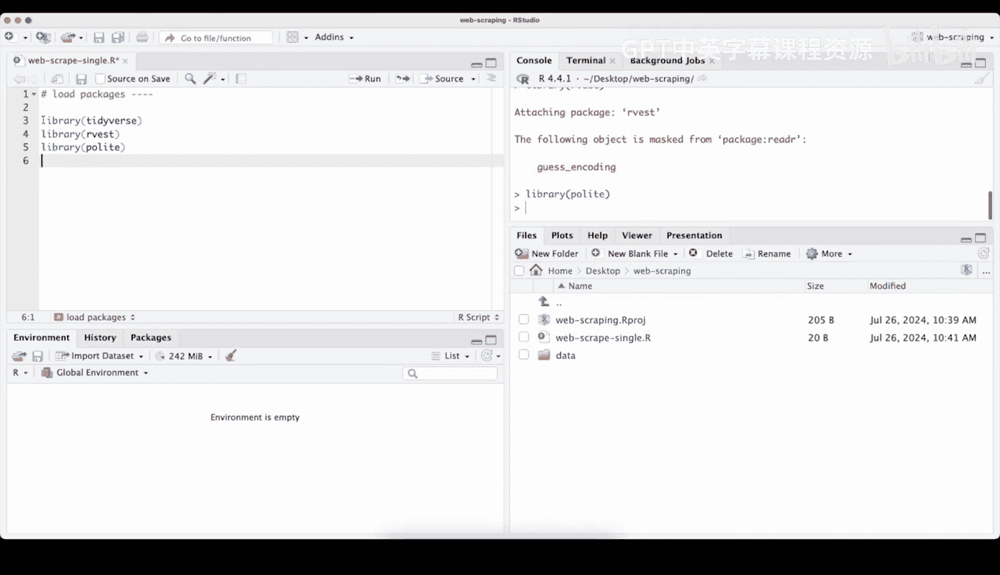
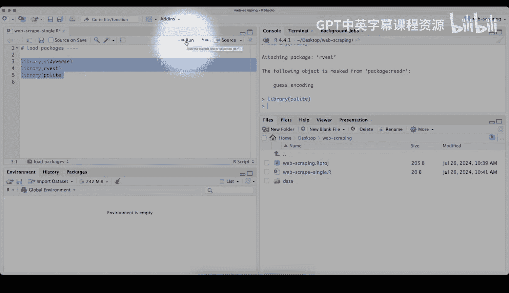
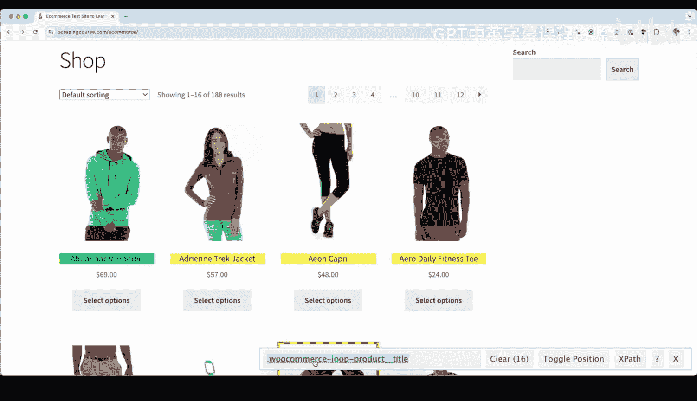
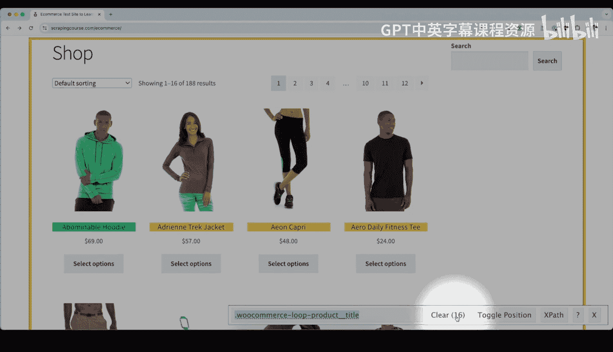
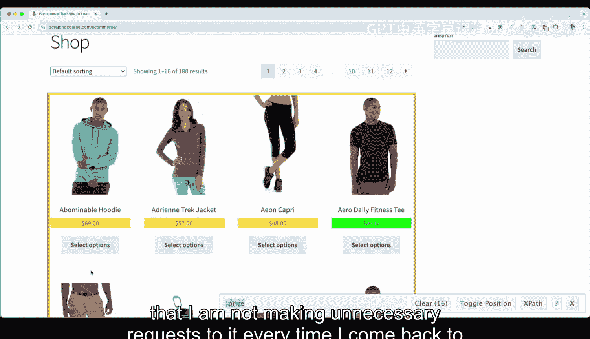

#  031：爬取电商页面 🛒


在本节课中，我们将学习如何从网页上抓取数据。我们将编写一个R脚本，从一个电商示例页面中提取商品信息，并将抓取到的数据保存到本地文件中。



## 概述



我们将通过一个完整的流程来学习网页抓取。首先，我们会创建一个RStudio项目来组织代码。然后，我们将加载必要的R包，检查目标网站是否允许抓取，并使用`rvest`包从网页中提取商品标题、价格和链接。最后，我们会将数据整理成一个整洁的数据框，并保存为CSV文件。

## 创建RStudio项目

首先，我们需要创建一个新的RStudio项目来封装我们的工作。这能确保我们的工作目录始终指向项目文件夹，便于管理代码和数据文件。

在RStudio中，点击“File” -> “New Project”。选择“New Directory”，然后选择“Empty Project”。将项目命名为“web_scraping”并保存到桌面。

创建项目后，当前工作目录会自动设置为该项目文件夹。我们可以通过运行`getwd()`来确认这一点。

接下来，在项目中创建一个新的R脚本文件。点击“File” -> “New File” -> “R Script”，或者使用工具栏上的绿色加号按钮。我们将这个脚本命名为`web_scrape_single_page.R`。





## 加载必要的R包

在编写代码之前，我们需要加载几个关键的R包。我们将使用`tidyverse`进行数据处理，`rvest`进行网页抓取，以及`polite`包来礼貌地检查网站是否允许抓取。

在R脚本中，我们可以使用注释（以`#`开头）来组织代码。在注释后添加四个破折号（`----`）可以创建代码节，方便在脚本中导航。

以下是加载包的代码：

```r
# 加载包 ----
library(tidyverse)
library(rvest)
library(polite)
```

## 检查网站抓取许可

在开始抓取数据之前，我们应该检查目标网站是否允许我们进行抓取。这可以通过网站的`robots.txt`文件来确认，该文件规定了网络爬虫的访问规则。

我们将使用`polite`包中的`bow()`函数来检查一个专门用于学习网页抓取的示例网站：`scrapingcourse.com`。

```r
# 检查抓取许可 ----
bow("https://scrapingcourse.com/")
```

如果函数返回允许抓取的信息，我们就可以继续。作为对比，我们可以尝试检查`facebook.com`，它通常会禁止抓取。

```r
# 对比：一个不允许抓取的网站
bow("https://www.facebook.com/")
```

确认示例网站允许抓取后，我们就可以开始读取网页内容了。

## 读取网页内容





我们将目标网页的URL保存为一个变量，然后使用`rvest`包的`read_html()`函数来获取网页的HTML源代码。

```r
# 读取网页 ----
url <- "https://scrapingcourse.com/"
page <- read_html(url)
```

`page`对象是一个包含网页完整HTML源代码的列表。它是一个`xml_document`类型的对象。我们不需要查看全部代码，只需要使用选择器工具定位我们感兴趣的部分。

## 提取商品标题

我们的目标是提取页面上每个商品的标题、价格和商品详情页的链接。

首先，我们使用浏览器扩展“SelectorGadget”来定位标题对应的HTML标签。点击一个商品标题，工具会显示相关的CSS选择器。我们发现标题的标签是`.title`。

在R中，我们使用`html_elements()`函数配合选择器来提取所有匹配的元素，然后使用`html_text()`函数来获取纯文本内容。

```r
# 提取标题 ----
titles <- page %>%
  html_elements(".title") %>%
  html_text()
```

现在，`titles`变量是一个包含所有商品标题的字符向量。

## 提取商品链接

接下来，我们需要提取每个商品对应的详情页链接。再次使用SelectorGadget，我们点击商品区域，发现链接信息存储在`a`标签的`href`属性中，选择器可能是`.product-link`。

要提取属性而不是文本，我们使用`html_attr()`函数。

```r
# 提取链接 ----
urls <- page %>%
  html_elements(".product-link") %>%
  html_attr("href")
```

现在，`urls`变量是一个包含所有商品链接的字符向量。

## 提取商品价格

最后，我们来提取商品价格。使用SelectorGadget点击价格，发现其选择器是`.price`。

我们同样先提取元素，然后获取文本。但价格文本包含美元符号`$`，我们需要将其移除并将其转换为数值型数据。

```r
# 提取并清理价格 ----
prices_raw <- page %>%
  html_elements(".price") %>%
  html_text()

# 移除美元符号并转换为数值
prices <- prices_raw %>%
  str_remove_all("\\$") %>%  # 使用转义字符\\$来匹配美元符号
  as.numeric()
```

我们使用`stringr`包（`tidyverse`的一部分）的`str_remove_all()`函数来移除所有美元符号。注意，因为`$`在正则表达式中是特殊字符，所以需要用两个反斜杠`\\`进行转义。最后，使用`as.numeric()`将字符转换为数值。

现在，`prices`变量是一个数值向量。

## 整合数据并保存

我们已经成功提取了三个向量：`titles`、`urls`和`prices`。接下来，我们将它们组合成一个整洁的数据框。

```r
# 创建数据框 ----
items <- tibble(
  title = titles,
  url = urls,
  price = prices
)
```

`items`数据框包含了我们从网页上抓取的所有信息。作为最后一步，我们应该再次运行整个脚本，确保没有错误，并且结果符合预期。

为了后续分析，并且避免每次分析都重新访问网站，我们将数据保存到本地。

首先，在项目文件夹中创建一个名为`data`的子文件夹（可以在RStudio的“Files”面板中操作）。然后，使用`write_csv()`函数将数据框保存为CSV文件。



```r
# 保存数据 ----
write_csv(items, "data/items.csv")
```

现在，我们可以在任何R会话中通过`read_csv(“data/items.csv”)`来读取这个数据集，并应用我们学过的所有数据分析工具。

## 总结

在本节课中，我们一起学习了网页抓取的基本工作流程。我们创建了一个RStudio项目来组织工作，使用`polite`包检查了网站的抓取政策，并利用`rvest`包从HTML页面中提取了结构化数据。我们使用了SelectorGadget工具来定位目标元素，并处理了文本数据（如移除货币符号）。最后，我们将提取的数据整合成数据框并保存到本地，为后续的数据分析做好了准备。这个流程是进行网页抓取项目的坚实基础。