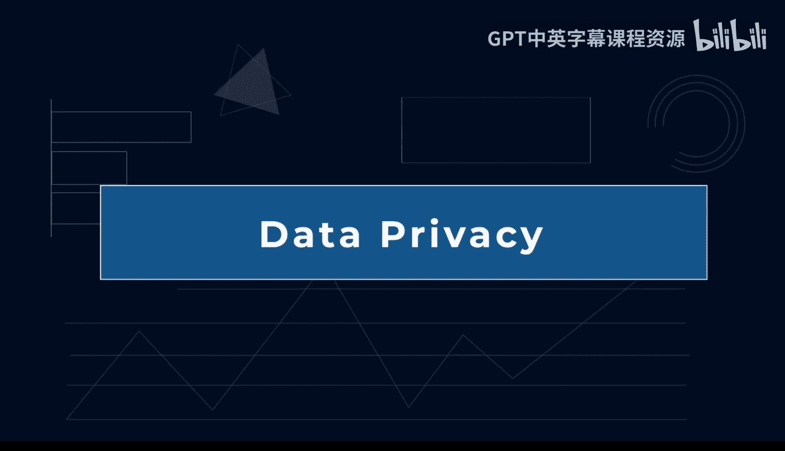
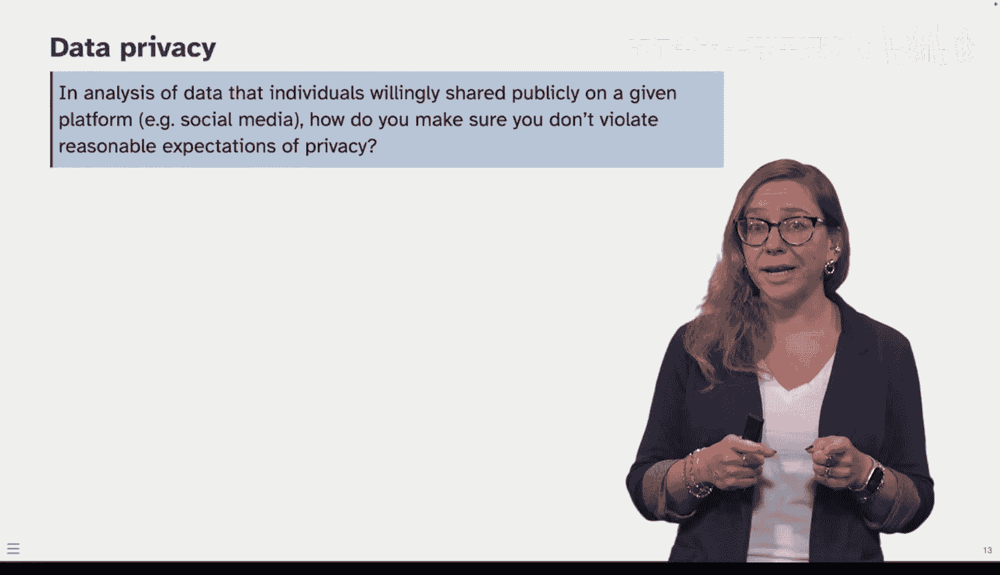

#  036：数据隐私 🔒

在本节课程中，我们将探讨数据隐私这一重要议题。我们将了解个人数据如何被收集、使用和共享，并思考在数据分析工作中如何尊重和保护隐私。

---

## 数据收集无处不在

每次我们使用应用程序、网站和设备时，我们的数据都在被收集、使用或出售给他人。更重要的是，执法机构、金融机构和政府会基于这些数据做出直接影响人们生活的决策。

请思考一下，你今天在互联网上留下了哪些数据片段。回顾你登录过的所有账户、点击过的内容、主动或自动签到过的地点。这些行为可能都在追踪你。

你是否知道这些数据存储在哪里？谁可以访问它们？它们是否被分享给他人？如果你不知道这些问题的答案，你是否对此感到安心？

---

## 数据共享的边界

接下来，我们思考一下共享数据的问题。你愿意分享哪些信息？

以下是人们可能被要求或无意中分享的数据类型列表：
*   你的姓名、年龄、电子邮件和电话号码。
*   你观看过的每一个视频列表。
*   你评论过的每一个视频列表。
*   你的打字方式，例如速度和准确度。
*   你在不同内容上花费的时间。
*   你所有的私信列表，包括日期、时间和收件人。
*   关于你照片的信息，包括拍摄方式、地点（可能包含GPS坐标）和时间。

这个列表似乎越来越令人不安。

---

## 广告个性化背后的逻辑

让我们尝试思考另一个问题：你是否想过为什么会在谷歌上看到某个广告？

你可以暂停视频，去谷歌搜索一下，尝试弄清楚你是否开启了广告个性化功能，以及你的广告是如何被个性化的。然后回来继续学习。

这里还有一个反思性问题：你愿意你的浏览历史被用于以下哪些目的？
*   为你提供定向广告。😊
*   作为求职候选人的评分依据。
*   为投票目的预测你的种族和民族。

---

## 社交媒体数据的流向

假设你在一个社交媒体网站上创建了个人资料，并在个人资料中分享了你的个人信息。谁有权使用这些数据？

*   社交媒体公司本身及其关联公司。这在当今时代几乎是默认的。
*   社交媒体公司出售数据的公司。这一点我们现在也已经习以为常。
*   以科学为名的研究人员。这听起来似乎没有威胁性，对吗？

坦率地说，我很想说“是的，可以”，但让我们来看看这个关于OkCupid的案例研究。

---

## 案例研究：OkCupid数据泄露

OkCupid是最早的约会平台之一。在2016年，研究人员发布了7万名OkCupid用户的数据，包括用户名、政治倾向、吸毒情况和私密的性行为细节。

这些数据是用户自愿提供给OkCupid公司用于创建个人资料的。尽管这些研究人员没有公布OkCupid用户的真实姓名和照片，但他们可能没有意识到，用户的身份很容易从提供的细节中被识别出来。

例如，你是否在多个地方使用同一个用户名？是否存在一定数量的关于你的特征，可以让别人帮助你识别出你？

这是一位研究人员与一位访问过该数据集的人的在线对话截图。对方说：“这个数据集的可重识别性很高。它甚至包含了用户名。有没有做过任何匿名化处理？”研究人员回答：“没有，这些数据已经是公开的。”

你同意研究人员的观点吗？他们说：“有些人可能会反对收集和发布这些数据的伦理问题。然而，数据集中发现的所有数据都已经或曾经是公开可用的。因此，发布这个数据集只是以一种更有用的形式呈现它。”但“更有用”也可能意味着“可以恢复”，即实际上可以识别出具体的人。

---

## 如何在分析中保护隐私

那么，在分析个人在特定平台（例如他们的社交媒体资料）上自愿公开分享的数据时，如何确保不侵犯合理的隐私期望？

遗憾的是，我无法在这里给你具体的答案。但我鼓励你，在处理自己的数据以及使用他人作为数据源时，都要思考这个问题。

---

## 总结

本节课中，我们一起学习了数据隐私的基本概念。我们认识到个人数据在数字时代被广泛收集和利用，探讨了数据共享可能涉及的敏感信息，并通过OkCupid的案例看到了即使“公开”数据也可能带来隐私风险。最重要的是，我们开始思考作为数据分析者，应如何在工作中秉持伦理，尊重和保护数据主体的隐私。这是一个没有标准答案但至关重要的问题。