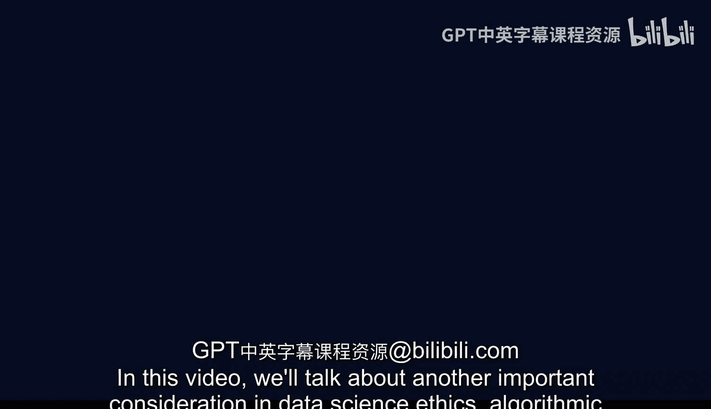
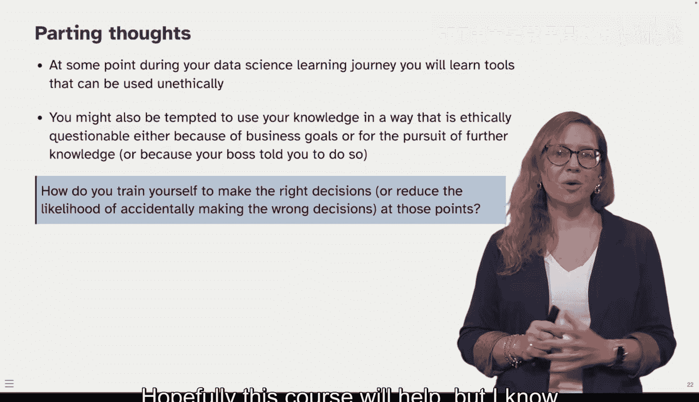

#  037：算法偏见

在本节课中，我们将探讨数据科学伦理中的另一个重要考量：算法偏见。我们将了解偏见如何通过数据进入算法，并影响翻译、招聘、面部识别和司法判决等多个领域。理解这些偏见是构建公平、负责任的数据科学应用的第一步。

---

## 垃圾进，垃圾出

在统计学中，有一个基本原则：**垃圾进，垃圾出**。这意味着，如果你的数据质量不高——这里“高质量”指的是**随机且具有代表性**——那么你的分析结果将是不可靠且无法推广的。

由此可以推导出一个推论：**偏见进，偏见出**。如果输入的数据本身带有偏见，那么算法输出的结果也会延续甚至放大这种偏见。

---

## 算法偏见与性别

上一节我们介绍了偏见的基本原理，本节中我们来看看算法偏见在性别方面的具体表现。

以下是谷歌翻译从土耳其语（一种没有性别化第三人称代词的语言）翻译成英语的例子：

*   **原句**：`O bir doktor.`（意为：这个人是一名医生。）
*   **旧版翻译**：`He's a doctor.`（他是一名医生。）
*   **原句**：`O bir öğretmen.`（意为：这个人是一名老师。）
*   **旧版翻译**：`She's a teacher.`（她是一名老师。）

这里存在一个模式：某些职业被自动分配了男性代词，而另一些则被分配了女性代词。谷歌这种带有性别偏见的翻译，其根源很可能在于其训练所使用的网络数据。算法只是延续了它在有偏见的数据中所看到的模式。

> 谷歌后来已经在绝大多数翻译案例中解决了这个问题。如今从土耳其语翻译成英语时，通常会使用中性表达“They are a doctor/teacher”。

另一个例子是亚马逊的实验性招聘算法。该系统为求职者打分（1到5星），但它并非以性别中立的方式评估软件开发等职位的候选人。由于这些职位上现有员工多为男性，算法“自学”认为男性候选人更可取。进一步调查还发现，支撑模型判断的数据存在问题，导致不合格的候选人经常被推荐给各种职位。

---

## 算法偏见与种族

接下来，让我们将目光转向算法偏见与种族的问题。

第一个例子是关于面部识别技术。研究人员发现，商用人脸识别软件中的人工智能系统存在性别和肤色偏见。一项面部分析软件的测试显示，其对浅肤色男性的错误率仅为 **0.8%**，而对深肤色女性的错误率高达 **34.7%**。事实上，一家主要美国科技公司声称其面部识别软件准确率超过 **97%**，但用于评估其性能的数据集中，**超过77%是男性，超过83%是白人**，根本不具代表性。

不幸的是，种族在刑事判决中也扮演着重要角色，即使判决得到了所谓“公正”算法的支持。2016年，ProPublica撰写了一篇关于用于评估被告再犯罪风险算法的深度报道。

以下是该算法预测的一些案例：
*   **高风险**：多为黑人被告。
*   **低风险**：多为白人被告。

ProPublica对佛罗里达州布劳沃德县7000多名被捕者的风险评分及其随后两年是否再犯罪的分析显示：
*   在预测会实施暴力犯罪的人中，有20%确实再犯。
*   当考虑所有罪行（包括轻罪）时，算法的准确率为61%。
*   此外，算法**错误地将黑人被告标记为未来犯罪者的可能性几乎是白人被告的两倍**。
*   白人被告被错误标记为低风险的情况也比黑人被告更常见。

那么，一个没有明确使用种族作为输入的算法，为何会表现出种族偏见？请记住我们的核心原则：**偏见进，偏见出**。算法的训练数据（如历史逮捕记录）可能本身就反映了社会中的系统性偏见，算法只是学习并复制了这些模式。

---

## 一个伦理困境：预测种族的软件

现在，我们来看一个引发伦理思考的具体案例。研究人员开发了一种方法，旨在通过聚合选举结果和种族构成来推断不同种族群体的投票行为。

他们提出的方法是通过选民登记记录来预测个人层面的种族信息，以减少聚合偏差。其核心是应用**贝叶斯定理**，将人口普查局的姓氏列表与地理编码的选民登记记录中的各种信息结合起来。

> **公式/方法核心**：`P(Race | Surname, Location) ∝ P(Surname | Race) * P(Race | Location)`

更重要的是，他们提供了一个开源软件包（R语言中的`wru`包）来实现这个方法。这固然很棒，但它也意味着**任何人都可以仅凭他人的姓氏（和地理位置）来预测其种族**。

这引发了一系列伦理问题：
*   这个算法是否可能被用于不当目的？
*   安装和使用这个软件包是否存在伦理顾虑？
*   发表这个模型本身是否符合伦理？代码的开源性是否改变了你的答案？
*   使用这个软件是否合乎伦理？你的答案是否会因其用途不同而改变？

无论个人答案如何，了解其存在和运作方式是重要的。该软件包附带一个示例姓名列表，并仅基于这些姓名来预测个体的种族。

---

## 总结与延伸阅读

本节课中，我们一起学习了算法偏见的概念及其在现实世界中的多种表现形式。我们看到，从翻译服务到招聘工具，从面部识别到司法判决，算法中的偏见可能对人们的生活产生深远影响，有时甚至会加剧社会不平等。

希望这节课能让你意识到偏见潜入算法的各种途径。如果你有兴趣深入探讨这个主题，强烈推荐以下阅读材料：

*   ProPublica 的文章《机器偏见》。
*   书籍《**Ethics and Data Science**》。
*   书籍《**Weapons of Math Destruction: How Big Data Increases Inequality and Threatens Democracy**》。
*   书籍《**Algorithms of Oppression: How Search Engines Reinforce Racism**》。

在你的数据科学学习之旅中，终将学到一些可能被不道德使用的工具。你也可能因为商业目标、求知欲，或仅仅是上司的要求，而面临伦理上的抉择。

因此，希望你不断自问：如何训练自己做出正确的决策，或至少减少无意中做出错误决定的可能性？本课程希望能提供一些帮助，但这只是我们需要共同完成的庞大工作中的一小部分。