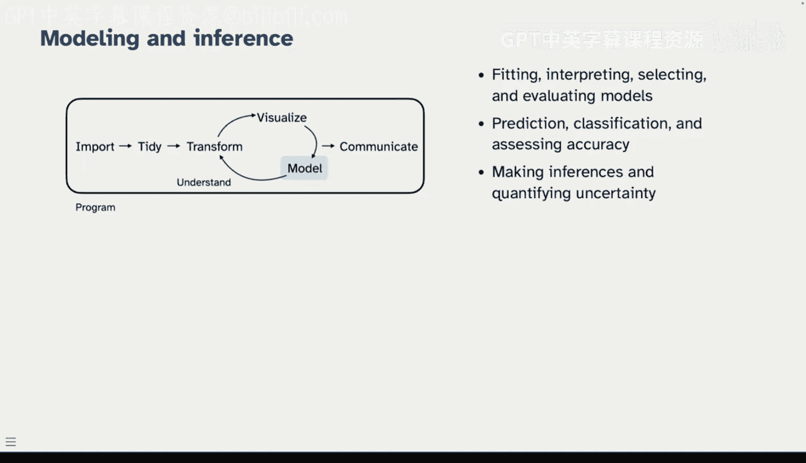

#  038：建模与推断入门

大家好，欢迎来到本课程。我是Mina Tiinica Rde，我将担任“R语言数据科学”专项课程中“建模与推断”部分的讲师。

在本节课中，我们将概述整个专项课程的脉络，并重点介绍即将开始的建模与推断课程的核心学习目标。我们将回顾之前课程的内容，并明确本课程将涵盖的关键主题，包括模型拟合、解释、评估以及统计推断。

## 课程回顾与定位

在专项课程的第一门课中，我们借助《R for Data Science》一书中的图表，介绍了数据科学的基本流程。我们重点学习了**数据可视化**与**数据转换**。

上一节我们回顾了数据探索与转换，本节中我们来看看数据整理。在第二门课程中，我们引入了**数据整理**的概念，这涉及数据的**重塑**、**合并**，以及将数据导入R环境。

随后，我们暂时搁置了“如何在R中执行任务”的技术探讨，转而思考“我们是否应该执行这项任务”，这门课程聚焦于**数据科学伦理**。具体而言，我们讨论了数据科学结果的**误传**、**数据隐私**以及**算法偏见**等问题。

## 本课程核心内容

在回顾了数据处理与伦理基础后，现在我们将正式进入建模领域。在本课程中，我们将深入探讨**建模**。

以下是本课程将涵盖的主要模块：

*   **模型技术**：学习如何**拟合**、**解释**、**选择**和**评估**统计模型。
*   **预测与分类**：探讨如何进行**预测**和**分类**，并评估我们预测与分类结果的**准确性**。
*   **统计推断**：最后，学习如何从样本数据对目标总体进行**推断**，以及如何量化我们基于样本所得估计值的**不确定性**。

让我们开始学习吧。

本节课中，我们一起回顾了R语言数据科学专项课程的学习路径，明确了建模与推断课程在整个体系中的位置。我们简要重温了数据可视化、转换、整理及伦理等前期知识，并概述了本课程即将深入讲解的模型构建、评估与统计推断三大核心模块。接下来的课程将逐一展开这些内容。