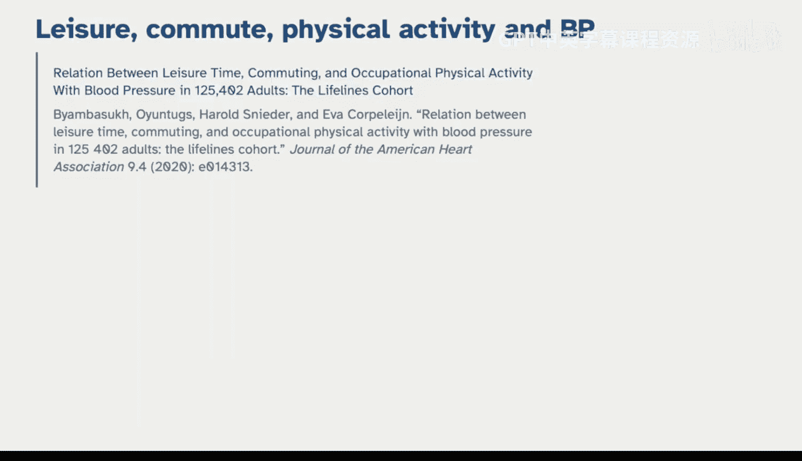

#  039：模型语言

在本节课中，我们将深入理解什么是模型、模型如何工作，以及我们如何使用模型来理解数据。我们将从线性模型入手，学习核心概念和术语，并通过具体示例展示模型在解释关系和进行预测中的应用。

## 什么是模型？

我们使用模型来解释变量之间的关系并进行预测。模型是一种数学方法，用于描述一个事物如何影响另一个事物，或一个事物如何与另一个事物相关联。

在本课程中，我们主要关注**线性模型**。这些模型用直线来描述关系。但请记住，这只是开始，世界上还存在许多其他类型的模型。

以下是两种关系的示例：
*   **线性关系**：数据点大致遵循直线模式。
*   **非线性关系**：数据模式呈现曲线或弯曲。

本课程将聚焦于线性关系。了解线性模型为学习非线性模型奠定了坚实的基础。

## 一个建模示例

上一节我们介绍了模型的基本概念，本节中我们来看看一个具体的建模过程，并引入相关术语。

我们将使用一个具体的数据集进行建模：经典的 `mtcars` 数据集，它记录了汽车的燃油效率。

以下散点图展示了汽车重量（X轴）与其燃油效率（Y轴，单位：英里每加仑，MPG）之间的关系。

请思考两个问题：
1.  汽车重量与其燃油效率之间的关系是什么？
2.  如果一辆车重3500磅，你对其MPG的最佳猜测是多少？

观察散点图，每个点代表一辆车。现在，让我们回答第一个问题。

### 识别关系

当我们为数据添加一条趋势线时，关系变得清晰。

我们可以看到一种**负向的线性关系**：随着重量增加，每加仑英里数减少。这符合直觉：更重的汽车通常每加仑行驶里程更少，因此消耗更多燃料。这条线帮助我们看到了数据的整体模式，尽管个别汽车可能偏离这一趋势。

### 进行预测

现在回答第二个问题：如何预测一辆重3500磅汽车的MPG？

这正是我们模型的预测能力所在。我们可以使用趋势线进行预测。从X轴的3.5（代表3500磅）向上画一条垂直线与回归线相交，然后从该交点向左画一条水平线与Y轴相交，我们得到预测值：大约**18.5 MPG**。

这展示了模型如何让我们根据观察数据中出现的趋势，对未直接观测到的值进行预测。

## 核心模型术语

我们已经看到了模型的应用，现在来建立讨论模型时使用的关键词汇。这些术语对于理解模型如何工作至关重要。

以下是模型的核心组成部分：
*   **结果变量**：这是我们试图理解其行为的变量，位于Y轴。也称为响应变量或因变量。
*   **预测变量**：这是我们用来解释结果变量变化的变量，位于X轴。也称为解释变量或自变量。
*   **模型函数**：即我们的回归线本身，用于进行预测。它由一个**截距**和每个预测变量的**斜率**组成。
*   **预测值**：我们的模型函数给出的值，是基于预测变量值得出的结果变量的典型或期望值。
*   **残差**：衡量实际观测值与其预测值之间的距离。计算公式为：`残差 = 观测值 - 预测值`。它告诉我们每个案例高于或低于期望值的程度。

## 在数据中应用术语

让我们将这些概念应用到我们的燃油效率数据中。

*   **预测变量**：汽车的**重量**。我们用它来预测燃油效率。
*   **结果变量**：**每加仑英里数（MPG）**。这是我们试图预测或解释的变量。
*   **模型函数**：描述重量与MPG之间关系的**回归线**。这条线代表了我们对MPG如何随重量变化的最佳估计。

### 斜率和截距

*   **斜率**：回归线的斜率告诉我们，预测变量每增加一个单位，结果变量会变化多少。在本例中，斜率为负，意味着重量每增加一千磅，我们预期MPG会减少一定量。
*   **截距**：回归线与Y轴相交的点。它是当预测变量等于0时的预测值。在我们的汽车例子中，这代表重量为0的汽车的预测MPG。虽然这可能没有实际意义，但它是定义回归线所必需的数学组成部分。

### 相关性

相关性衡量两个变量之间线性关系的强度和方向。这些汽车的重量与燃油效率之间的**相关性为 -0.87**。

相关性范围从-1到1：
*   接近-1的值表示强烈的负相关关系。
*   接近1的值表示强烈的正相关关系。
*   接近0的值表示几乎没有线性关系。

我们的相关性-0.87表明重量与燃油效率之间存在强烈的负相关关系。请注意，相关性始终与回归线斜率的符号相同。

## 可视化模型与残差

以下是叠加在数据上的模型可视化。线条总结了整体关系，而各个点显示了实际数据以及模型周围存在多少变异性。

要创建此图，我们使用 `geom_point()` 函数添加点，然后使用 `geom_smooth()` 添加另一个图层来叠加回归线，其中 `method` 参数设置为 `"lm"`（线性模型的缩写）。

### 理解残差

残差对于理解模型对数据的拟合程度至关重要。在下图中，点根据其残差的正负进行着色。

*   **正残差**（粉色）：观测值高于预测值的案例。这些点位于回归线上方。
*   **负残差**（黄色）：观测值低于预测值的案例。这些点位于回归线下方。

残差的大小告诉我们模型的性能如何。较小的残差表示更好的预测。

## 模型的注意事项与用途

### 避免外推

将回归线延伸到数据范围之外需要谨慎。虽然数学上我们可以向两个方向无限延伸直线，但出于预测目的这样做可能是危险的。我们的模型基于观察到的数据，在此范围之外进行预测（称为**外推**）假设相同的关系继续成立，这可能不成立。

例如，在我们的案例中，不可能有重量小于零甚至只有几磅的汽车。对于远大于6000磅的汽车，或者对于超大汽车与常规尺寸汽车，重量与燃油效率之间的关系也可能不同。

因此，对于数据范围之外的预测应始终保持谨慎，除非有非常充分的理由或使用专门为外推（如基于过去时间序列数据预测未来）设计的更高级模型，否则应避免外推。

### 模型的优势与局限

模型有其优势和局限性。
*   **优势**：模型可以揭示仅从数据中不易立即看出的模式。它们提供了一种系统化的方式来理解关系和进行预测。
*   **局限性**：模型存在强加实际上不存在的结构的风险。模型是现实的简化，我们应始终对其结论保持健康的怀疑态度。

我们模型周围的变异（即我们讨论过的残差）与模型本身同样重要，甚至更重要。毕竟，统计学就是在未解释的背景下解释变异。我们线条周围的散点表明，可能还有其他影响燃油效率的因素我们尚未考虑，或者随机性可能起了很大作用。有时，向模型中添加更多解释变量或预测变量可以减少散点并改进我们的预测。

### 模型的两种主要用途

模型主要有两种用途：
1.  **预测或分类**：我们输入预测变量的值，以获得结果变量的预测值。
2.  **描述**：我们使用模型中的斜率来量化预测变量与结果变量之间的关系。

**预测/分类实例**：自动驾驶汽车如何判断前方的物体是人、另一辆车还是垃圾桶？它们使用基于数千张图像训练的模型进行分类。在线购物网站如何决定向你展示哪个广告？它们使用基于你的浏览历史和其他因素预测你最可能购买什么的模型。但关键问题是：如果其中任何一个出错了怎么办？后果可能从令人烦恼到危及生命，这就是理解模型准确性和局限性如此重要的原因。

**描述用途实例**：一项关于休闲、通勤、体力活动与血压的研究，检查了超过125,000名成年人中不同类型体力活动与血压水平之间的关系。

研究发现，较高水平的通勤和休闲时间体力活动（而非职业体力活动）与较低的血压和降低的高血压风险相关。这种关系是剂量依赖性的：活动越多，益处越大。例如，与不活动相比，最高水平的通勤和休闲活动组合与收缩压降低2.9毫米汞柱相关。

有趣的是，这种关系是年龄依赖性的。在老年人中关联更强：60岁以上的人显示收缩压降低4.64毫米汞柱，而40岁以下的成年人仅降低1.67毫米汞柱。这展示了模型如何帮助我们描述和量化复杂现实世界数据中的关系，使研究人员不仅能理解关系是否存在，还能了解其强度以及在不同群体中如何变化。

## 总结

本节课中我们一起学习了模型的基本语言，从预测变量和结果变量等基本词汇，到相关性和残差等概念。我们看到了模型如何服务于两个关键目的：进行预测和描述关系。请记住，模型是理解数据的强大工具，但它们也是现实的简化。始终要思考你的模型告诉了你什么，以及它没有捕捉到什么。