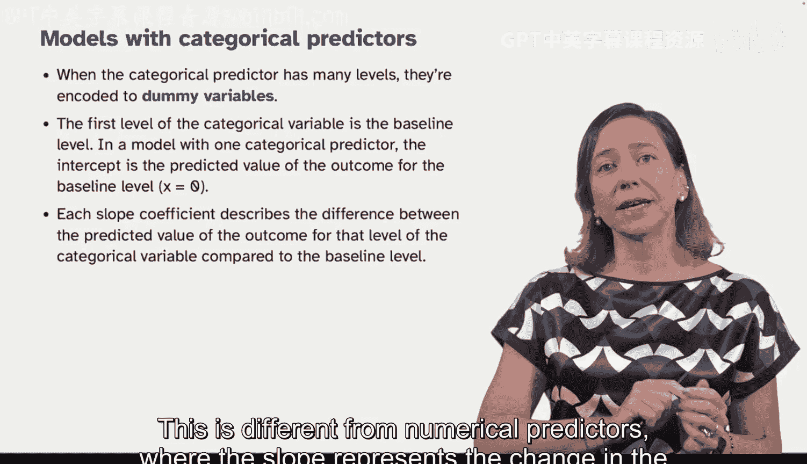
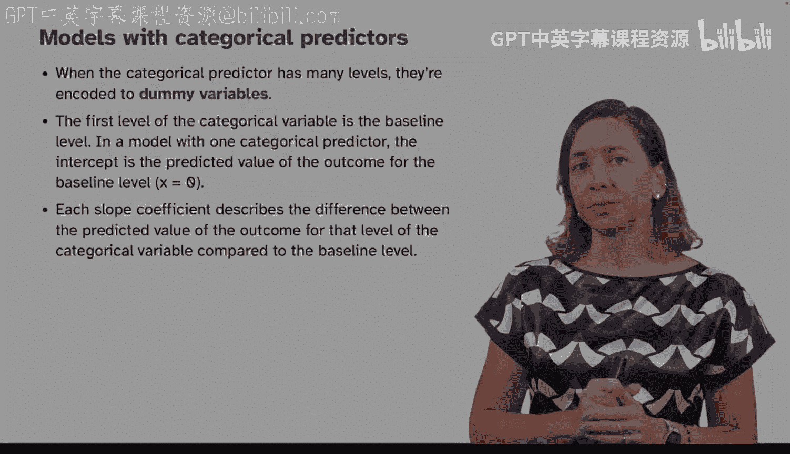

#  042：使用分类预测变量的线性回归 📊


在本节课中，我们将学习如何使用线性回归模型，但这次我们的预测变量是分类变量（例如岛屿名称），而不是数值变量。我们将通过一个关于企鹅体重的实际案例，来理解如何解释模型结果并进行预测。


## 数据准备与探索

首先，我们需要加载必要的R包并查看数据。我们将使用 `palmerpenguins` 包中的企鹅数据集，以及 `tidyverse` 和 `tidymodels` 包进行数据处理和建模。

```r
# 加载必要的包
library(palmerpenguins)
library(tidyverse)
library(tidymodels)
```

我们使用的数据集包含了来自三个岛屿（Bisco、Dream 和 Togerson）的344只南极企鹅的身体测量数据。变量包括体重、喙长、喙深、鳍肢长度以及它们被观察到的岛屿。

我们的研究问题是：探究企鹅的体重与其被记录时所在的岛屿之间是否存在关系。

与之前不同，我们的预测变量 `island` 是分类变量。这意味着我们不能将其放在一个数值尺度上衡量（例如，不能说Bisco比Dream“多”或“少”）。因此，我们需要调整建模思路。

在建模之前，我们先通过可视化来探索数据。由于预测变量是分类的，散点图并不适用。箱线图或小提琴图是展示数值变量（体重）在分类变量（岛屿）各水平上分布的理想选择。

以下是绘制箱线图的代码：

```r
# 绘制体重与岛屿关系的箱线图
ggplot(penguins, aes(x = island, y = body_mass_g)) +
  geom_boxplot() +
  labs(title = "不同岛屿企鹅的体重分布",
       x = "岛屿",
       y = "体重 (克)")
```

从图中我们可以观察到一些初步模式：Bisco岛的企鹅平均体重似乎更重，而Dream岛和Togerson岛的企鹅体重较低且较为相似。

## 拟合线性回归模型

接下来，我们拟合一个线性回归模型来量化这种关系。语法与我们之前使用数值预测变量时非常相似。

```r
# 拟合线性回归模型：用岛屿预测体重
penguin_model <- linear_reg() %>%
  fit(body_mass_g ~ island, data = penguins)

# 查看模型摘要
tidy(penguin_model)
```

模型摘要会显示一些有趣且不同于之前的结果。尽管我们只使用了一个预测变量 `island`，但输出中却出现了两个斜率项：`islandDream` 和 `islandTorgersen`，而 `islandBisco` 不见了。

这是因为当模型包含分类预测变量时，R会自动将其转换为**虚拟变量**。对于一个有K个水平的分类变量，我们只需要K-1个虚拟变量。被省略的那个水平（此处是Bisco）被称为**基线水平**。

## 理解虚拟变量与模型解释

对于我们的三个岛屿，R在幕后创建了两个虚拟变量：
*   `islandDream`: 当企鹅来自Dream岛时为1，否则为0。
*   `islandTorgersen`: 当企鹅来自Torgersen岛时为1，否则为0。

当这两个虚拟变量都为0时，就代表企鹅来自基线水平——Bisco岛。

现在，让我们来解释模型系数。假设我们的模型方程是：

**`预测体重 = 4716 - 1003 * islandDream - 1010 * islandTorgersen`**

*   **截距 (4716)**: 代表基线组（Bisco岛企鹅）的**预测平均体重**，即4716克。
*   **斜率 islandDream (-1003)**: 代表Dream岛企鹅与Bisco岛企鹅的**预测平均体重差异**。Dream岛企鹅平均比Bisco岛企鹅轻1003克。
*   **斜率 islandTorgersen (-1010)**: 代表Torgersen岛企鹅与Bisco岛企鹅的**预测平均体重差异**。Torgersen岛企鹅平均比Bisco岛企鹅轻1010克。

每个斜率系数都描述了特定组与基线组之间的平均差异。

## 使用模型进行预测

我们可以使用模型方程手动计算每个岛屿的预测平均体重。

*   **Bisco岛**: 两个虚拟变量均为0。
    `预测体重 = 4716 - 1003*0 - 1010*0 = 4716克`
*   **Dream岛**: `islandDream` 为1，`islandTorgersen` 为0。
    `预测体重 = 4716 - 1003*1 - 1010*0 = 3713克`
*   **Torgersen岛**: `islandDream` 为0，`islandTorgersen` 为1。
    `预测体重 = 4716 - 1003*0 - 1010*1 = 3706克`

我们也可以使用R代码自动进行预测，这在变量很多时更为方便。

```r
# 创建一个包含各岛屿一只企鹅的新数据框
new_penguins <- tibble(island = c("Bisco", "Dream", "Torgersen"))

# 使用模型进行预测
augment(penguin_model, new_data = new_penguins)
```

预测结果将与我们的手动计算一致：Bisco岛为4716克，Dream岛为3713克，Torgersen岛为3706克。

## 总结

本节课中，我们一起学习了如何使用分类预测变量进行线性回归建模。关键要点如下：

1.  **虚拟变量编码**：当模型包含分类预测变量时，R会自动将其水平编码为虚拟变量。对于有K个水平的变量，会创建K-1个虚拟变量。
2.  **基线水平**：第一个水平（或按字母顺序排列的第一个）通常被设为基线。截距表示基线组的预测结果值。
3.  **系数解释**：每个斜率系数表示对应分类水平与基线水平之间预测结果的平均差异。这与数值预测变量中“单位变化导致的结果变化”的解释不同。





通过本案例，我们掌握了处理分类预测变量的基本方法，这是数据科学建模中一项非常重要的技能。