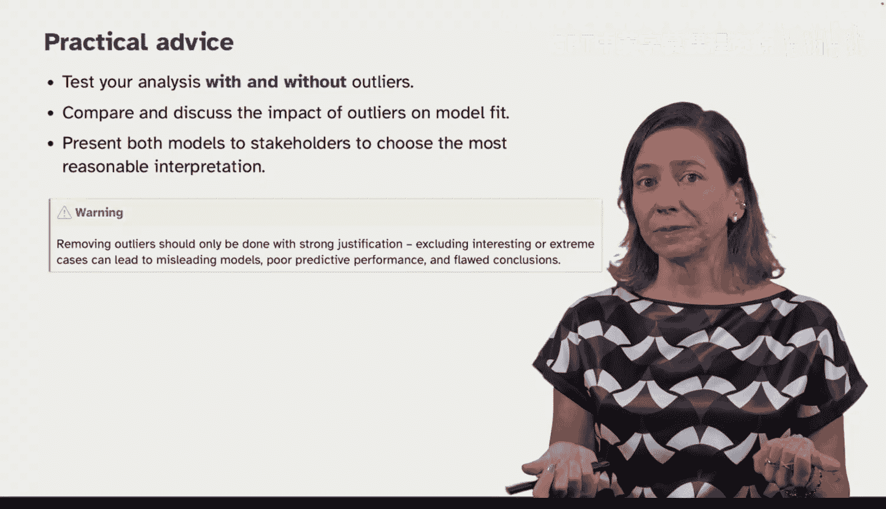

#  043：线性回归中的异常值

在本节课程中，我们将学习线性回归中的异常值。我们将探讨什么是异常值，它们如何影响回归模型，以及如何识别和处理它们。

## 概述

线性回归模型假设数据点大致围绕一条直线分布。然而，实际数据中常会出现一些远离主体数据云的点，这些点被称为异常值。它们可能出现在X方向、Y方向或两个方向上。理解这些点对模型的影响至关重要。

## 异常值的类型与影响

上一节我们介绍了线性回归的基本概念，本节中我们来看看异常值如何具体影响回归线。并非所有在单变量分布上极端的点，在双变量模型中都会成为异常值。如果一个点虽然在一个变量上取值极端，但它符合两个变量之间的整体趋势，那么它在回归模型中可能不会显得异常。

以下是三种常见的异常值情况，通过散点图可以更好地理解：

*   **图A**：该点在Y方向上极端偏低，且不遵循整体模式。它会对回归线产生轻微影响。
*   **图B**：该点在X和Y方向上都远离主体数据，但它恰好落在回归线附近。因此，它对回归线几乎没有影响，无论是否包含它，最佳拟合线都几乎相同。
*   **图C**：该点在X和Y方向上都远离主体数据，且不符合整体趋势。它会将回归线向上拉，导致对大多数数据点的拟合变差。这是一个**有影响力的点**。

每个图表下方的残差图提供了另一个视角，显示了每个点距离模型预测值的远近。

## 更多示例分析

接下来，我们通过另一组三个例子来加深理解。

*   **图D**：在右侧出现一小簇点。它们不仅仅是异常值，而是形成了一个次要的数据云，会强烈地将回归线拉向自身。
*   **图E**：右侧有一个单独的点，它完全决定了回归线的斜率，在主数据本身没有趋势的地方制造出存在趋势的假象。
*   **图F**：异常点在X和Y方向上都远离主体，但它恰好落在已有的趋势线上。它具有高杠杆值，但并未影响模型。

## 核心概念与术语

现在我们已经看了一些例子，让我们来明确相关术语。

*   **异常值**：指在任何方向上与主体数据分离的点。
*   **杠杆点**：指在水平方向上远离主体数据云中心的点。它们倾向于对回归线施加更大的“拉力”，因此被称为具有**高杠杆**的点。
*   **有影响力的点**：指那些实际会影响回归模型（如斜率或截距）的点。

> 核心概念：并非所有异常值都有影响力，但许多有影响力的点都是具有高杠杆的异常值。

判断一个点是否有影响力的标准是：如果移除该点，回归线的斜率或位置会发生显著变化。

## 处理异常值的实用建议

以下是处理数据中异常值的一些实用建模建议：

*   **对比分析**：始终用包含和不包含疑似异常值的数据分别测试你的分析。比较并讨论异常值对模型拟合的影响。
*   **呈现选择**：将两种模型结果都呈现给利益相关者，以便选择最合理的解释。
*   **谨慎删除**：除非有强有力的、可辩护的理由（如数据录入错误），否则应非常谨慎地删除异常值。随意删除不寻常的点可能适得其反，导致模型过于乐观、遗漏关键情况，甚至支持误导性结论。

始终将异常值视为信息，而不仅仅是噪声。异常值可能很微妙、难以处理，有时甚至具有误导性，但理解它们如何影响你的模型是进行可靠统计建模的关键部分。

因此，要始终思考：这个点试图告诉我什么？

## 总结

本节课中，我们一起学习了线性回归中异常值的概念。我们区分了异常值、杠杆点和有影响力的点，并通过示例观察了它们对回归线的不同影响。最后，我们掌握了处理异常值的实用原则：通过对比分析来评估其影响，并谨慎对待删除操作，将异常值视为潜在的重要信息。